# Chapter 1 — Data Understanding and Versioning (7 marks)

## 1.1 Environment

I created a project-local `.venv` with Python 3.12.3, so this assignment stays separate from my system Python and other courses. `requirements.txt` pins direct dependencies, including `tensorflow==2.20.0`, while `requirements.lock.txt` records the full `pip freeze`. I pinned them because Keras or MLflow updates can change defaults or saved-model formats and make an old run hard to repeat.

I used `scripts/env_report.py` with `.venv/bin/python scripts/env_report.py` to record the machine, interpreter and installed versions. It reads installed package metadata rather than the requirements files, then asks TensorFlow for physical GPUs. Figure 1.1 shows TensorFlow 2.20.0, Keras 3.15.1, Keras Tuner 1.4.8, MLflow 3.17.2, DVC 3.67.1 and dagshub 0.7.3.

The laptop has a GTX 1050 Max-Q (3 GB), but no NVIDIA driver is loaded. TensorFlow reports `GPUs visible to TF : 0` and `CUDA_ERROR_NO_DEVICE`; `TF built with CUDA : True` confirms the build supports GPUs. I trained on a Kaggle GPU notebook and used the laptop for the audit, EDA, toy labs and serving.

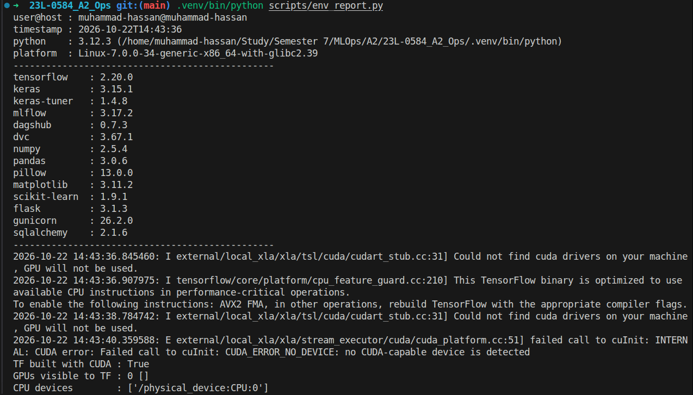

## 1.2 Dataset audit

`scripts/audit_dataset.py` scans `data/raw/AiArtData` as `ai` and `data/raw/RealArt` as `real`. It writes one row per file to `reports/audit/audit.csv` and regenerates `reports/audit/summary.md`. Rows record class, size, dimensions, colour mode, format and SHA-256, so the tables come from the audit rather than manual counting.

Each image is opened twice with Pillow: `verify()` checks its structure, then a fresh `load()` decodes every pixel and catches truncation. The decoder identifies formats from magic bytes, not names. SHA-256 is calculated over raw bytes in 1 MB chunks; matching hashes identify exact duplicates, including any that would have conflicting labels.

**Table 1.1 — Files per class, readable and corrupt files, and files that belong to a duplicate group.**

| class | files | readable | corrupt | duplicate files |
|---|---|---|---|---|
| ai | 539 | 539 | 0 | 2 |
| real | 436 | 436 | 0 | 0 |
| TOTAL | 975 | 975 | 0 | 2 |

**Table 1.2 — Minimum, median and maximum of width, height (pixels) and file size (bytes) over the readable images.**

| class | metric | min | median | max |
|---|---|---|---|---|
| all | width | 183 | 1024 | 8495 |
| all | height | 135 | 768 | 7091 |
| all | file_size | 11311 | 169093 | 10195352 |
| ai | width | 225 | 1024 | 6000 |
| ai | height | 135 | 800 | 4001 |
| ai | file_size | 11738 | 199760 | 5626183 |
| real | width | 183 | 920 | 8495 |
| real | height | 158 | 720 | 7091 |
| real | file_size | 11311 | 144840 | 10195352 |

All 975 files decoded, with **0 corrupt files**. The only exact duplicate pair is `AiArtData/image33.jpg` and `AiArtData/image34.jpg` (163,866 bytes each), so removing 1 redundant copy leaves no hash in both classes. The 539 ai and 436 real images are moderately imbalanced, so I use precision, recall and ROC-AUC as well as accuracy. The 183 px to 8495 px width range also makes a fixed model input necessary.

**Format surprises.** JPEG accounts for 429 ai and 403 real files, while PNG accounts for 110 ai and 33 real files. Table 1.3 lists the **20 files** whose extension disagrees with their content. The pipeline therefore uses `tf.io.decode_image` in `src/visionguard/data.py`, and the Task 4 web app validates uploads by content. Mixed P, RGBA and L modes are converted with `channels=3`, so the model receives RGB. No file has more than one frame.

**Table 1.3 — The 20 files whose extension does not match the decoded format, grouped by type (full list in `reports/audit/summary.md`).**

| class | extension | real format | files |
|---|---|---|---|
| ai | png | JPEG | 8 |
| ai | jpg | PNG | 3 |
| ai | webp | JPEG | 3 |
| real | png | JPEG | 3 |
| real | jpg | PNG | 1 |
| real | gif | JPEG | 1 |
| real | (none) | JPEG | 1 |

**Cleaning and split.** `scripts/make_splits.py` removes corrupt files, hashes shared by both classes, and all but the alphabetically first file in other duplicate groups. Only the last rule applied here, leaving 974 images. It makes a stratified 70/15/15 split with seed 42 through two `train_test_split` calls and asserts that no SHA-256 crosses a split. The saved `splits/{train,val,test}.csv` files contain path, label, class and sha256; label 1 = ai and 0 = real.

**Table 1.4 — Clean stratified split (seed 42), from `splits/cleaning_report.md`.**

| split | images | ai (1) | real (0) |
|---|---|---|---|
| train | 681 | 376 | 305 |
| val | 146 | 81 | 65 |
| test | 147 | 81 | 66 |

SHA-256 cannot find a resized or re-compressed version of the same image, so the audit does not rule out near-duplicates.

## 1.3 Visual EDA

`scripts/eda.py` reads `audit.csv`. It applies EXIF rotation, converts images to RGB and creates a grid of 12 random images per class with seed 42. Its histograms use log scales for width, height and file size, plus aspect ratio to guide resizing in Task 2.1.

Figure 1.2 shows that the AI class is mostly saturated digital art, while the real class also includes magazine covers, letterboxed thumbnails and photos of paintings. The model must separate generated from non-generated images, not art from photographs; both classes contain text overlays, borders and occasional UI elements.

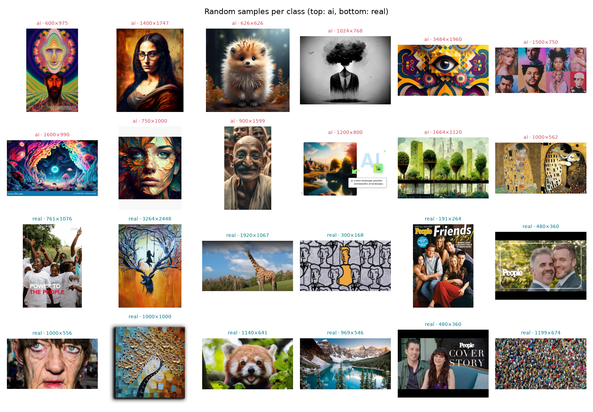

Figure 1.3 shows the distribution gap: AI images cluster around generator sizes near 1024 px, whereas real images range from thumbnails to 8495-px originals. There are 47 real images under 20 KB versus 15 AI images, and PNG use is 8% versus 20%. Both medians are 1.5 for aspect ratio, although squares are 22% of AI images and 8% of real images.

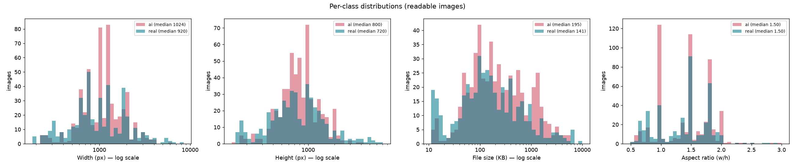

**What this means for modelling.** Size, format and shape could become shortcuts, such as learning that a small compressed JPEG is real. I decode bytes, resize every image and hide file metadata from the model. Task 2.6 checks whether errors still cluster on thumbnails or unusual aspect ratios.

## 1.4 Data versioning with DVC

### Toy lab

I learned DVC first in a separate CSV folder. `labs/dvc_toy_lab.sh` runs and timestamps the steps for the DagsHub repository `MHassanAbaid24/23L-0584_A2_Ops_dvc_toy`.

1. **Initialise.** In `dvc-toy`, I ran `git init -b main` and `dvc init`, then committed DVC's skeleton as `ae58d01`. Figure 1.4 shows Git holding code and pointers while DVC manages cached data.
2. **Track v1.** I added a 3-row `toy.csv` with `dvc add toy.csv`. Its pointer and `/toy.csv` ignore rule were committed as `9ffec16`; Figure 1.5 shows that Git does not hold the data itself.
3. **Change to v2.** After appending two rows, I ran `dvc add` and committed `ee5c6fc`. Figure 1.6 shows that the pointer diff changes only its md5 and size, from 60 to 93 bytes.
4. **Go back to v1.** `git checkout HEAD~1 -- toy.csv.dvc` and `dvc checkout toy.csv` restored the 3-row file; using `HEAD` returned to v2. Figure 1.7 records both versions.
5. **Configure the remote.** I added DagsHub as the Git and default DVC remote. Credentials set with `dvc remote modify --local` stay in git-ignored `.dvc/config.local`; Figure 1.8 shows that `.dvc/config` keeps only the URL.
6. **Push.** `git push` sent commits and `dvc push` sent v2, then v1. Figure 1.9 shows `dvc status -c` reporting the cache and remote in sync.
7. **Delete and pull back.** After deleting `toy.csv` and `.dvc/cache`, `dvc pull` restored v2, then v1 after checking out its pointer. Figure 1.10 proves the remote holds both versions.

Figure 1.11 shows the DagsHub result: 4 commits and a `dvc` badge on `toy.csv`, while Git contains only `toy.csv.dvc`.

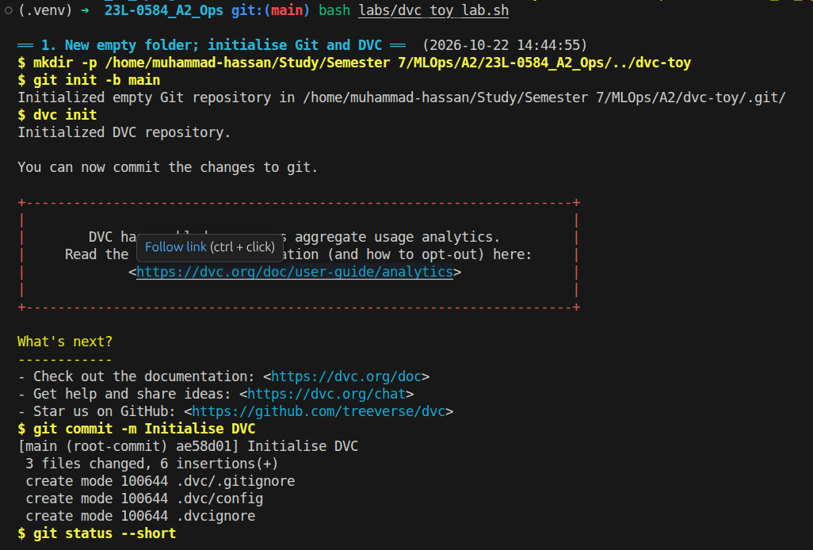

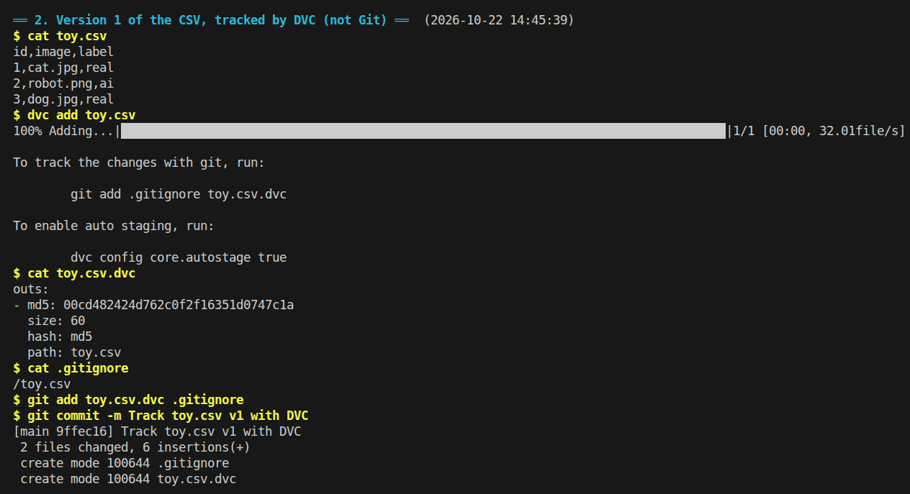

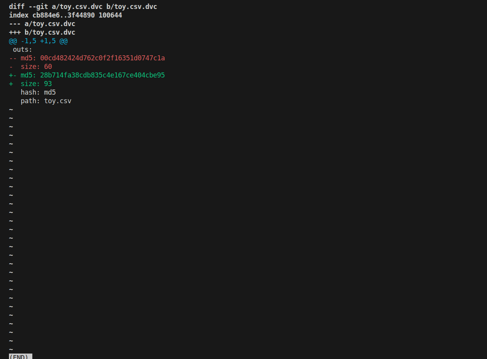

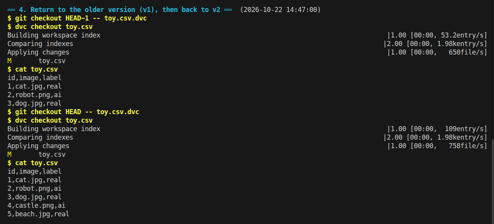

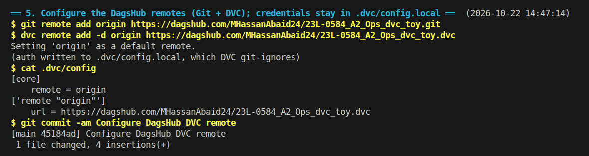

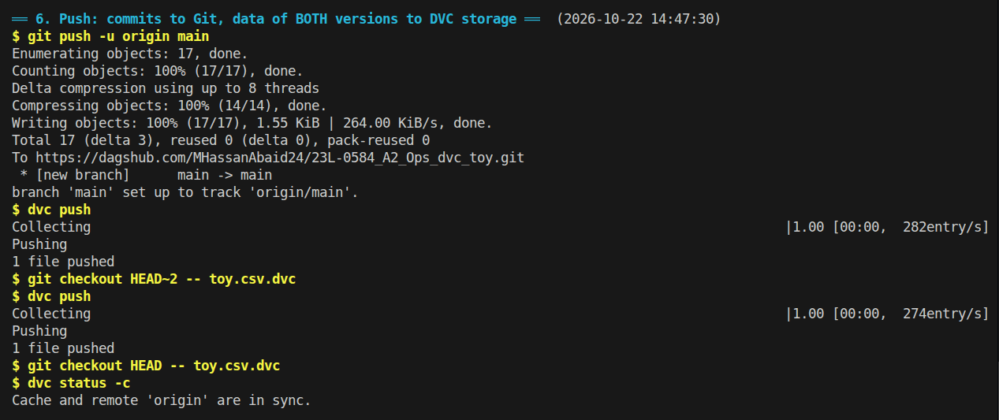

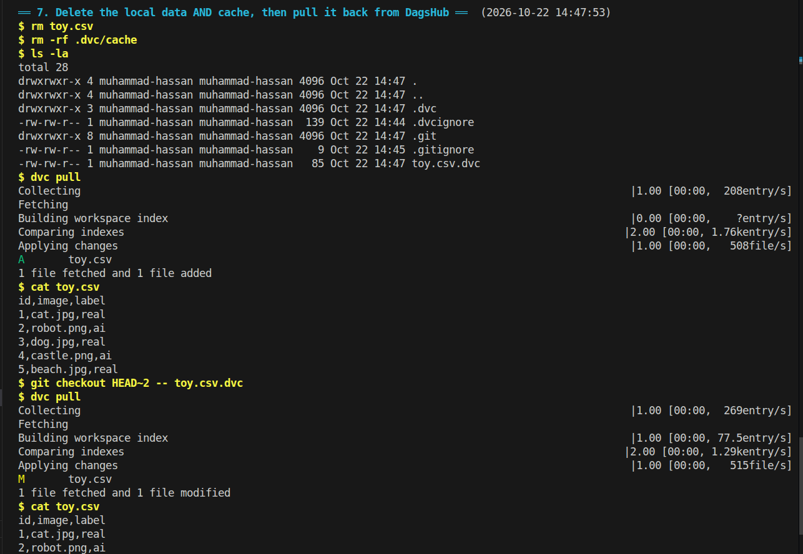

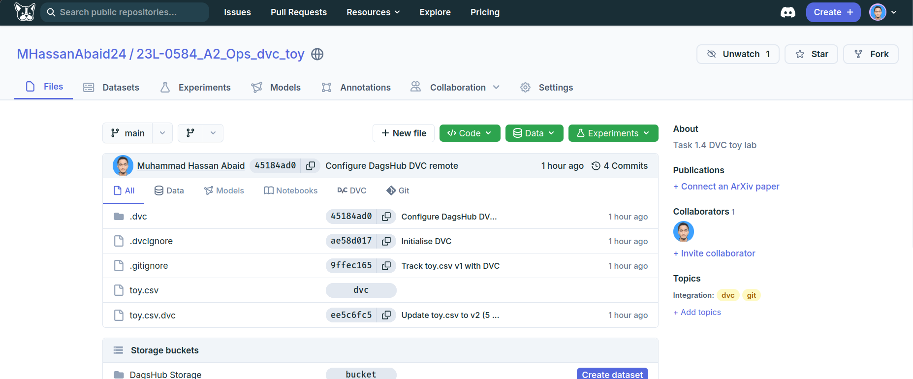

### Applying it to the VisionGuard dataset

I ran `dvc add data/raw`, committed `data/raw.dvc` and `data/.gitignore`, then used `dvc push` to send 504 MB of images to the project's DagsHub storage. Figure 1.12 shows the pointer, `/raw` ignore rule, ignored images and `.dvc/config.local`, remote and sync status. Figure 1.13 shows DagsHub marking `data/raw` with a `dvc` badge while Git keeps `raw.dvc` and `.gitignore`.

`data/raw.dvc` records `md5: 8f23d6dc9b06d363c3981642c50856c0.dir`, `size: 503783378`, `nfiles: 975`, `hash: md5` and `path: raw`. The `.dir` hash identifies the directory manifest, so an old Git commit plus `dvc pull` retrieves that exact dataset. I log this md5 as the data-version tag in Task 3.3.

Git would store every binary revision in every clone, and GitHub rejects files over 100 MB. DVC keeps the repository small while linking each commit to the matching data hash.

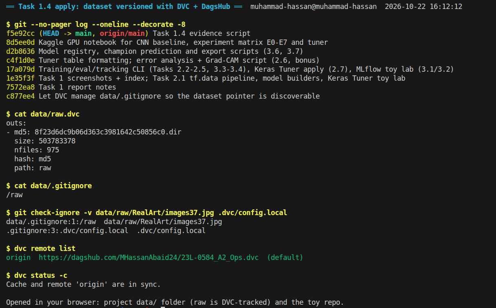

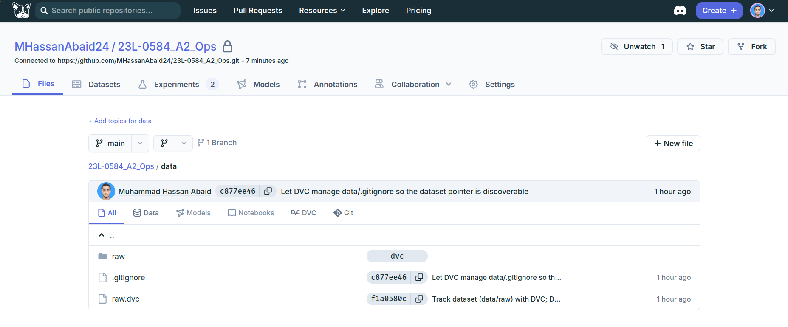

### What went wrong

- **`dvc push --all-commits` skipped v1.** Its older commits had no configured remote, so I checked out the v1 pointer and pushed it explicitly with `git checkout HEAD~2 -- toy.csv.dvc` and `dvc push`. Figure 1.10 confirms that v1 can be pulled.
- **The dataset pointer was hidden.** The root `/data/*` rule also ignored `data/raw.dvc`, so DVC found no tracked data. I removed it and kept DVC's `data/.gitignore` rule for `/raw` instead (commit `c877ee4`).
