# Chapter 2 — Model Development with TensorFlow/Keras (14 marks)

All models in this chapter were trained on a Kaggle GPU with `notebooks/kaggle_train.ipynb`. The notebook clones the
project from DagsHub, checks every split image against the SHA-256 hashes in the split lists, and then calls the same
command-line entry points that I use locally (`python -m visionguard.train …` and `python -m visionguard.tune …`).
The splits come from Chapter 1: 681 training images (305 real, 376 AI), 146 validation images (65 real, 81 AI) and
147 test images (66 real, 81 AI). Label 1 means "AI-generated" and is the positive class everywhere.

## 2.1 Input pipeline

The pipeline lives in `src/visionguard/data.py`. The function `make_dataset(split)` reads one split list
(`splits/train.csv`, `val.csv` or `test.csv`) and builds a `tf.data.Dataset` in these stages:

1. **Paths and labels.** The CSV gives a relative path and a 0/1 label per image. I turn them into two tensors with
   `from_tensor_slices`, so the rest of the pipeline runs inside TensorFlow.
2. **Read and decode.** `tf.io.read_file` loads the bytes and `tf.io.decode_image(channels=3)` decodes them. This
   function looks at the file's content, not its extension. That matters because the audit found 20 files whose
   extension does not match their real format. `channels=3` turns greyscale, palette and RGBA images into RGB, and drops
   the alpha channel.
3. **Resize.** Every image becomes 224×224 with bilinear, anti-aliased resizing. I chose 224 px because both ImageNet
   backbones I use were pre-trained at that size, so their filters see objects at the scale they learned. The default
   mode, `stretch`, resizes straight to a square. It **distorts the aspect ratio**: the median image is 1.5:1 wide and
   becomes 1:1, so things look narrower than they are. The other mode, `pad`, keeps the ratio and fills the rest with
   black bars. Experiment E6 compared the two (Chapter 3): validation AUC 0.8587 with padding versus 0.8697 with
   stretching, a difference within noise, so I kept the simpler `stretch`.
4. **Cache.** After resizing, the image is rounded to `uint8` and cached in memory. Caching as `uint8` takes
   974 × 224 × 224 × 3 bytes ≈ 147 MB instead of about four times as much as float32, and the slow JPEG/PNG decode
   runs once instead of every epoch.
5. **Shuffle (training only).** A full-size shuffle buffer with seed 42 and a new order each epoch.
6. **Batch** to 32 images, then cast to float32. Pixel values stay in [0, 255]: each model normalises its input inside
   its own graph (Sections 2.2 and 2.3).
7. **Augment (training only).** A small Keras `Sequential` of random layers: horizontal flip, rotation up to ±18°
   (`RandomRotation(0.05)`, i.e. 5 % of a full turn), zoom ±10 % and contrast ±10 %. Empty corners are filled by
   reflection, and the result is clipped back to [0, 255]. The augmentation runs *after* the cache; otherwise every
   epoch would see the same "random" copy.
8. **Prefetch** with `AUTOTUNE`, so the CPU prepares the next batch while the GPU trains on the current one.

Validation and test data go through the same stages minus shuffle and augmentation, so their scores are not affected
by randomness. I left out blur, noise and JPEG re-compression on purpose. Those transformations would either wipe out or
imitate the fine generation artefacts that the model is supposed to detect. The decode-and-resize step is a single
function, `decode_and_resize`, and the web app (Chapter 4) imports it, so an uploaded image is treated exactly like a
training image.

Figure 2.1 shows one batch before and after augmentation. To show the same images in both rows, the script
`scripts/show_augmented_batch.py` takes them from the unshuffled validation split and runs it once without and once
with the augmenter; during training only the training split is augmented. The flips are easy to see (the woman in
the white cap, the girl in the head-wrap). Rotation and zoom are mild, and the reflected borders do not add black
corners.

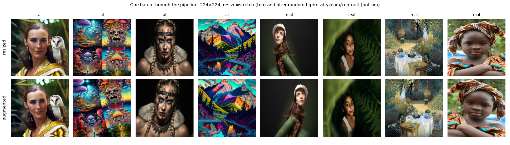

## 2.2 Baseline CNN

The baseline is built by `build_cnn` in `src/visionguard/models.py` and was trained as run `cnn-baseline`. It is a
plain stack of four convolution blocks followed by a small head:

- **Rescaling(1/255)** maps pixels to [0, 1]. Small, similar input ranges keep the first gradients well-scaled, and
  doing it inside the model means the saved file can be fed raw pixels.
- **Conv2D 3×3, `padding="same"`** with 32, 64, 128 and 256 filters. A 3×3 kernel is the smallest that sees a
  neighbourhood, and stacking blocks grows the receptive field. The convolutions have no bias, because the
  BatchNormalization that follows has its own shift term. This is why `conv1` has exactly 3·3·3·32 = 864 weights.
- **BatchNormalization** normalises each channel over the batch. It makes training at a learning rate of 10⁻³ stable
  and adds a little regularisation. Its moving mean and variance are the 960 non-trainable parameters.
- **ReLU** adds the non-linearity.
- **MaxPooling 2×2** halves the height and width. Each later 3×3 kernel then covers twice the image distance, and
  doubling the filter count at the same time keeps the work per block roughly balanced.
- **GlobalAveragePooling** averages each of the 256 final maps to one number. Flattening the 14×14×256 output would
  give 50,176 features and a dense layer with as many weights; with 681 training images that would overfit at once.
- **Dropout 0.3** randomly drops 30 % of those 256 features during training, so the output cannot rely on a few of
  them.
- **Dense(1, sigmoid)** named `p_ai` outputs the probability that the image is AI-generated.

Table 2.1 lists every layer with its output shape and parameter count. It is generated by `layer_table()` during
training. Figures 2.2 and 2.3 show the same model in Keras' own summary, printed in my project terminal: 390,113
parameters in total, 389,153 trainable.

**Table 2.1 — Baseline CNN: output shape and parameters per layer (from `reports/figures/runs/cnn-baseline/layer_table.csv`).**

| Layer | Type | Output shape | Parameters |
|---|---|---|---:|
| image | InputLayer | (None, 224, 224, 3) | 0 |
| rescale_0_1 | Rescaling | (None, 224, 224, 3) | 0 |
| conv1 | Conv2D | (None, 224, 224, 32) | 864 |
| bn1 | BatchNormalization | (None, 224, 224, 32) | 128 |
| relu1 | Activation | (None, 224, 224, 32) | 0 |
| pool1 | MaxPooling2D | (None, 112, 112, 32) | 0 |
| conv2 | Conv2D | (None, 112, 112, 64) | 18,432 |
| bn2 | BatchNormalization | (None, 112, 112, 64) | 256 |
| relu2 | Activation | (None, 112, 112, 64) | 0 |
| pool2 | MaxPooling2D | (None, 56, 56, 64) | 0 |
| conv3 | Conv2D | (None, 56, 56, 128) | 73,728 |
| bn3 | BatchNormalization | (None, 56, 56, 128) | 512 |
| relu3 | Activation | (None, 56, 56, 128) | 0 |
| pool3 | MaxPooling2D | (None, 28, 28, 128) | 0 |
| conv4 | Conv2D | (None, 28, 28, 256) | 294,912 |
| bn4 | BatchNormalization | (None, 28, 28, 256) | 1,024 |
| relu4 | Activation | (None, 28, 28, 256) | 0 |
| pool4 | MaxPooling2D | (None, 14, 14, 256) | 0 |
| gap | GlobalAveragePooling2D | (None, 256) | 0 |
| dropout | Dropout | (None, 256) | 0 |
| p_ai | Dense | (None, 1) | 257 |
| **Total** | | | **390,113** |

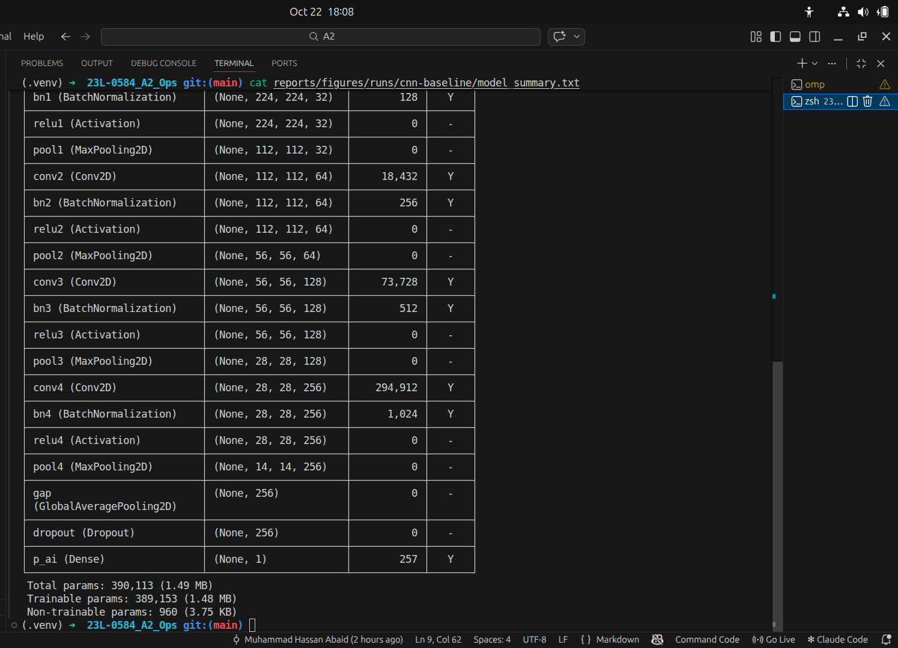

**Loss, optimizer and metrics** (`compile_model` in `src/visionguard/train.py`). I used **binary cross-entropy**.
A single sigmoid output is a Bernoulli probability, and cross-entropy is its negative log-likelihood, so minimising it
gives calibrated probabilities. It also punishes confident mistakes much more than hesitant ones. The optimizer is
**Adam** with learning rate 10⁻³. Adam adapts the step size per weight, so it works without much tuning and is a
standard starting point. I tracked **accuracy, AUC, precision and recall**. Accuracy alone hides *which* error the
model makes, and AUC measures ranking quality without a threshold.

**Result.** The CNN trained for up to 40 epochs with early-stopping patience 8. It stopped after 19 epochs; the best
epoch was 11. Its validation AUC was 0.6957 and its test AUC 0.7421 (Section 2.5). With only 681 training images, a
network that starts from random weights cannot learn strong features. That is the reason for transfer learning in
Section 2.3.

## 2.3 Transfer learning

`build_transfer` in `src/visionguard/models.py` loads a backbone from `keras.applications` with ImageNet weights and
`include_top=False`, which drops the 1000-class ImageNet classifier and keeps only the feature extractor. On top I
put my own head: GlobalAveragePooling → Dropout 0.3 → Dense(1, sigmoid). I used two backbones:
**EfficientNetB0** for the base experiment E0 and **MobileNetV2** for E5, which became the champion model
(Chapter 3).

**Preprocessing.** A pretrained network only works on the input distribution it was trained on. Its first filters and
its BatchNorm statistics assume a certain pixel range; feed it a different range and every activation shifts away from
what the later layers expect. The two backbones expect different ranges:

- **EfficientNetB0** in Keras contains its own Rescaling and Normalization layers and expects raw [0, 255] pixels.
  I therefore add nothing in front of it.
- **MobileNetV2** expects [−1, 1]. Its `preprocess_input` computes x / 127.5 − 1. I implemented exactly this formula as
  a `Rescaling(1/127.5, offset=−1)` layer named `mobilenetv2_preprocess`. A real layer is saved inside the `.keras` file;
  a `Lambda` wrapping `preprocess_input` would not load in Keras' safe mode.

In both cases the preprocessing is part of the saved model, so the server only decodes and resizes.

**Two training stages** (`run()` in `src/visionguard/train.py`):

- **Stage 1 — frozen backbone.** `base.trainable = False`, so only the head learns: 1,281 parameters (1,280 weights
  + 1 bias). Learning rate 10⁻³, at most 20 epochs. A new head starts with random weights; if the backbone were
  trainable now, its large early gradients would flow back and damage the pretrained features.
- **Stage 2 — fine-tune the last block.** `unfreeze_top()` makes only the backbone's last block trainable, I
  recompile (Keras needs this for the new trainable flags to take effect) and train for at most 15 more epochs at
  **10⁻⁵, a hundred times smaller**. The small rate lets the top features adapt to "AI or real" without forgetting
  ImageNet. I unfreeze only the last block because early layers detect generic edges and textures that transfer well,
  while the last block is the most ImageNet-specific, and 681 images are too few to retrain more without overfitting.
  BatchNorm layers stay frozen, and the backbone is always called with `training=False`, so batches of 32 cannot
  overwrite the ImageNet running statistics.

Table 2.2 lists the trainable layers per stage, copied from `trainable_layers.json` in each run folder. In stage 2 the
model has 880,321 trainable parameters with MobileNetV2 and 1,122,865 with EfficientNetB0. I computed these counts with
the project venv by rebuilding both models and calling the same `unfreeze_top()`.

**Table 2.2 — Trainable layers in each stage (from `trainable_layers.json`).**

| Stage | E0 — EfficientNetB0 | E5 — MobileNetV2 (champion) |
|---|---|---|
| 1 (frozen backbone) | `p_ai` (head only) | `p_ai` (head only) |
| 2 (fine-tuning) | `block7a_expand_conv`, `block7a_dwconv`, `block7a_se_reduce`, `block7a_se_expand`, `block7a_project_conv`, `top_conv`, `p_ai` | `block_16_expand`, `block_16_depthwise`, `block_16_project`, `Conv_1`, `p_ai` |

The training code writes **one `curves.png` per run that covers both stages**. Stage 2 is a second `fit()` call
that continues the epoch count (here `initial_epoch=20`), so the two histories join into one plot. The grey dotted line at
epoch 20.5 marks where fine-tuning starts; left of it are the stage 1 curves, right of it the stage 2 curves. The red
dashed line marks the best epoch (Section 2.4).

Figure 2.4 shows E0. In stage 1 the validation loss falls smoothly and flattens towards epoch 20. After unfreezing it
keeps falling slowly, and training accuracy keeps rising towards 0.90, which shows the unfrozen block is learning. Figure 2.5 shows the
champion E5. Here the validation loss has stopped improving over the last epochs of stage 1 and drops again once
fine-tuning starts; validation accuracy reaches its highest values in stage 2. Experiment E3 (frozen backbone only)
confirms that fine-tuning helps: validation AUC 0.8572, against 0.8697 for E0.

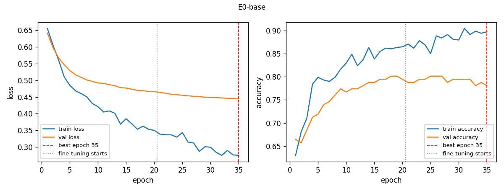

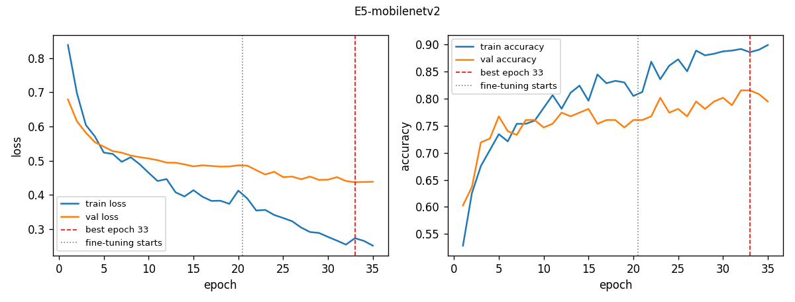

### What went wrong

In E0 the best epoch is the last one (35 of 35): the validation loss was still falling slowly when the 15-epoch
fine-tuning budget ran out, so a longer stage 2 might have helped a little.

## 2.4 Training discipline

- **Fixed seeds.** `keras.utils.set_random_seed(42)` seeds Python, NumPy and TensorFlow in one call, and
  `tf.config.experimental.enable_op_determinism()` makes TensorFlow use deterministic GPU kernels. The split seed,
  the shuffle seed and the augmentation seed are also 42. Re-running a configuration should therefore give the same
  numbers.
- **Early stopping** on validation loss, patience 6 (8 for the CNN), with `restore_best_weights=True`. Validation
  loss is continuous and reacts to confidence, so it is less jumpy than accuracy on 146 images.
- **Checkpoint on validation loss** (`ModelCheckpoint`, `save_best_only=True`). I create a single instance and pass it
  to both `fit()` calls. A new instance in stage 2 would start with "best = infinity" and save the first fine-tuning
  epoch even if it was worse than stage 1. After training, the code reloads this checkpoint, so every evaluation uses
  the best epoch over both stages.
- **Learning-rate reduction** (`ReduceLROnPlateau`): when validation loss has not improved for 2 epochs, the learning
  rate is multiplied by 0.3 (minimum 10⁻⁷). This lets training take smaller steps on a plateau before early stopping
  gives up.

The best epoch is the one with the lowest validation loss over the combined history; the red dashed line in every
`curves.png` marks it (Figures 2.4, 2.5 and 2.6). Table 2.3 gives the values.

**Table 2.3 — Best epoch and epochs actually run (from each run's `metrics.json`).**

| Run | Best epoch | Epochs run | How training ended |
|---|---:|---:|---|
| cnn-baseline | 11 | 19 | early stopping (11 + patience 8) |
| E0-base | 35 | 35 | epoch budget used up (20 + 15) |
| E5-mobilenetv2 (champion) | 33 | 35 | epoch budget used up |
| E7-ft-lr-1e-4 | 24 | 30 | early stopping in stage 2 (24 + patience 6) |

Figure 2.6 shows the CNN. Training loss keeps falling, but validation loss stops improving after epoch 11 and the gap
between training and validation accuracy widens: the model starts to overfit. Early stopping ended the run 8 epochs
later and the checkpoint from epoch 11 was restored.

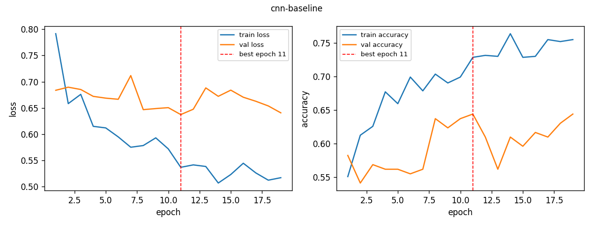

## 2.5 Evaluation

**Threshold on validation.** A sigmoid gives a probability; turning it into a verdict needs a threshold, and 0.5 is
not automatically right. `choose_threshold()` in `src/visionguard/evaluate.py` takes the validation predictions,
tries every distinct predicted probability (plus 0.5) as a threshold and keeps the one with the highest
**F0.5 score** for the AI class. F-beta is (1 + β²)·P·R / (β²·P + R); with β = 0.5 precision counts more than recall.
Ties go to the higher threshold. The threshold is stored with the model and used unchanged on the test set and in
the web app. The code also logs Youden's J threshold (best TPR − FPR) for comparison; for E5 it would have been 0.6208.

**Which error is worse?** I decided that **calling a real image fake is worse** than missing a fake. A false "AI"
verdict accuses a person of faking genuine work and quickly destroys trust in the tool. A missed fake is bad too, but
the result page already warns that the verdict is not proof. In the confusion matrix "real called fake" is a false
positive, so I want high precision for the AI class, which is why I chose F0.5 instead of F1.

The effect is visible on E5's validation set. At 0.5 it reaches accuracy 0.8151 and F1 0.8364. At the chosen threshold
of 0.6725 accuracy (0.7877) and F1 (0.7832) are lower, but precision is 0.9032 and only 6 of 65 real images (9.23 %) are
called fake. I accepted that trade.

**Test set, once.** The test split is only used at the very end of a run, after the best checkpoint is loaded and the
threshold is fixed. Its numbers are reported but never used to choose a model; Chapter 3 picks the champion on
validation metrics. Table 2.4 compares the CNN with the best transfer model (champion E5) and with E0.

**Table 2.4 — Test-set metrics at each model's validation-chosen threshold (147 images; values to 4 decimals as in `reports/experiments/comparison.md`, rates from `metrics.json`).**

| Metric | CNN baseline | E5-mobilenetv2 (champion) | E0-base (EfficientNetB0) |
|---|---:|---:|---:|
| Threshold (from validation) | 0.5422 | 0.6725 | 0.6108 |
| Accuracy | 0.6871 | 0.7823 | 0.8027 |
| Precision (AI) | 0.7536 | 0.9016 | 0.8421 |
| Recall (AI) | 0.6420 | 0.6790 | 0.7901 |
| F1 | 0.6933 | 0.7746 | 0.8153 |
| ROC-AUC | 0.7421 | 0.8709 | 0.8853 |
| Real called fake (FP rate) | 0.2576 | **0.0909** | 0.1818 |
| Fake called real (miss rate) | 0.3580 | 0.3210 | 0.2099 |
| TN / FP / FN / TP | 49 / 17 / 29 / 52 | 60 / 6 / 26 / 55 | 54 / 12 / 17 / 64 |

Transfer learning beats the CNN on every metric: test AUC 0.8709 against 0.7421, and the CNN wrongly accuses a quarter
of the real images. Between the two transfer models, E0 has higher test accuracy, F1 and AUC, but it calls twice as
many real images fake (0.1818 against 0.0909). E5 was chosen on validation, where it had the best AUC and the lowest
real-called-fake rate (Chapter 3). On 147 test images an AUC gap of about 0.015 is within noise, and choosing by test
score would leak the test set into model selection.

Figures 2.7 and 2.8 show the test confusion matrices. The CNN makes 17 false accusations; the champion makes 6. The
champion's main weakness is the bottom-left cell: 26 AI images are let through as real. Figures 2.9 and 2.10 show the
ROC curves for validation and test. The champion's two curves lie close together (AUC 0.881 and 0.871), so a threshold
chosen on validation should transfer to new data. The CNN's curves are much closer to the diagonal.

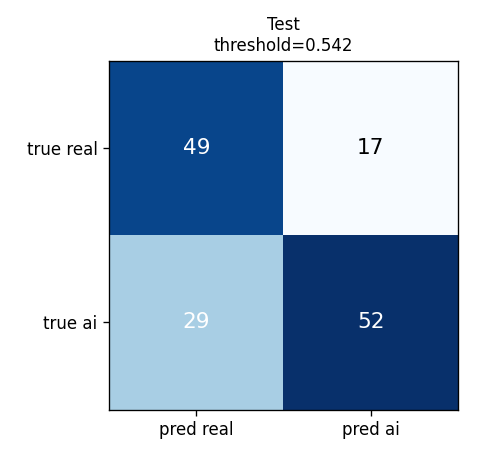

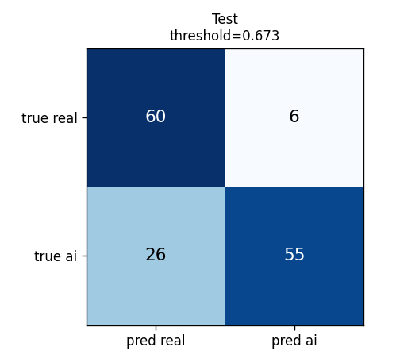

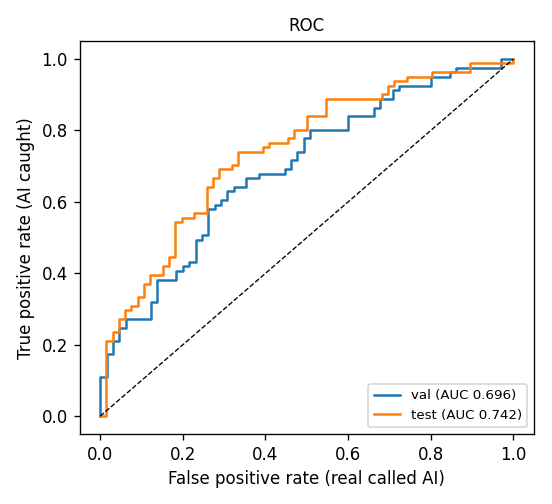

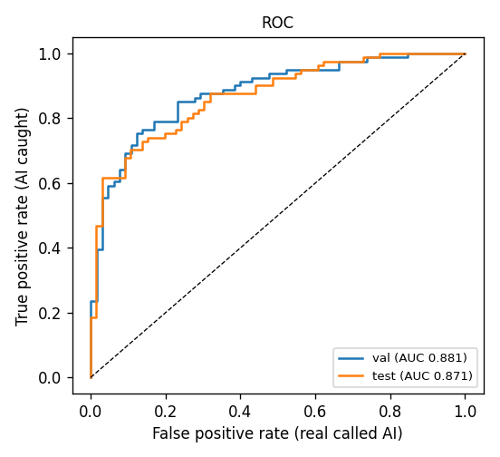

## 2.6 Error analysis

The champion misclassifies 32 of the 147 test images (6 false positives, 26 false negatives).
`scripts/analyze_errors.py` sorts these mistakes by how confident the model was and keeps the 10 most confident ones.
It joins them with the audit table from Chapter 1 (size, format, file size), so each hypothesis can be checked against
facts. Figure 2.11 shows the 10 images as the model sees them (stretched to 224×224), and Table 2.5 gives my
hypothesis for each one.

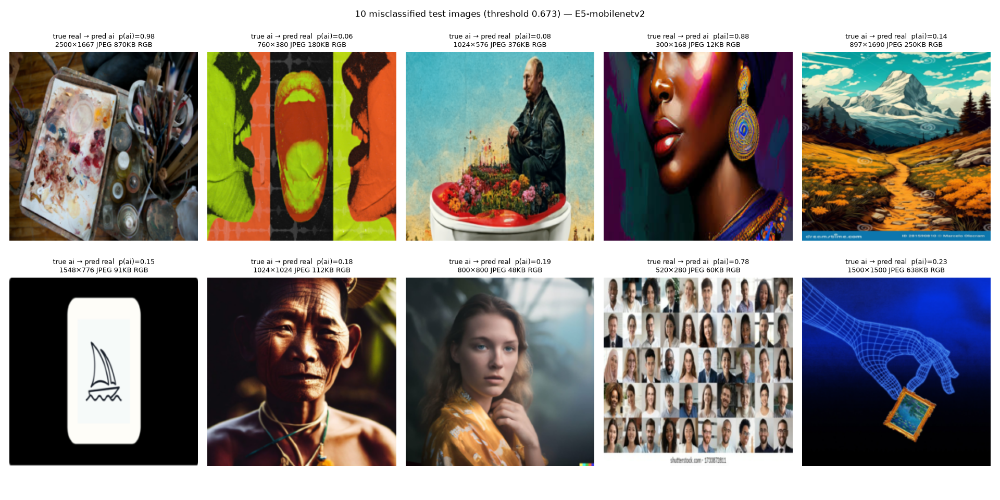

**Table 2.5 — Hypotheses for the 10 most confident test errors (facts from `reports/figures/champion/errors_table.csv`).**

| # | File | True → predicted | p(ai) | Size, file size | Hypothesis |
|---:|---|---|---:|---|---|
| 1 | `RealArt/_MG_5812.jpg` | real → ai | 0.98 | 2500×1667, 870 KB | A photo of a used paint palette. The smeared, saturated paint blobs look like the painterly texture of many AI images in training. |
| 2 | `AiArtData/240201-airec-main-ksp-5625e8.jpg` | ai → real | 0.06 | 760×380, 180 KB | A flat pop-art graphic made of large single-colour areas. There is almost no fine texture where generation artefacts could show, and the 2:1 image is squeezed by the stretch resize. |
| 3 | `AiArtData/midjourney-putin.jpg` | ai → real | 0.08 | 1024×576, 376 KB | A muted, collage-like Midjourney image with a paper-grain background. It imitates a printed photo or poster, which the model links to real images. |
| 4 | `RealArt/images108.jpg` | real → ai | 0.88 | 300×168, 12 KB | A tiny thumbnail of a vividly painted portrait. Strong saturation plus blur from upscaling a 168-px-high image to 224 px resemble smooth AI renders. |
| 5 | `AiArtData/ath-flowers-vivid-colors-generative-ai-landscape-painting-…-281590810.jpg` | ai → real | 0.14 | 897×1690, 250 KB | A stock image with a dreamstime watermark strip. Stock-site watermarks also appear on real images (see #9), and the tall image is squeezed to a square. |
| 6 | `AiArtData/Group_12467.jpg` | ai → real | 0.15 | 1548×776, 91 KB | A logo-like line drawing of a boat on a white card. The image is mostly flat black and white, so there is no texture to judge. |
| 7 | `AiArtData/3e9bc32a-…-1024x1024.jpg` | ai → real | 0.18 | 1024×1024, 112 KB | A photorealistic portrait of an elderly man with natural light and skin detail. Modern generators match photo statistics closely, and the model has learned "photo-like ⇒ real". |
| 8 | `AiArtData/earing-a-yellow-kimono-…-800x800.jpg` | ai → real | 0.19 | 800×800, 48 KB | Another photoreal portrait with natural background blur, and heavily compressed (48 KB). The only visible generator trace is a small coloured strip in the bottom-right corner, which shrinks to a few pixels after resizing. |
| 9 | `RealArt/many-happy-diverse-ethnicity-different-260nw-1733872811.jpg` | real → ai | 0.78 | 520×280, 60 KB | A grid of many similar smiling faces with a Shutterstock watermark. Repeated faces in a grid look like AI collages, such as the collage the model correctly calls AI in Figure 2.12. |
| 10 | `AiArtData/chayka_ai_copyright.jpg` | ai → real | 0.23 | 1500×1500, 638 KB | A 3-D wireframe hand on a blue gradient. Render-like digital art exists in both classes, so the style gives no clear signal. |

**Pattern.** Seven of the ten are AI images let through as real, which matches the high threshold chosen in
Section 2.5. The model seems to have learned a shortcut: "painterly or saturated ⇒ AI" and "photo-like ⇒ real". It
misses photoreal AI portraits (#7, #8) and flat graphics (#2, #6), and it flags real paint (#1) and painted portraits
(#4). This mirrors the class bias seen in the EDA in Chapter 1: much of the AI class is colourful digital art, while the
real class has many photographs. More photoreal AI images and more real paintings in training would attack this
bias directly.

## 2.7 Keras Tuner

**Toy lab.** `labs/keras_tuner_toy.py` tunes a small Fashion-MNIST classifier: Flatten → Dense(*units*, ReLU) →
Dropout 0.2 → Dense(10, softmax). The search space is *units* from 32 to 256 in steps of 32 and the learning rate
from {10⁻², 3·10⁻³, 10⁻³, 3·10⁻⁴, 10⁻⁴}. To keep it quick I used 12,000 training and 3,000 validation images. I chose
**Hyperband** (`max_epochs=6`, `factor=3`). It trains many configurations briefly and gives more epochs only to the
best, so bad settings are dropped cheaply. The trial files in `tuner/fashion_mnist_toy/` show how it ran: in bracket 1,
five configurations (trials 0000–0004) trained for 2 epochs, and the best two continued to 6 epochs as trials 0005
(from 0000) and 0006 (from 0004); bracket 0 trained three more configurations (0007–0009) for the full 6 epochs
directly. Table 2.6 shows all 10 trials. The best settings were 224 units and learning rate 3·10⁻⁴ (validation
accuracy 0.849333). Retraining that model from scratch for only 3 epochs gave 0.833667, lower because it trained for
half as long.

**Table 2.6 — Keras Tuner toy results, Fashion-MNIST, Hyperband (`reports/tuner/toy_results.md`).**

| Trial | Units | Learning rate | Epochs trained | Best val accuracy |
|---|---:|---:|---:|---:|
| 0005 | 224 | 0.0003 | 6 | 0.849333 |
| 0009 | 128 | 0.001 | 6 | 0.842333 |
| 0008 | 192 | 0.01 | 6 | 0.827667 |
| 0006 | 160 | 0.01 | 6 | 0.823667 |
| 0000 | 224 | 0.0003 | 2 | 0.822333 |
| 0004 | 160 | 0.01 | 2 | 0.820667 |
| 0003 | 224 | 0.003 | 2 | 0.820333 |
| 0002 | 160 | 0.001 | 2 | 0.818000 |
| 0001 | 96 | 0.0003 | 2 | 0.811667 |
| 0007 | 32 | 0.0001 | 6 | 0.784333 |

**Applied to VisionGuard.** `src/visionguard/tune.py` defines `TwoStageTuner`, a subclass of Keras Tuner's
`RandomSearch` whose `run_trial` repeats the two-stage schedule of Section 2.3 with EfficientNetB0. Stage 1 trains the
head at 10⁻³ for at most 8 epochs. Stage 2 unfreezes the last *N* backbone layers and trains for at most 10 epochs.
Both stages use early stopping with patience 3. The search space has three hyperparameters:

- **fine-tune learning rate**: 10⁻⁴, 3·10⁻⁵, 10⁻⁵, 3·10⁻⁶;
- **dropout**: 0.1, 0.3, 0.5;
- **number of unfrozen layers**: 0, 10, 20, 40, 80 (0 keeps the backbone frozen; BatchNorm layers always stay frozen).

The objective is the maximum validation AUC, read at the epoch with the lowest validation loss. AUC needs no
threshold, so trials can be compared before any threshold is chosen. The test split is never loaded. I ran 10 trials
(seed 42) on Kaggle. They cover 10 of the 60 possible combinations, and by chance no trial drew 10 or 40 unfrozen
layers. Table 2.7 shows the results.

**Table 2.7 — VisionGuard tuner results (EfficientNetB0, RandomSearch, 10 trials, objective max val AUC; `reports/tuner/visionguard_results.md`).**

| Trial | Dropout | Unfrozen layers | Fine-tune LR | Val AUC | Val accuracy | Best epoch |
|---|---:|---:|---:|---:|---:|---:|
| trial-09 | 0.5 | 80 | 3e-05 | 0.8888 | 0.8219 | 17 |
| trial-05 | 0.1 | 20 | 0.0001 | 0.8844 | 0.8425 | 13 |
| trial-02 | 0.1 | 80 | 3e-05 | 0.8828 | 0.8151 | 13 |
| trial-07 | 0.3 | 20 | 3e-05 | 0.8799 | 0.8082 | 18 |
| trial-03 | 0.1 | 80 | 1e-05 | 0.8795 | 0.8082 | 18 |
| trial-06 | 0.1 | 20 | 3e-06 | 0.8561 | 0.7808 | 18 |
| trial-00 | 0.1 | 0 | 0.0001 | 0.8522 | 0.7671 | 18 |
| trial-01 | 0.3 | 0 | 3e-05 | 0.8461 | 0.7671 | 18 |
| trial-08 | 0.1 | 0 | 1e-05 | 0.8456 | 0.7808 | 18 |
| trial-04 | 0.5 | 0 | 3e-06 | 0.8246 | 0.7534 | 18 |

**Which setting mattered most?** To estimate this I averaged the validation AUC of all trials sharing a value
(Table 2.8). The "spread" is the gap between the best and the worst mean.

**Table 2.8 — Mean validation AUC per hyperparameter value (n = number of trials).**

| Hyperparameter | Mean val AUC per value | Spread |
|---|---|---:|
| Unfrozen layers | 0 → 0.8421 (n=4), 20 → 0.8735 (n=3), 80 → 0.8837 (n=3) | **0.0416** |
| Fine-tune LR | 3e-06 → 0.8404 (n=2), 1e-05 → 0.8625 (n=2), 0.0001 → 0.8683 (n=2), 3e-05 → 0.8744 (n=4) | 0.034 |
| Dropout | 0.5 → 0.8567 (n=2), 0.3 → 0.863 (n=2), 0.1 → 0.8668 (n=6) | 0.0101 |

The **number of unfrozen layers** mattered most. All four trials with a frozen backbone are at the bottom of
Table 2.7, and the mean rises steadily from 0 to 20 to 80 layers. I think the reason is that ImageNet features describe
objects, not generation artefacts, so the more of the network can adapt to the new task, the better it separates the
classes. The **fine-tune learning rate** came second, mainly because 3·10⁻⁶ is too small to move the weights in 10
epochs (mean 0.8404). **Dropout** hardly mattered: trial-02 and trial-09 differ only in dropout (0.1 vs 0.5) and are
0.006 apart. These estimates are rough: each mean rests on 2–4 trials, and in a random sample the values are not
balanced against each other.

**Why picking the best validation score overfits validation.** The validation set has only 146 images; one image
changes accuracy by about 0.7 %. The top five trials lie within 0.0093 AUC of each other, which is inside that noise.
Each trial's score is the true quality plus a random error. Taking the maximum over many trials favours the trial
whose error happened to be positive, so the winning score is optimistically biased, and the bias grows with the number
of trials. The same validation set is also used for early stopping and for the threshold, so the whole pipeline is
tuned to these 146 images. That is why the test set stays untouched until the end, and why the final model choice in
Chapter 3 also weighs the real-called-fake rate and model size instead of following one highest number.

### What went wrong

The random search never sampled 10 or 40 unfrozen layers, so the trend between 20 and 80 is based on two points only.
The tuner's best configuration (80 unfrozen layers) was not trained as a separate full run, so the comparison in
Chapter 3 uses the last-block fine-tuning of Section 2.3.

## Bonus — Grad-CAM

Grad-CAM shows which image regions pushed the prediction towards "AI-generated". The function `gradcam()` in
`scripts/analyze_errors.py` runs the champion layer by layer and records the backbone's last feature map
(7×7×1280 for MobileNetV2). It then takes the gradient of the output p(ai) with respect to that map. The gradients
are averaged per channel to give one weight per channel. The weighted sum of the channels, passed through ReLU and
divided by its maximum, is a 7×7 heat map, which is upsampled to 224×224 and laid over the image. The script picks
2 correct images per class at random (seed 42) and the 4 most confident wrong ones (#1–#4 of Table 2.5). Figure 2.12
shows the result.

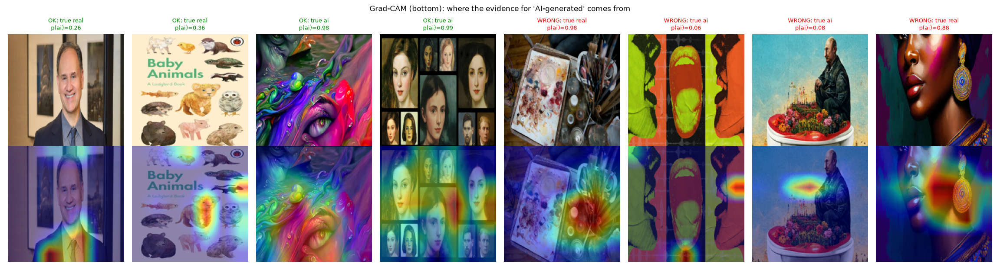

For the two correct AI images (p = 0.98 and 0.99) the evidence spreads over large high-saturation, textured areas:
the swirls around the painted eye and the faces in the portrait collage. For the two correct real images the model
was not confident in "AI" anyway (p = 0.26 and 0.36), and the small hot spots on the tie and on one animal on the book
cover carry little weight. In the wrong cases the map focuses on **local colour and texture**: the paint blobs on the
palette, the cheek colour patch and the earring of the painted portrait, and small edge regions in the pop-art and
Midjourney images, which got low scores. This supports the shortcut from Section 2.6: the model reacts to saturated,
painterly patches rather than to global structure. Two limits apply. A 7×7 map is coarse, and each map is scaled to
its own maximum, so a red area on a low-probability image marks the *relatively* strongest evidence, not strong
evidence.
