# Chapter 3 — Experiment Tracking with MLflow and DagsHub (12 marks)

## 3.1 MLflow locally

### What I did and why

I first learned MLflow with `labs/mlflow_toy.py`, a small MNIST network that trains in seconds. It runs one experiment per learning rate, logs parameters, epoch metrics, tags, a curves plot, and the trained model. `mlflow.log_params` captures settings fixed before training, while the Keras callback records loss, accuracy, `val_loss`, and `val_accuracy` by epoch. That split made it easy to see both what changed and how the run behaved. I used a SQLite backend at `sqlite:///mlflow.db` because one file is easier to inspect and remove than a folder store; both it and `mlruns/` are ignored by Git. `mlflow ui --backend-store-uri sqlite:///mlflow.db` reads that same file on 127.0.0.1:5000.

Figure 3.1 shows the two local runs: lr 0.001 reached val accuracy 0.8965 and lr 0.01 reached 0.907. Figure 3.2 lists them in the local UI. Figure 3.3 shows the `lr-0.01` run, while Figure 3.4 shows its curves; validation loss rises after epoch 4. Figure 3.5 compares the runs, with `learning_rate` as the only changed parameter. Figure 3.6 plots it against final training loss.

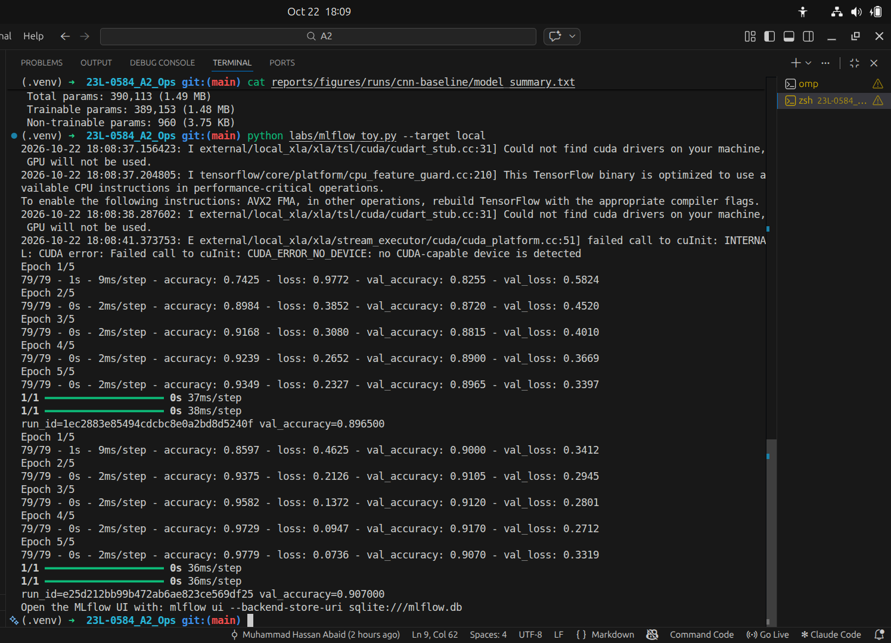

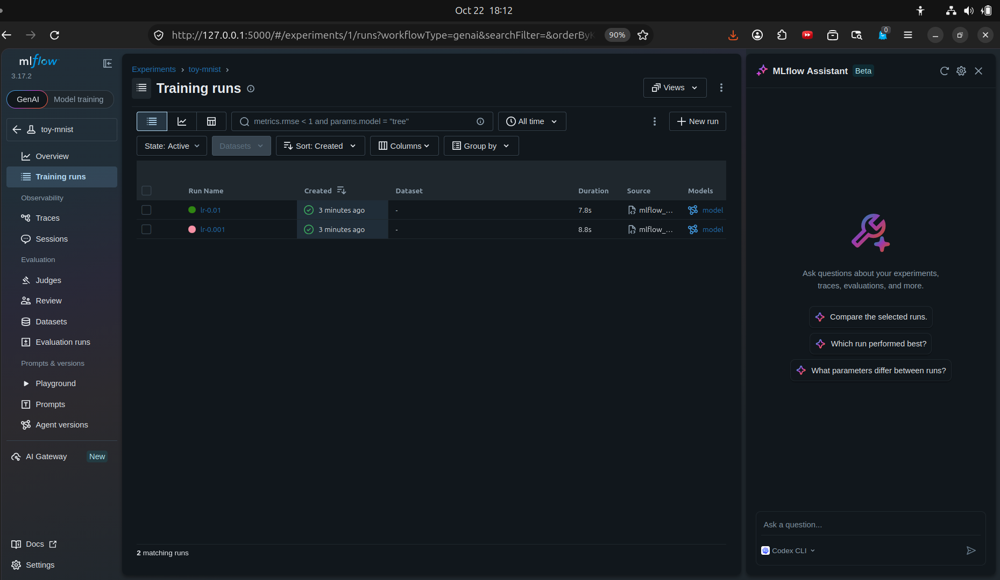

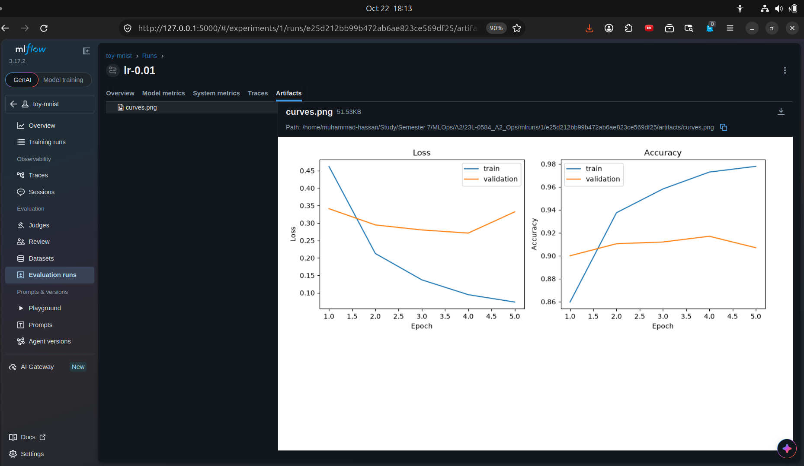

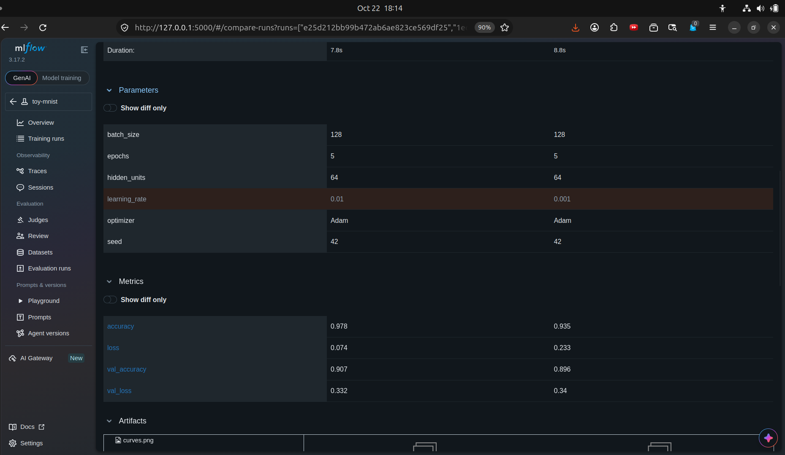

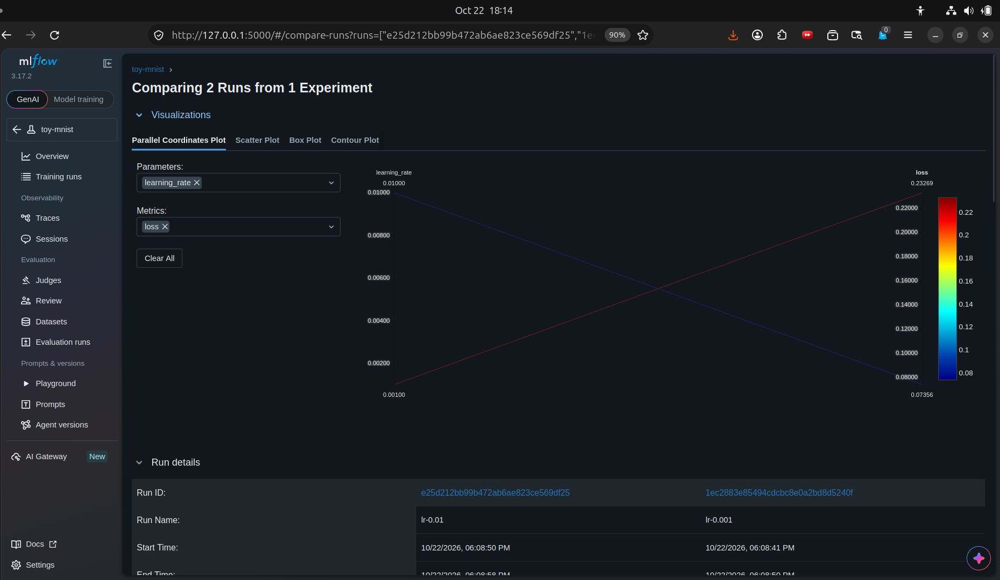

### Definitions in my own words

- **Experiment**: a named group of runs that answer one question.
- **Run**: one execution of training and its recorded inputs and results.
- **Parameter**: a setting fixed before training, such as learning rate.
- **Metric**: a measured value, such as loss, logged over steps.
- **Artifact**: an output file stored with a run.
- **Tag**: a searchable key-value label for provenance.

## 3.2 DagsHub setup

### What I did and why

The DagsHub project `23L-0584_A2_Ops` links GitHub, the Task 1.4 DVC remote, and MLflow runs. A recorded commit can therefore lead back to the code behind a result, while DVC identifies the data version. Its tracking URI is `https://dagshub.com/<user>/23L-0584_A2_Ops.mlflow`. Scripts read `MLFLOW_TRACKING_URI`, `MLFLOW_TRACKING_USERNAME`, and `MLFLOW_TRACKING_PASSWORD` from `.env` when run with `--target dagshub`; missing settings cause an error instead of a local fallback. `.env.example` documents the names without exposing the token. Kaggle reads `DAGSHUB_USER` and `DAGSHUB_TOKEN` from its secrets, so the notebook needs no local credentials file.

Figure 3.7 confirms that `.env` is ignored and the template has 7 empty lines. I repeated the toy run on DagsHub for 2 epochs: lr 1e-3 reached val accuracy 0.872 and lr 1e-2 reached 0.9105. Figure 3.8 shows those runs beside VisionGuard runs, and Figure 3.9 shows their hosted MLflow page.

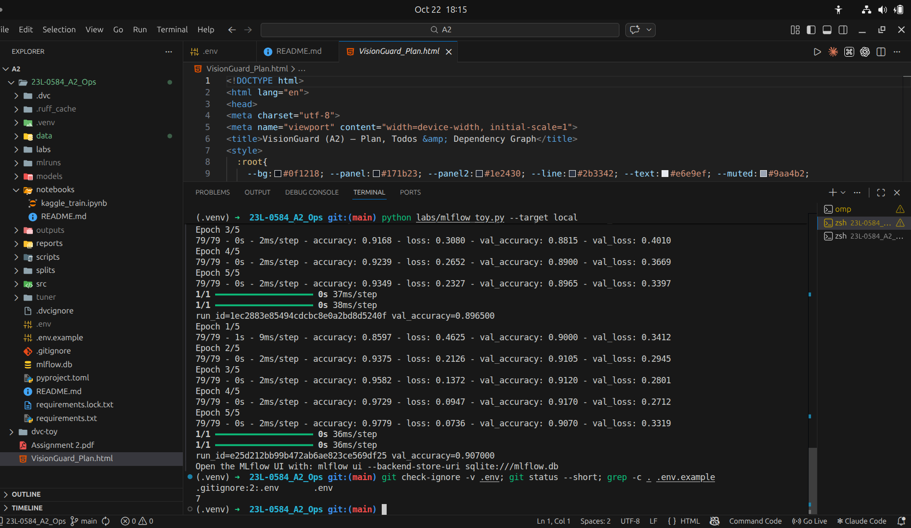

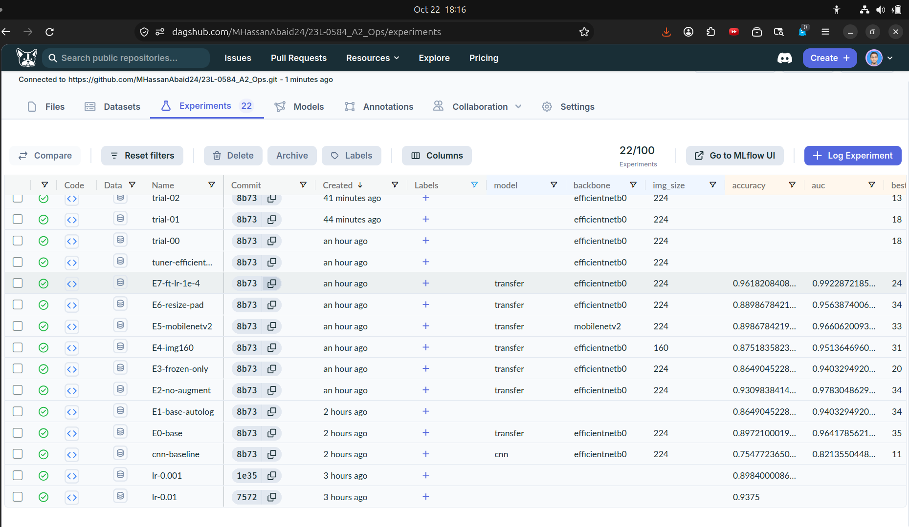

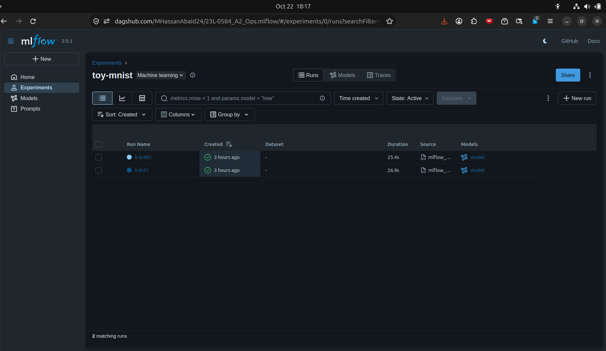

## 3.3 Instrument training

### What I did and why

VisionGuard trains through `python -m visionguard.train`. I compared `--logging manual` in E0-base with `mlflow.tensorflow.autolog` in E1-base-autolog, using EfficientNetB0, 20 frozen epochs at lr 1e-3, then 15 fine-tuning epochs at lr 1e-5. Keeping the training configuration the same meant that the logging method, rather than the model, explained the differences on the run pages.

Both modes record reproducibility tags: `git_commit`, `git_dirty`, seed 42, and the `data/raw.dvc` md5 8f23d6dc… with 975 files. Those tags tie a result to both its code state and its input data. They also log final validation and test results. Thresholded validation accuracy, precision, and recall use `val_thr_*`.

Manual logging records 30 experiment parameters, including the backbone, image size, augmentation, resize mode, and fine-tuning choices. It uses `MlflowEpochLogger` for epoch metrics. The second `fit()` begins at `initial_epoch=20`, so its points continue through 20–34 instead of overwriting the first stage. Figure 3.10 shows the parameters, Figure 3.11 the 39 metrics and tags, and Figure 3.12 the complete 35-epoch curves.

Autolog recorded 31 `fit()` and optimizer parameters, not the backbone, image size, or augmentation. It also restarted its steps during the second `fit()`: Figure 3.13 shows its parameter list and Figure 3.14 stops at step 19. Figure 3.15 shows the supplied tags and its stale 0.001 learning-rate metric. I could use autolog for a quick baseline, but manual logging preserves the details needed to compare the real experiment and both training stages, so I used it for the other runs.

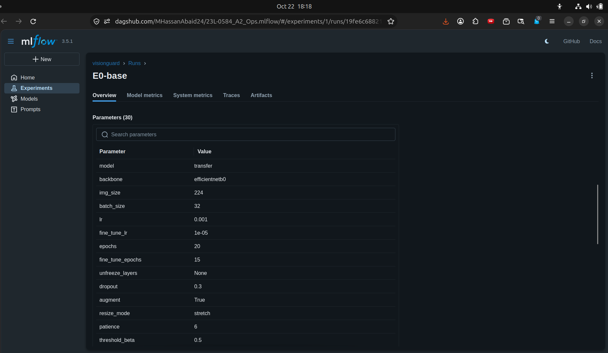

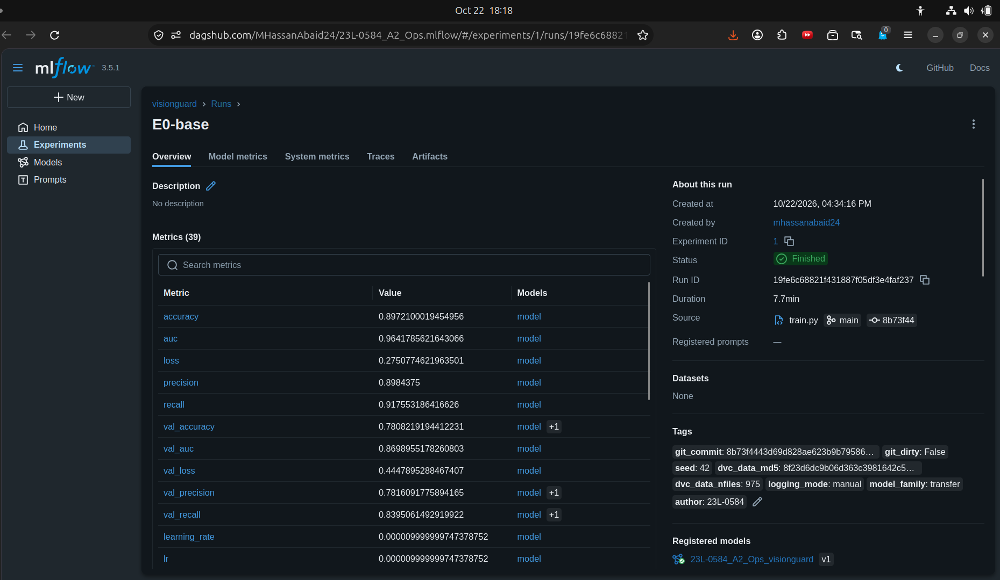

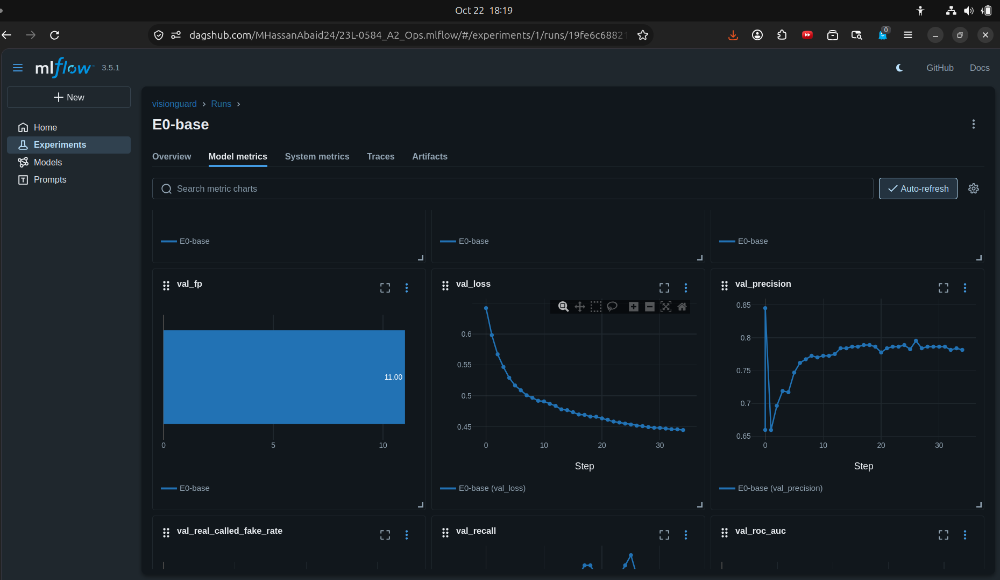

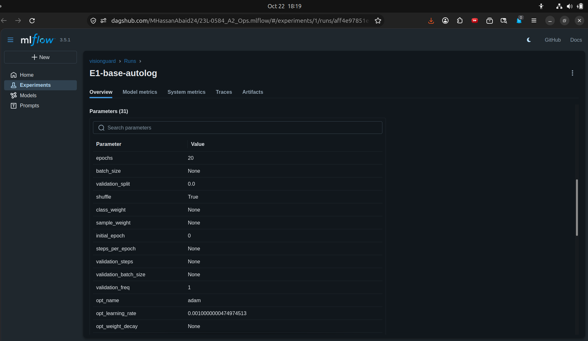

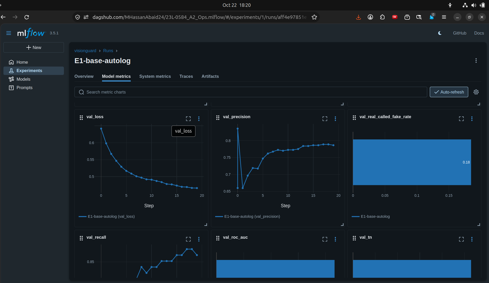

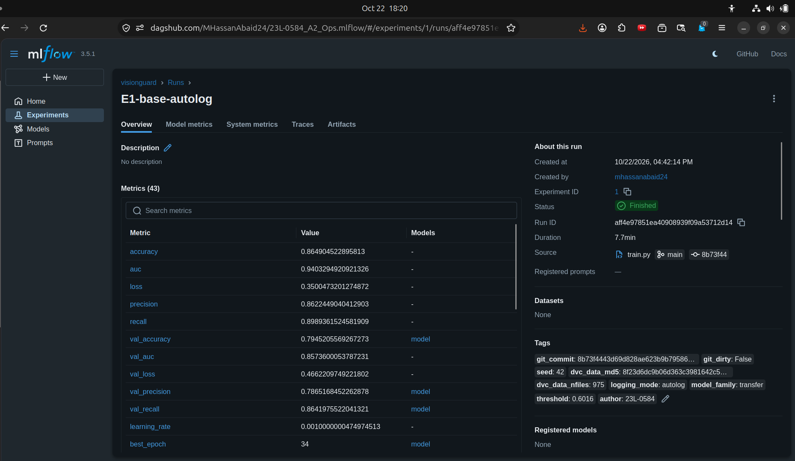

### What went wrong

I first used `val_accuracy`, `val_precision`, and `val_recall` for final thresholded values. Keras already logged those names each epoch at threshold 0.5, and MLflow displayed the last step instead. E5-mobilenetv2 therefore showed 0.8148 rather than the `metrics.json` value 0.9032; E0-base showed 0.7816 rather than 0.8451.

Unique metrics, including `val_roc_auc`, `val_f1`, and every `test_*` metric, were unaffected, so the 3.5 choice did not change. I renamed the three final metrics to `val_thr_accuracy`, `val_thr_precision`, and `val_thr_recall`, rebuilt the `val_precision` comparison column from `metrics.json`, and left existing DagsHub runs unchanged. It was a useful reminder that a summary metric should not reuse a per-step name.

## 3.4 Artifacts

Each run uploads `figures/`, `splits/`, `run_info/`, `keras_model/model.keras`, and the MLflow `model`. The splits preserve the image lists behind a metric, and `run_info/` includes the training environment, metrics, serving configuration, and training history. I keep both model formats because the registry uses the MLflow model while the web server loads the plain `.keras` file. The serving config travels with it, so the validation threshold matches the weights rather than relying on a separate default.

Figure 3.16 shows the champion artifact tree. Figure 3.17 shows its test confusion matrix at threshold 0.673: 60 TN, 6 FP, 26 FN, and 55 TP. Figure 3.18 shows the 18 KB training-environment `requirements.txt`; it is a full `pip freeze`, useful for reproducing the run rather than serving the model.

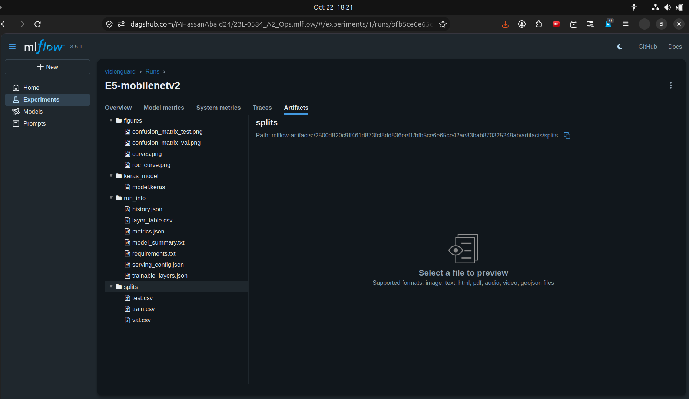

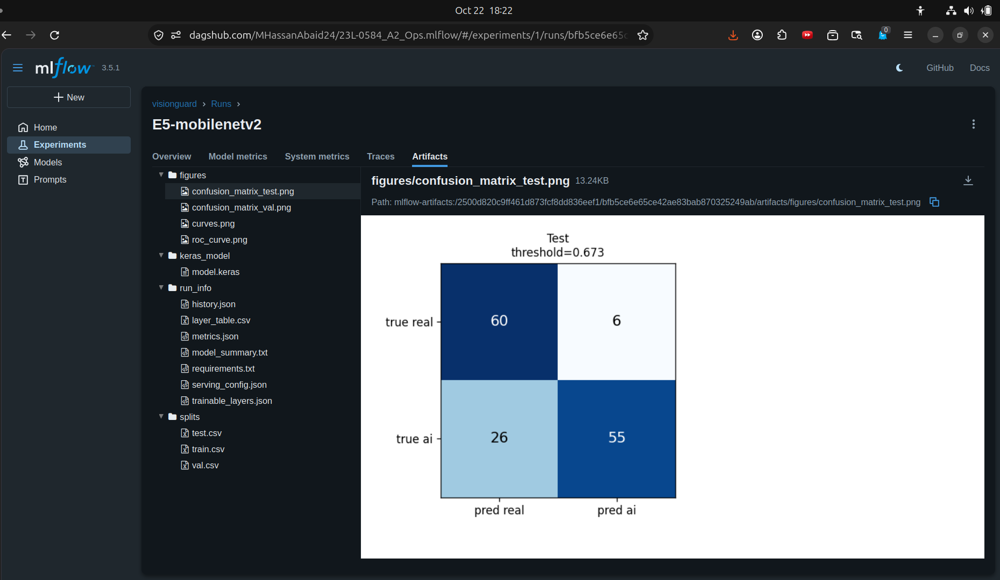

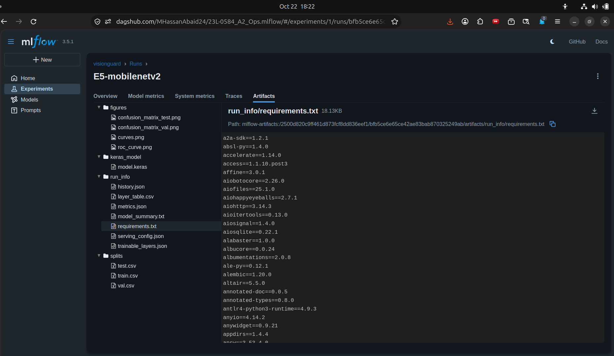

## 3.5 Experiment comparison

### What I did

The Kaggle notebook runs an experiment matrix and writes `reports/experiments/comparison.md|csv`. E0 is EfficientNetB0 with augmentation, stretch resize, 224 px, fine-tune lr 1e-5, and manual logging. E1–E7 each change one flag, while `cnn-baseline` is the Task 2.2 reference. This setup makes a score difference easier to trace to a design choice instead of several changed settings. Table 3.1 is the extract used for selection.

**Table 3.1 — VisionGuard runs (experiment `visionguard`). "val/test r→f" is the rate of real images called AI at the run's validation-chosen threshold. Sorted by val AUC.**

| run | change vs E0 | val AUC | val F1 | val r→f | test AUC | test F1 | test r→f |
|---|---|---|---|---|---|---|---|
| E5-mobilenetv2 | MobileNetV2 backbone | **0.8807** | 0.7832 | **0.0923** | 0.8709 | 0.7746 | 0.0909 |
| E7-ft-lr-1e-4 | fine-tune lr 1e-4 | 0.8786 | 0.8250 | 0.2000 | 0.8902 | 0.8364 | 0.2273 |
| E2-no-augment | no augmentation | 0.8764 | 0.8471 | 0.2615 | 0.8915 | 0.8362 | 0.3333 |
| E0-base | — | 0.8697 | 0.7895 | 0.1692 | 0.8853 | 0.8153 | 0.1818 |
| E1-base-autolog | logging only (autolog) | 0.8663 | 0.7922 | 0.1846 | 0.8844 | 0.8250 | 0.1970 |
| E6-resize-pad | pad instead of stretch | 0.8587 | 0.7975 | 0.2154 | 0.8883 | 0.8503 | 0.2273 |
| E3-frozen-only | no fine-tuning | 0.8572 | 0.8324 | 0.3077 | 0.8739 | 0.8046 | 0.3485 |
| E4-img160 | 160 px input | 0.8298 | 0.7826 | 0.2615 | 0.8694 | 0.8199 | 0.2121 |
| cnn-baseline | from-scratch CNN (reference) | 0.6957 | 0.6711 | 0.3077 | 0.7421 | 0.6933 | 0.2576 |

Figure 3.19 shows the ranking, Figure 3.20 plots validation ROC-AUC against the real-called-fake rate, and Figure 3.21 shows the parameter lines. Fine-tuning helped, smaller images hurt, and padding changed little. E1 stayed close enough to E0 that its small difference looks like noise.

### Choice and justification

I chose **E5-mobilenetv2** as champion and E7 as challenger. E5 has the highest validation ROC-AUC, 0.8807, and the lowest validation real-called-fake rate, 0.0923. That rate mattered because Task 2.5 treats falsely accusing a real photo as the worse error. Figure 3.20 places E5 alone at the bottom right.

It is also the smallest model at 16.7 MB `.keras` and 2.3 M parameters, which suits a CPU server. The trade-off is val fake→real 0.3086. I selected on validation only; with 147 test images, choosing a model from the test columns would leak the test set. Its test real-called-fake rate remained 0.0909, which made the validation result more convincing.

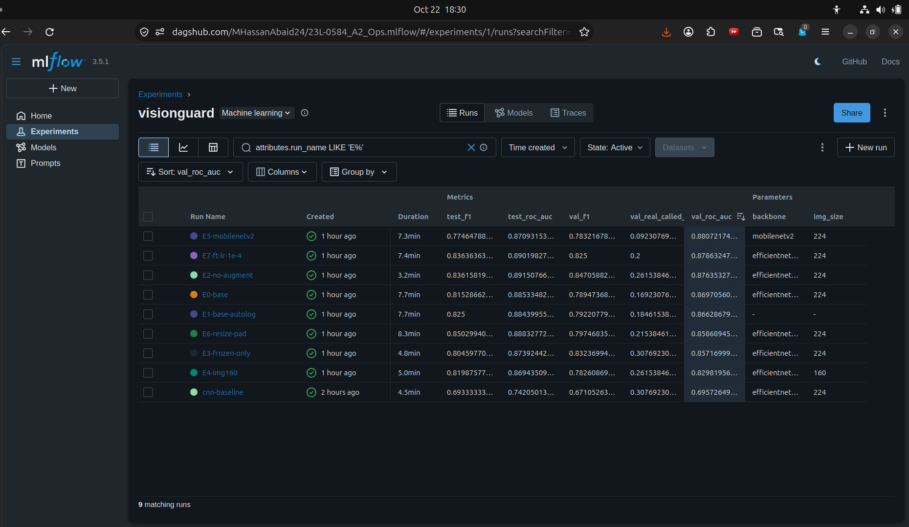

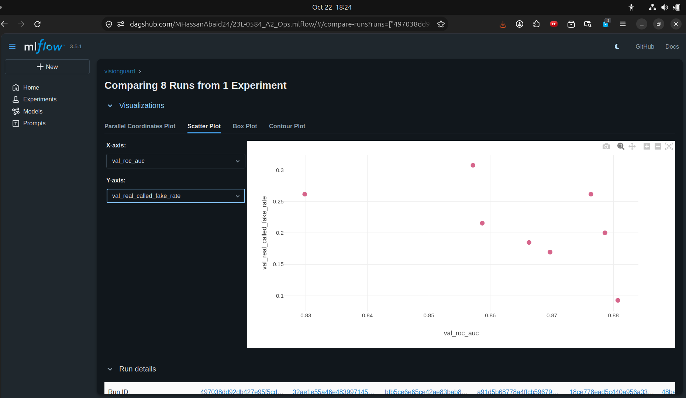

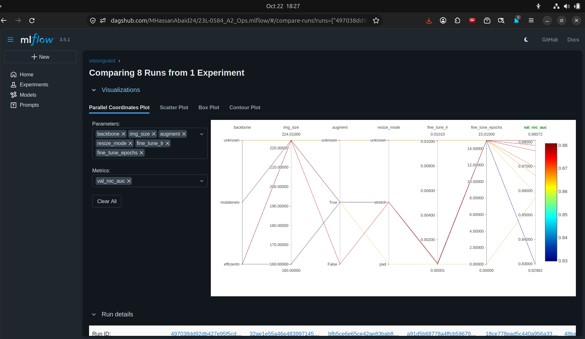

### What went wrong

E1 has no `backbone`, `img_size`, or `augment` parameters, so Figure 3.21 shows it as unknown and the notebook infers its settings from the run name. That is another practical drawback of autolog when the comparison table needs model details. A second notebook run also created duplicate DagsHub names. On 2026-11-08 I soft-deleted the duplicates and kept the runs used by the registry; `scripts/register_model.py` requires one finished run for each name.

## 3.6 Model registry

### Registering and aliasing

`scripts/register_model.py` registers named runs, waits for READY versions, adds metric and threshold tags, then assigns aliases. The model `23L-0584_A2_Ops_visionguard` has v1 = E0-base, v2 = E7-ft-lr-1e-4 as `challenger`, and v3 = E5-mobilenetv2 as `champion`. Figure 3.22 shows the versions, Figure 3.23 the champion page, and Figure 3.24 its tags. Aliases let consumers request the champion without changing their code when I promote another model.

### Load by alias

`scripts/predict_champion.py` resolves the alias, downloads `serving_config.json`, loads `models:/23L-0584_A2_Ops_visionguard@champion`, preprocesses with `decode_and_resize`, and applies the stored threshold. Figure 3.25 shows `RealArt/images37.jpg` classified as real at confidence 0.978 and `AiArtData/sddefault.jpg` as ai at 0.733 with threshold 0.6725. Loading took 10.5–12.0 s and prediction took 0.71 s.

### How the champion reaches the server

The server does not contact DagsHub for each request. `scripts/export_champion.py` resolves `champion`, downloads `keras_model/model.keras` as `models/champion.keras`, and saves its serving configuration. `ChampionModel` loads both once at start-up from `MODEL_PATH`. Keeping the download outside requests avoids a long remote load for every prediction. To deploy a new champion, I move the alias, export it again, and restart the server.

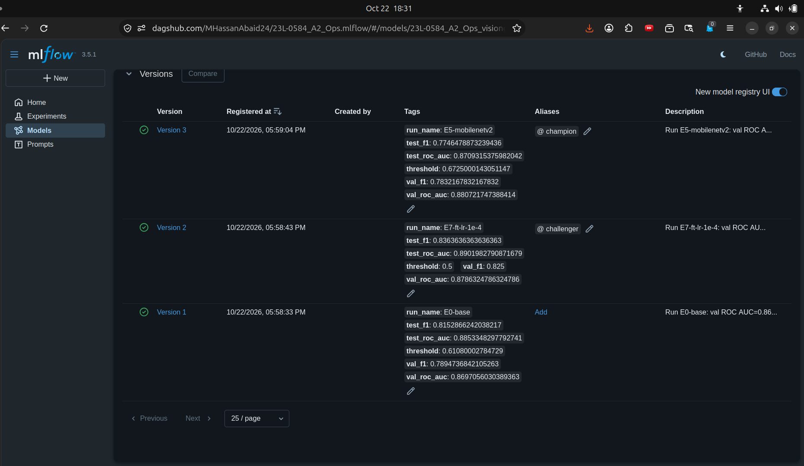

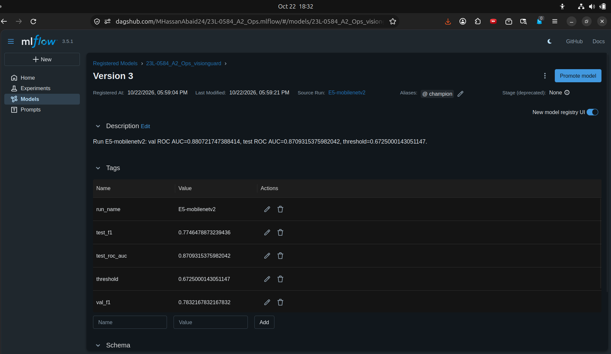

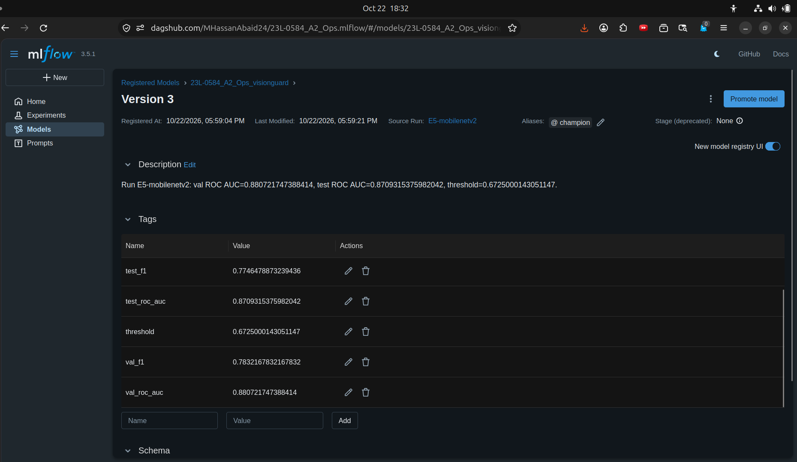

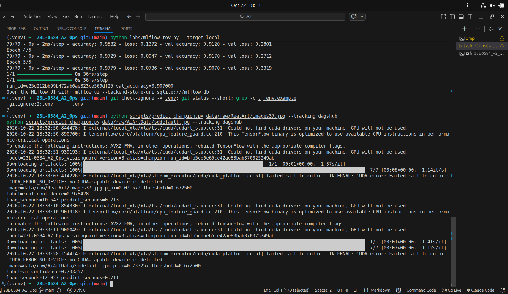

### What went wrong

My first URI, `runs:/<run_id>/model`, did not resolve on DagsHub. In MLflow 3, logged models have their own ids, so `register_model.py` finds the READY model with `mlflow.search_logged_models` and registers `models:/<model_id>`.
