# Chapter 4 — Flask Web Application (12 marks)

I captured the browser evidence in Chapters 4 and 5 from the running app on Sun 08 Nov 2026, 12:40–12:43 PKT. It ran under gunicorn with debug off, champion model v3 and local SQLite. I used headless Chromium, so each image has a strip with the real URL, capture time, `user@host` and project name. Figure 4.1 and Figure 5.3 are rendered command transcripts, not desktop screenshots.

## 4.1 Inference module

`src/visionguard/inference.py` keeps inference separate from the web layer. `ChampionModel` loads `models/champion.keras` and its neighbouring `serving_config.json`: threshold 0.6725, image size 224, `stretch` resizing, and registry `23L-0584_A2_Ops_visionguard` v3. I export both once with `scripts/export_champion.py` (Section 3.6), so serving does not contact DagsHub. The constructor loads and warms up the model on a blank 224×224 image; the app factory creates it once per process. Requests reuse `predict_bytes()`, which returns the verdict, probabilities, model details and latency.

Figure 4.1 shows why I do not load per request. Cold start was 9.06 s, including TensorFlow and Keras imports, loading and warm-up; later predictions took 314 ms and 313 ms. In contrast, my notes show 2.5–6 s to load locally and 10–12 s through MLflow, versus 0.1–0.2 s for a prediction. Per-request loading would make uploads 20–50× slower, duplicate a several-hundred-MB model for concurrent requests and hit DagsHub.

Serving must use the training preprocessing. `predict_bytes()` imports `visionguard.data.decode_and_resize` rather than duplicating it: content-based RGB decoding, antialiased bilinear resize to 224×224, uint8 rounding and float32 [0, 255] conversion. Normalisation stays inside the model. The exported model gives the registry values 0.0216 and 0.7333 from Section 3.6, and `midjourney-putin.jpg` gives P(AI) 0.076, matching 0.07635648 in `reports/figures/champion/errors_table.csv`. Figure 4.1 also shows `RealArt/images37.jpg` classified real at 0.978 confidence and `AiArtData/sddefault.jpg` classified AI at 0.733. Confidence is P(AI) for AI, otherwise 1 − P(AI).
If serving changed the resize, channel order or [0, 1] scaling, the model would receive an input distribution it never learned and accuracy could fall without an error. Reusing the training function prevents that train/serve skew.

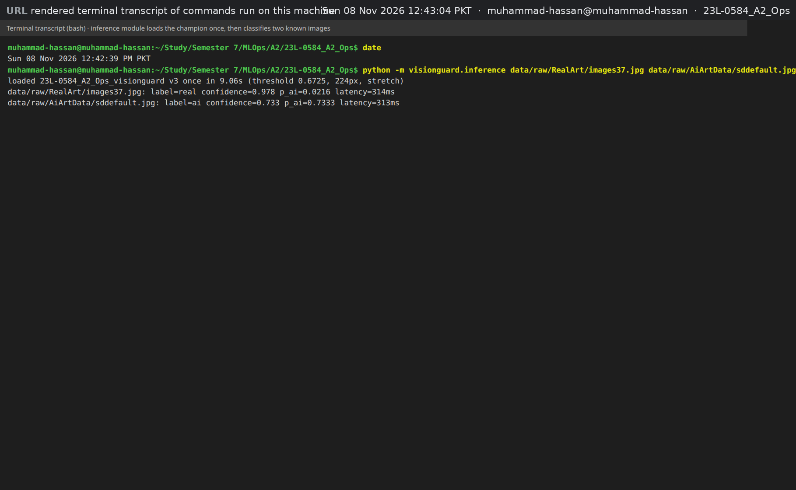

### What went wrong

`tf.io.decode_image` cannot read WEBP. To avoid train/serve skew, `_tf_compatible_bytes()` converts only WEBP uploads to lossless PNG with Pillow; every other format still uses TensorFlow's training decoder.

## 4.2 Routes and validation

`create_app()` defines five routes: `GET /` for upload, `POST /predict` for validation and prediction, `GET /result/<id>` for a stored verdict, `GET /history` for the trail, and `GET /health` for JSON.

`inspect_image()` validates content, not an extension or browser-supplied MIME type. Figure 4.2 shows a real TIFF rejected with 415 because Pillow reads its magic bytes and only JPEG, PNG, WEBP, GIF and BMP are allowed. Figure 4.3 shows a 17 MB PNG rejected with 413 before its body is read: `MAX_CONTENT_LENGTH` comes from `MAX_UPLOAD_MB`, which defaults to 10 MB. The error page says, "The file is larger than the 10 MB limit."

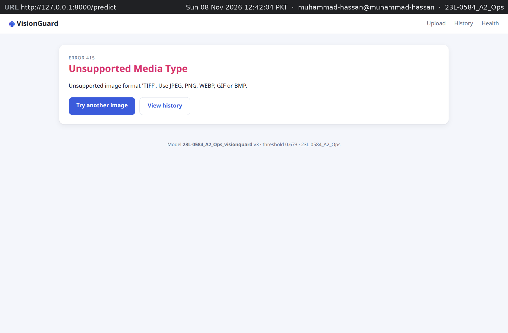

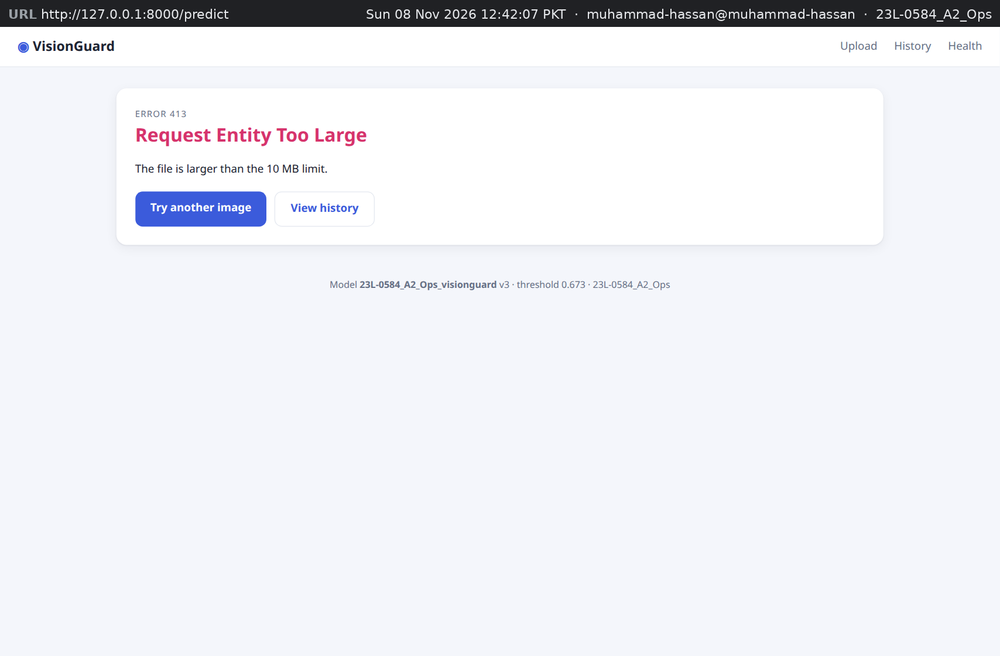

Figure 4.4 shows a text file renamed `vacation.jpg` rejected with 400. Pillow first runs `verify()`, then reopens and fully loads the image to catch truncated files. Images above 100 megapixels raise `DecompressionBombError` and also receive 400; the largest training image is 60 MP.

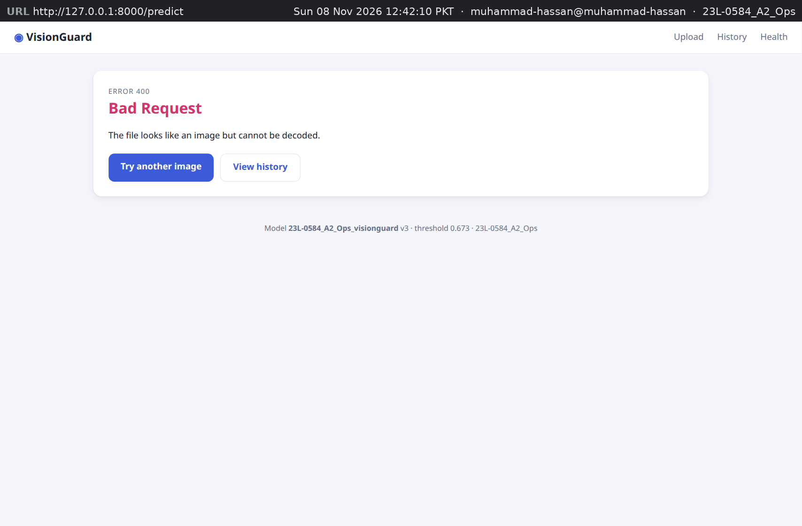

A missing file gets 400, an unknown id gets 404 and an unhandled exception gets a friendly 500 page. `error.html` keeps "Try another image" and "View history" links while the stack trace stays in the log. I sanitise names with `werkzeug.utils.secure_filename`, limit them to 120 characters, and use them only for display and logging. For example, `../../etc/passwd <script>.jpg` becomes `etc_passwd_script.jpg`; Jinja also escapes HTML.

Uploads never reach disk. The request class returns an in-memory `BytesIO` from `_get_file_stream()`, keeping bytes in RAM within the 10 MB limit; I checked this with a 7.7 MB upload. Results embed a base64 JPEG thumbnail in HTML, while the database receives metadata only.

## 4.3 HTML and CSS

The interface uses Jinja templates in `src/visionguard/web/templates/` and `static/style.css`, not a JavaScript framework. Pages extend `base.html`; its menu has Upload · History · Health and its footer identifies the model, version and threshold.

Figure 4.5 shows the upload form. It accepts JPEG, PNG, WEBP, GIF and BMP up to 10 MB, then gives the limits before a user sees a result: fewer than 1,000 training images, roughly 4 correct verdicts out of 5, missed AI images, and confusion around paintings, filters and thumbnails. I put that warning first because people tend to anchor on the first verdict.

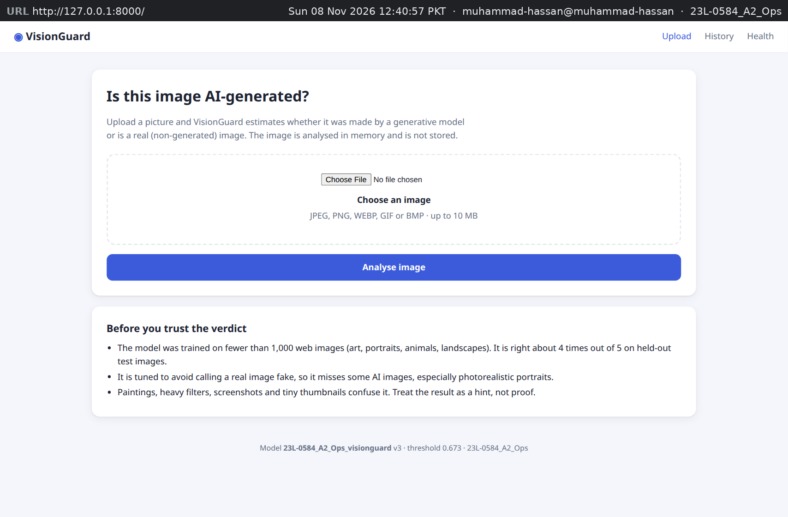

`result.html` presents the coloured verdict, confidence bar, P(AI), threshold, model details, latency, UTC time and an outcome-specific caveat. All four examples are test images. Figure 4.6 is a real photo correctly called "Likely real" at 99.6 % confidence and P(AI) 0.004; Figure 4.7 is a Midjourney collage correctly called AI-generated at 99.8 %. Figure 4.8 is just over the 0.673 threshold at P(AI) 0.685, so its confidence is 68.5 % and its low-confidence caveat applies below 70 %. Figure 4.9 is the important failure: AI-generated `midjourney-putin.jpg` is called "Likely real" at 92.4 % confidence. It is one of the Section 2.6 mistakes and looks like a muted printed-photo collage. The caveat warns that a likely-real result is not a guarantee or sole evidence against someone.
The 0.6725 setting also means a real verdict with P(AI) from 0.5 to 0.6725 has confidence below 50 %, another reason not to treat a single score as proof.

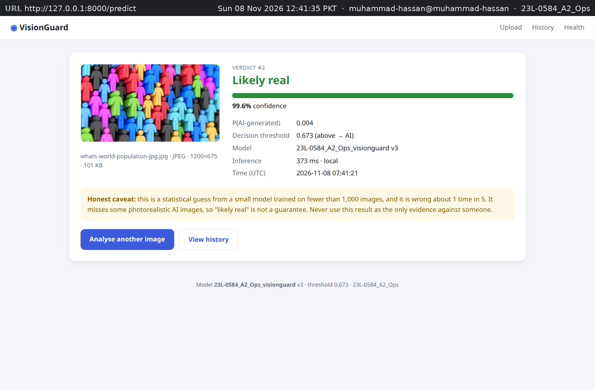

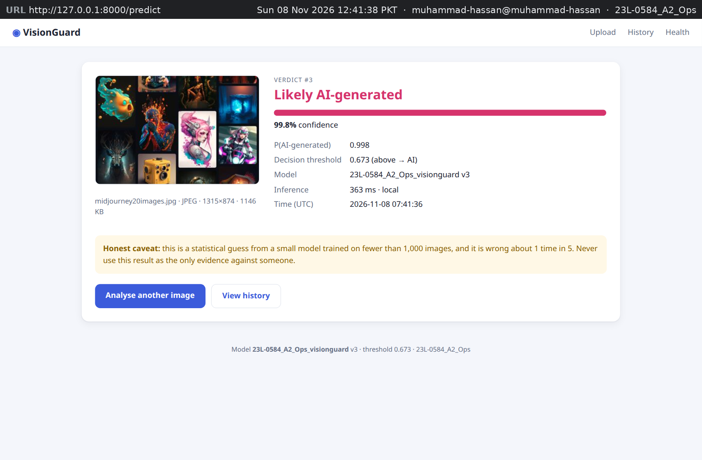

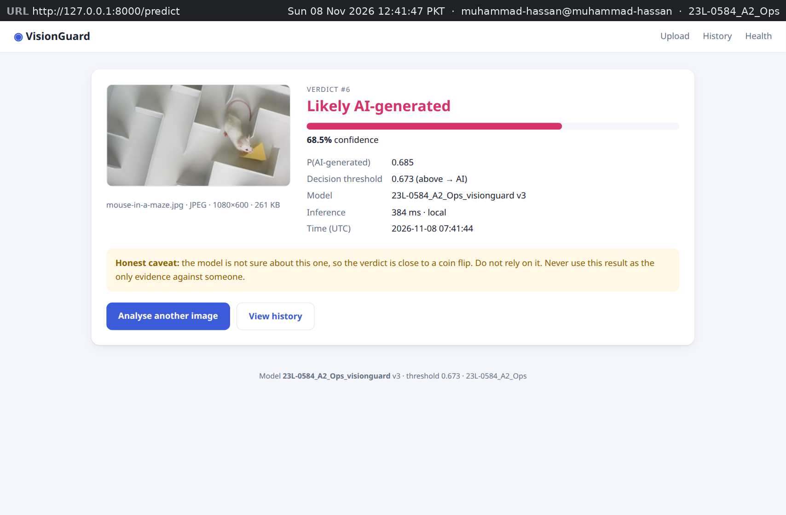

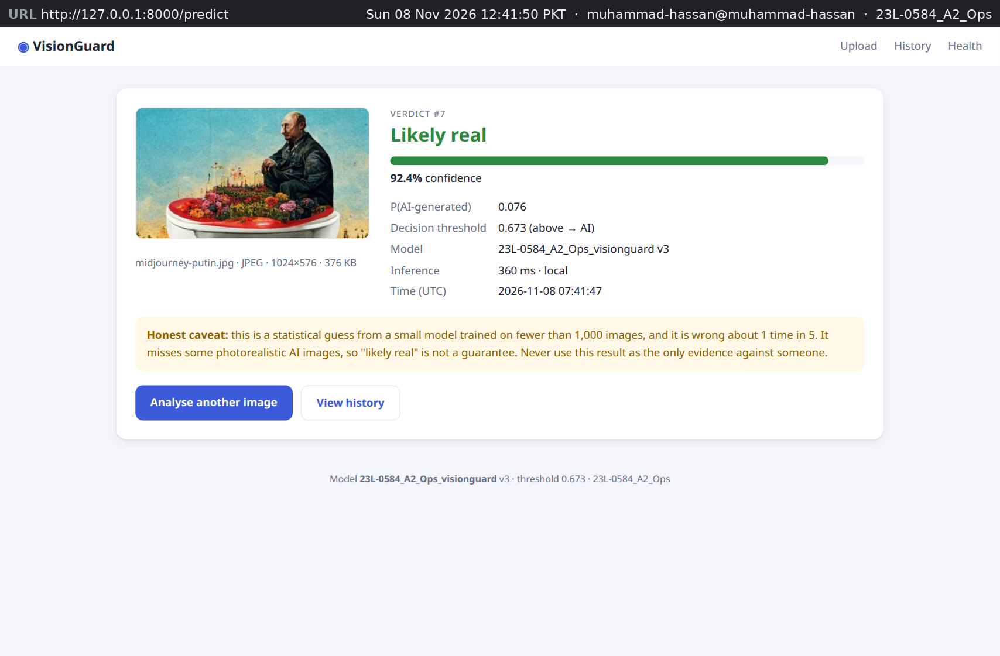

History is available from every page and is described in Section 5.3 (Figure 5.1). CSS variables, a centred card layout and a scrollable table wrapper keep it usable on narrow screens.

## 4.4 Configuration and production server

`Settings.from_env()` in `src/visionguard/web/config.py` reads deployment values from environment variables; `.env.example` and `gunicorn.conf.py` document the same approach. I can therefore run SQLite locally or PostgreSQL in Docker by changing values, not code. Table 4.1 lists them.

**Table 4.1 — Environment variables read by the app and by gunicorn.**

| Variable | Default | Why it is a setting |
|---|---|---|
| `MODEL_PATH` | `models/champion.keras` | Swap the model (e.g. a new champion) without a code change |
| `MODEL_CONFIG_PATH` | `serving_config.json` next to the model | Threshold, image size and version travel with the model file |
| `THRESHOLD` | empty (use the config value 0.6725) | Optional override, e.g. to trade false accusations for recall |
| `DATABASE_URL` | `sqlite:///instance/visionguard.db` | SQLite locally, PostgreSQL in Docker Compose |
| `MAX_UPLOAD_MB` | `10` | Upload limit (413), also bounds RAM per request |
| `SECRET_KEY` | random per process | Flask signs session cookies with it; the app keeps no session state, so a random key is safe when unset |
| `HISTORY_PAGE_SIZE` | `20` | Rows per history page |
| `LOG_LEVEL` | `INFO` | Log detail for the app and gunicorn |
| `BIND`, `WEB_WORKERS`, `WEB_THREADS`, `WEB_TIMEOUT` | `0.0.0.0:8000`, `1`, `4`, `60` | Port and capacity, tunable by Docker/cloud |

I run `gunicorn -c gunicorn.conf.py "visionguard.web:create_app()"` with one worker and four threads. One process avoids another roughly 400 MB TensorFlow copy and avoids forking TensorFlow after initialisation. A `threading.Lock` protects model calls, while validation, decoding, database work and rendering remain outside it; the 60 s timeout allows the model to load. Logs go to stdout for `docker compose logs`.

Debug mode and Flask's development server are off. The debugger could expose stack traces, source code and Python execution; its reloader would also load the model twice. Figure 4.10 shows `/health`: `"debug": false`, database `ok`, and `23L-0584_A2_Ops_visionguard` v3 from `E5-mobilenetv2`, with threshold 0.6725, 224 px, `stretch` and `load_seconds` 1.97. That value covers `load_model()` in gunicorn, while Figure 4.1's 9.06 s also includes TensorFlow import and warm-up. A failed database ping returns HTTP 503 with `"status": "degraded"`.

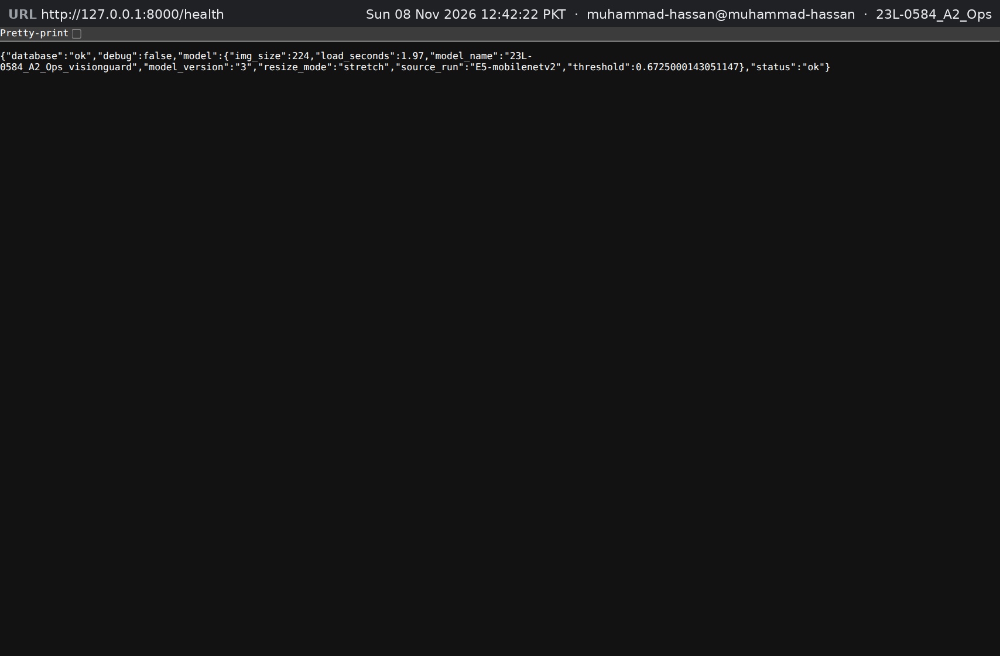

# Chapter 5 — Database Trail (8 marks)

## 5.1 Design

The trail is the SQLAlchemy 2 `predictions` table in `src/visionguard/web/db.py`. I designed it to answer what was decided, when, by which model and how confidently:

- `label` (`ai` or `real`, indexed) and raw `p_ai` show the decision and how close it was;
- indexed UTC `created_at`, filled with `datetime.now(UTC)`, makes laptop and cloud times comparable;
- `model_name` and `model_version` identify `23L-0584_A2_Ops_visionguard`, `3`, and therefore its training run;
- `confidence` and the active `threshold` keep an old P(AI), such as 0.68, interpretable after a threshold change.

`filename`, `image_format`, `width`, `height` and `file_size` describe the input. `latency_ms` records prediction time, `source` records `local` now and `remote-api` for Task 8, and `id` drives `/result/<id>`.

`DATABASE_URL` selects SQLite locally and PostgreSQL (`postgresql+psycopg://…`) for Task 6. `pool_pre_ping` replaces a dropped connection, and SQLite uses `check_same_thread=False` because gunicorn's four threads share the engine. `create_all` creates the schema only when it is absent. I store neither image bytes nor client IP addresses: the sanitised filename is the only user-provided text, which is enough for this trail.

## 5.2 Logging every request

The `/predict` view writes every successful verdict, so predictions cannot bypass the trail. After `predict_bytes()`, it builds a `PredictionRecord` from validated image details, the `Prediction` values, and the predictor's `source`. `Database.add()` uses `session.begin()`, committing the insert or rolling it back on failure. The new `id` becomes “Verdict #id”, and the view logs it with the filename, label, confidence and total time.

Rejected 415, 413 and 400 uploads do not reach the model, so they are logged with a reason rather than stored as decisions. If insertion fails, the user gets the friendly 500 page instead of a verdict without a trail entry.

## 5.3 History page

Figure 5.1 shows History after the capture session. Its `GROUP BY label` totals are 7 predictions, 3 AI and 4 real. Rows are newest first, 20 per page, with Newer/Older links as needed. Each row gives the UTC time, filename with format and size, coloured decision, confidence, P(AI), threshold, model and version, latency, and source. The uploads were made at 07:41 UTC, or 12:41 PKT.

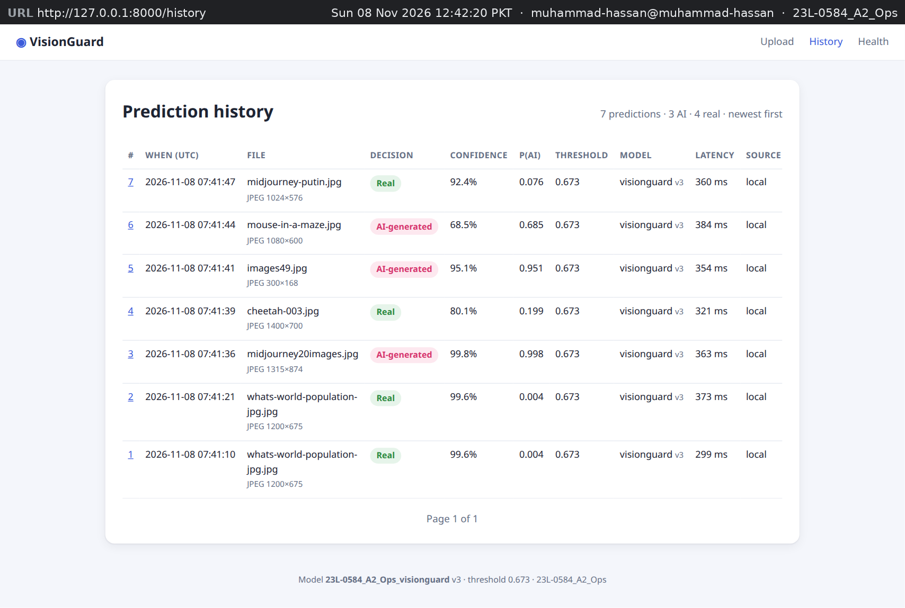

Each id links to `/result/<id>`. Figure 5.2 reopens record 7 with the same verdict, values and model as Figure 4.9. It says “Image not stored (only the verdict is kept)”, confirming that the image was not saved.

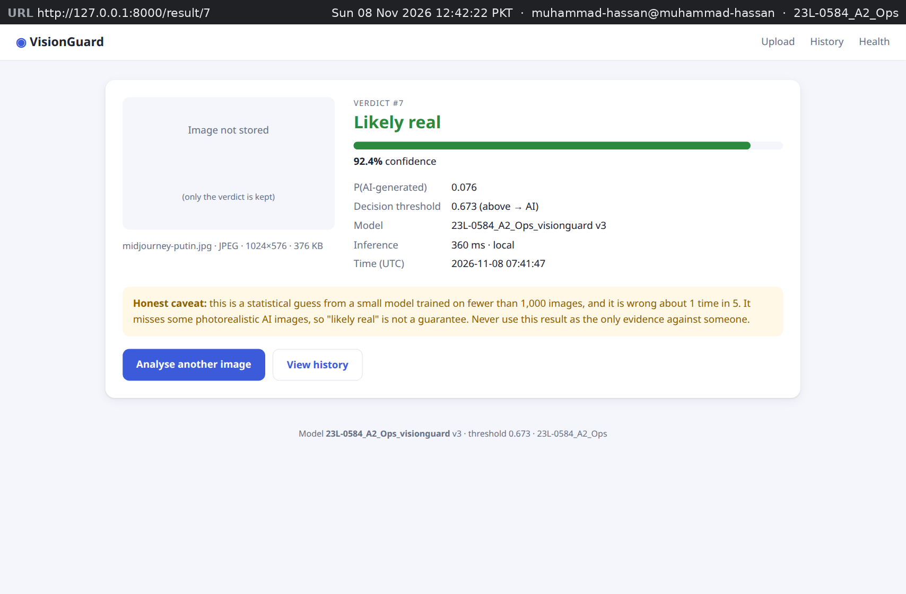

## 5.4 Querying the trail

Figure 5.3 shows direct commands against the local SQLite file. The `sqlite3` query returns the same seven rows as History. `.schema predictions` lists 15 `NOT NULL` columns and indexes `ix_predictions_label` and `ix_predictions_created_at`, which support label totals and time-window questions. `ls -la instance/` shows only `visionguard.db` (16 KB), not uploaded images.

Row 1 duplicates row 2 because I uploaded `whats-world-population-jpg.jpg` twice during capture. Both have P(AI) 0.004, showing deterministic prediction; only latency differs, 299 ms versus 373 ms in Figure 5.1. Once the Compose stack exists, the same query can use `psql` against PostgreSQL because the app relies on SQLAlchemy and `DATABASE_URL`.

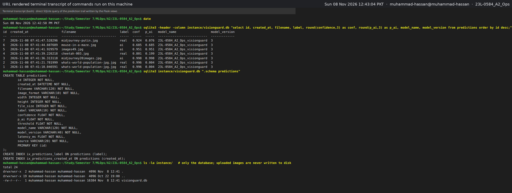