# Chapter 6 — Containerization with Docker and Docker Compose (14 marks)

Every figure in this chapter is a rendered transcript, not a desktop screenshot. I ran the commands on this machine on Sun 08 Nov 2026 between 14:10 and 14:35 PKT. I saved their exact output in `reports/evidence/task6/*.txt` and turned each file into an image with `scripts/render_transcripts.py`. The grey bar at the top of each image names the transcript file. The prompt line shows `user@host` and the working folder, and the first command of each transcript is `date`. The GitHub Actions evidence in Section 6.6 comes from the `gh` command-line client, and I give the run URLs so the runs can be opened on GitHub.

## 6.1 Docker warm-up

Before I packaged VisionGuard, I practised each basic Docker action on the small ready-made image `nginx:alpine`.

**Pull and inspect.** `docker pull nginx:alpine` downloads the image, and `docker images nginx` lists it at 63 MB. `docker image history` lists its layers (Figure 6.1). Most of them are 0 B metadata steps (`ENV`, `CMD`, `EXPOSE`). The real content is one 50.2 MB `RUN` layer that installs nginx, plus a few small `COPY` layers for start-up scripts.

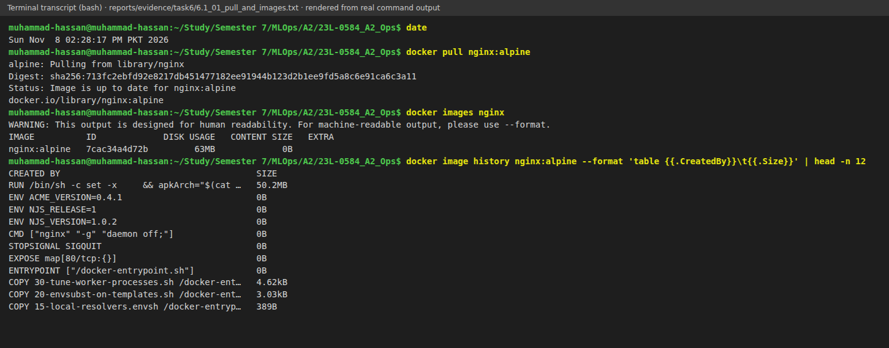

**Run, map a port, mount a folder.** I wrote a one-line page, `<h1>23L-0584_A2_Ops docker warm-up</h1>`, into `/tmp/vg-warmup-site`. Then I ran `docker run -d --name vg-warmup -p 8081:80 -v /tmp/vg-warmup-site:/usr/share/nginx/html:ro nginx:alpine`. `-d` runs the container in the background. `-p 8081:80` publishes nginx's port 80 on host port 8081. `-v …:ro` mounts my folder over nginx's web root, read-only, so the container cannot change my files. In Figure 6.2, `curl localhost:8081` returns my page and `docker port` confirms the mapping.

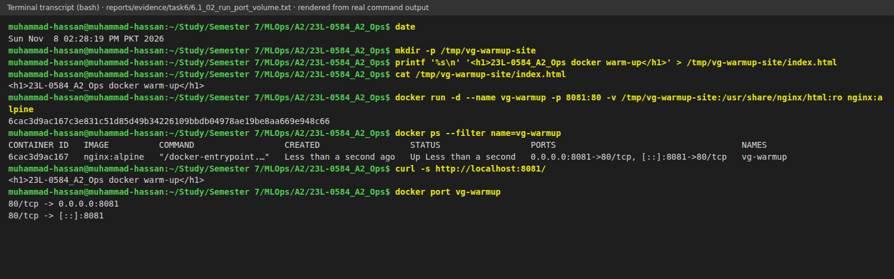

**Volumes.** I added a line to the page on the host. The next `curl` showed it without a restart (Figure 6.3), because a bind mount is the host folder itself, not a copy. I also created a named volume, `vg-warmup-data`. One throw-away `alpine` container (`--rm`) wrote `persisted` into it, and a second one read the text back. The data outlived the container that wrote it.

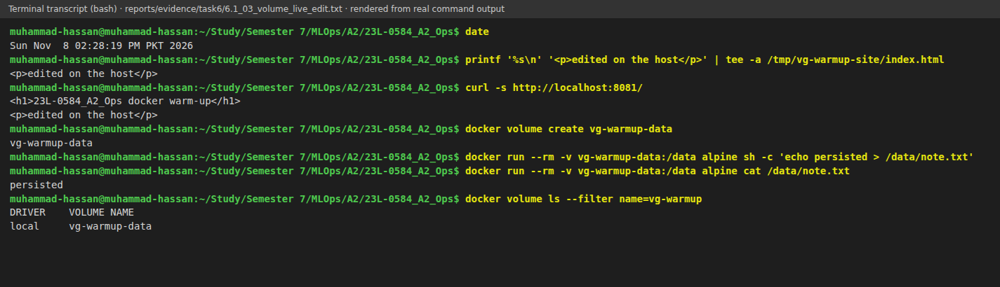

**Logs.** `docker logs vg-warmup` prints what the container wrote to stdout and stderr. In Figure 6.4 these are nginx's start-up notices and the access-log lines of my two `curl` requests. The response sizes are 40 and 66 bytes, before and after the edit.

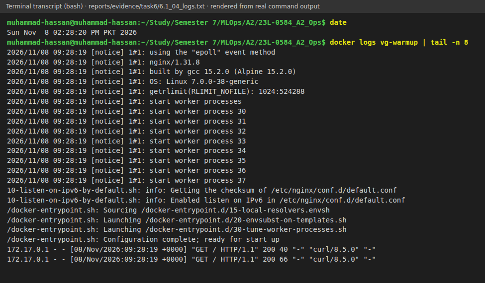

**Shell inside.** `docker exec vg-warmup sh -c '…'` runs commands inside the running container (Figure 6.5). The user is `root`, the hostname is the container ID `6cac3d9ac167`, and the system is Alpine Linux with my `index.html` and nginx 1.31.8. The process runs as root inside this image. That is one reason my own image uses a non-root user (Section 6.2).

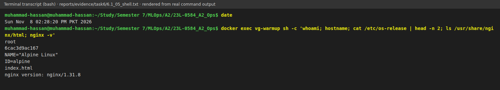

**List and remove.** `docker ps -a` lists the container. I removed it with `docker stop` and `docker rm`, the named volume with `docker volume rm`, and the helper image with `docker rmi alpine` (Figure 6.6). The empty listings afterwards confirm the clean-up.

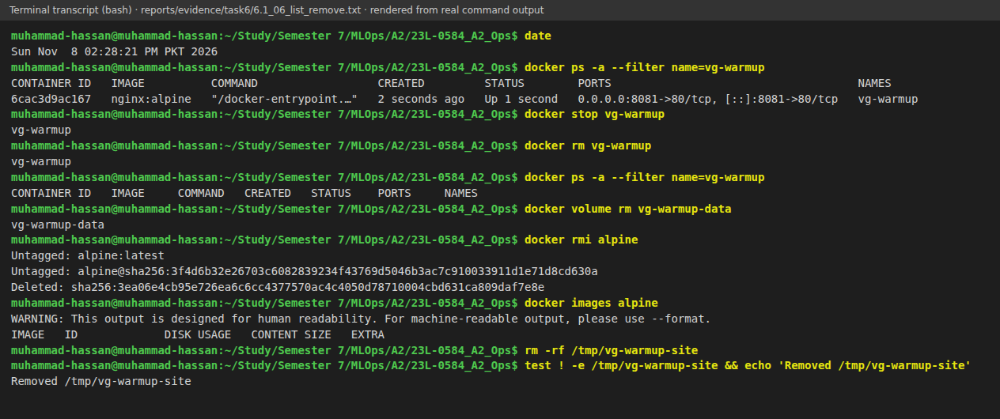

### Definitions in my own words

- **Image:** a read-only package with the filesystem, programs and settings needed to start some software. It is a template, for example `nginx:alpine`.
- **Container:** an isolated, runnable instance created from an image. It has its own processes, hostname and a thin writable layer on top of the image. `vg-warmup` was one.
- **Layer:** one cached filesystem change made by one build instruction. An image is a stack of layers, as the history in Figure 6.1 shows, and images can share identical layers.
- **Volume:** storage that lives outside a container's own filesystem, so the data stays when the container is removed. A named volume is managed by Docker; a bind mount is a host folder.
- **Port mapping:** a rule that forwards a port on the host to a port inside a container, so programs outside Docker can reach the service. Without it, the port is reachable only from containers on the same network.

### What went wrong

My first `docker pull` stopped with a TLS handshake timeout. A retry worked, so when I recorded Figure 6.1 the image was already local ("Image is up to date").

## 6.2 Dockerfile for the web app

The image is defined in [`Dockerfile`](https://github.com/MHassanAbaid24/23L-0584_A2_Ops/blob/main/Dockerfile), with [`.dockerignore`](https://github.com/MHassanAbaid24/23L-0584_A2_Ops/blob/main/.dockerignore) and [`requirements-serve.txt`](https://github.com/MHassanAbaid24/23L-0584_A2_Ops/blob/main/requirements-serve.txt).

**Base image.** I used `python:3.12-slim`, the same Python minor version as my training environment (3.12.3). Slim Debian has no compilers or documentation, but it uses glibc. The TensorFlow wheels are built for glibc and do not support Alpine's musl, so the smaller `python:3.12-alpine` was not an option.

**TensorFlow package.** I chose `tensorflow-cpu==2.20.0` (a 259 MB wheel) instead of `tensorflow` (621 MB, CUDA-capable). The server has no GPU, so the CUDA support would only add size. The CPU build has the same Python API and loads the same `.keras` file. `requirements-serve.txt` holds only what serving needs, pinned to the versions that trained the champion. Training extras (mlflow, keras-tuner, dvc, scikit-learn, matplotlib) are left out, because every extra package adds size and attack surface.

**Instruction order and the layer cache.** Docker builds an image one instruction at a time and caches the layer each instruction produces. On a rebuild it reuses a cached layer if the instruction and its inputs are unchanged and all layers before it were reused. For `COPY`, the inputs are the checksums of the copied files. The first changed layer and every layer after it are rebuilt. So I ordered the instructions from least to most often changed:

1. `FROM`, `ENV`, `WORKDIR`, and creating the user;
2. `COPY requirements-serve.txt`, then `RUN pip install --no-cache-dir -r requirements-serve.txt`;
3. `COPY gunicorn.conf.py` and `COPY src`;
4. `USER`, `EXPOSE`, `HEALTHCHECK` and `CMD`.

The dependency layer is 1.61 GB and the source layer is 67.7 kB (Figure 6.10). A code edit changes only the checksums of `src`, so Docker reuses the 1.61 GB layer and copies 67.7 kB again. If `src` were copied before the install, every code edit would reinstall TensorFlow.

**Environment.** `PYTHONUNBUFFERED=1` sends log lines to `docker logs` immediately. `PYTHONDONTWRITEBYTECODE=1` stops Python from writing `.pyc` files. `PYTHONPATH=/app/src` makes `visionguard` importable without a packaging step. `KERAS_HOME=/tmp/.keras` is needed because the `app` user cannot write to its home folder `/app`.

**Non-root user.** The Dockerfile creates a system user `app` with the fixed UID and GID 10001 and no login shell. `USER app` comes before `CMD`, so gunicorn and every `docker exec` run without root rights. If the app were compromised, the attacker would not be root inside the container. The fixed UID makes it easy to give mounted files the right permissions. Only `/app/instance` is made writable by `app`. Figure 6.7 shows `whoami` → `app` and `id` → `uid=10001(app)`.

**Health check.** `HEALTHCHECK` requests `http://127.0.0.1:8000/health` with Python's `urllib`. The slim image has no `curl`, and installing it only for this would add a package. The check runs every 30 s with a 5 s timeout and 3 retries. The 90 s start period covers the TensorFlow import and the model load; failures during that time do not count. `/health` returns 503 when the database ping fails, so "healthy" means both the model and the database work.

**Ignore file and secrets.** `.dockerignore` excludes `.env` and `.env.*` (except `.env.example`), `.git`, `.venv`, `data`, `models`, `reports`, `tests`, `scripts` and more. The build context is then only `requirements-serve.txt`, `gunicorn.conf.py` and `src/`. This keeps the context small, and it means the DagsHub token in `.env` cannot be copied into a layer by mistake. No `ENV` or `ARG` line holds a secret; passwords and `SECRET_KEY` arrive as environment variables at run time (Section 6.3). In Figure 6.7, `ls -a /app` lists only `gunicorn.conf.py`, `instance`, `requirements-serve.txt` and `src`: no `.env` and no model.

`CMD` starts gunicorn in exec form, so gunicorn is process 1 and receives the stop signal from `docker stop` directly. The final image is 1.73 GB and reports TensorFlow 2.20.0, Keras 3.15.1 and no GPU.

![Figure 6.7 — The 1.73 GB image; whoami → app and id → uid=10001(app); ls -a /app shows only gunicorn.conf.py, instance, requirements-serve.txt and src; TensorFlow 2.20.0, Keras 3.15.1, GPUs []; the health check (30 s interval, 5 s timeout, 90 s start period, 3 retries). Rendered transcript.](../reports/screenshots/task6/6.2_01_build_and_user.png)

### What went wrong

- The first build failed after 14 minutes with a PyPI read timeout while it downloaded the TensorFlow wheel. I added `PIP_DEFAULT_TIMEOUT=120` and `PIP_RETRIES=10`, and the retry built in 3 min 43 s.
- Docker on this machine has no buildx plugin, so `--progress=plain` was rejected and the local builds used the legacy builder. That is why the layer history shows `#(nop)` lines. CI uses BuildKit through `docker/setup-buildx-action`.
- My first evidence command used nested shell quoting that silently broke the TensorFlow version line. I recorded it again with plain `--entrypoint` commands (Figure 6.7).

## 6.3 Compose stack

The stack is defined in [`compose.yaml`](https://github.com/MHassanAbaid24/23L-0584_A2_Ops/blob/main/compose.yaml), with the template [`.env.example`](https://github.com/MHassanAbaid24/23L-0584_A2_Ops/blob/main/.env.example). I set `name: vg-23l-0584`, so the containers, the network and the volume get predictable names.

**db** uses `postgres:16-alpine`. Alpine is fine for the database, because the musl problem from Section 6.2 only affects the TensorFlow wheels. The database files live in the named volume `pgdata`, so they survive `docker compose down` and image rebuilds; only `down -v` deletes them. The health check runs `pg_isready -U visionguard -d visionguard` every 5 s (timeout 3 s, 10 retries, 10 s start period). A started container is not yet a ready database, because PostgreSQL initialises itself on first start. `pg_isready` asks the server whether it accepts connections, which is exactly what `web` needs. The service has no `ports:` section.

**web** builds from `.` and tags the image `23l-0584-a2-ops-web:latest`. `depends_on: db: condition: service_healthy` makes Compose wait for that health check. Figure 6.8 shows the order: db Started → Waiting → Healthy, and only then web Starting. The database address is `DATABASE_URL=postgresql+psycopg://visionguard:${POSTGRES_PASSWORD}@db:5432/visionguard`. Its host is `db`, the service name. Compose puts both containers on the project network `vg-23l-0584_default`, and its internal DNS resolves each service name to that container's address. Only `web` publishes a port (`8000:8000`). Both services use `restart: unless-stopped`.

In Figure 6.8, `docker compose ps` shows both services `Up (healthy)`: db with only `5432/tcp`, web with `0.0.0.0:8000->8000/tcp`. `/health` reports database ok, debug false and model version 3 (loaded in 2.35 s).

**Database port closed from outside.** Figure 6.9 gives the proof. `docker compose port db 5432` prints `:0`, so there is no host binding. `docker inspect` shows `PortBindings={}` for db and only `ExposedPorts 5432/tcp`. An exposed port is only declared by the image and is reachable on the internal network; web, in contrast, has a binding for 8000. A complication: on this host, port 5432 is already published by an unrelated container, `votesphere-db`, from another project (last line of the `docker ps` output). A test like "connect to localhost:5432" would have reached that other database and proved nothing. So I proved closure from the binding tables instead.

The same figure shows that the internal path works. From inside web, a socket to `db:5432` reaches 172.22.0.2. `docker network inspect` confirms that 172.22.0.2 is the db container (web is 172.22.0.3). The database stays private because only web needs it; a published port would expose it to the network with the password as its only protection. For maintenance I use `docker compose exec db psql` (Section 6.5).

**Passwords.** `POSTGRES_PASSWORD` and `SECRET_KEY` live in the untracked `.env` file. Git ignores it through line 2 of `.gitignore`. I generated both values with `secrets.token_hex`. `.env.example` is in Git and lists the variable names with empty values and a command to generate them. `${POSTGRES_PASSWORD:?set POSTGRES_PASSWORD in .env}` makes Compose refuse to start with that message when the value is missing, instead of starting PostgreSQL without a password. Compose reads `.env` only to fill the `${…}` placeholders. Each container receives only the variables listed under its `environment:`, so the DagsHub tokens that are also in `.env` never reach a container. PostgreSQL stores the password when its volume is first initialised. Changing it later needs `ALTER USER` or `down -v`, which matters in Section 6.5.

**The model file.** I mount the model read-only with `./models:/app/models:ro` and set `MODEL_PATH=/app/models/champion.keras`. I did not build it into the image, for three reasons:

- To deploy a new champion, I re-export it with `scripts/export_champion.py` and restart web. No image rebuild is needed.
- The image stays generic, and CI can build it. `models/` is not in Git, so CI could not bake the model in anyway.
- Each image version is 25 MB smaller.

The trade-off is that the host must have the file. A missing file is caught at start-up, because the app loads the model once in `create_app()` (Section 4.1) and fails fast; the container then never reports healthy. The `:ro` flag stops the app from changing the model. Three later variables in `compose.yaml` (`INFERENCE_MODE`, `MODEL_API_URL`, `MODEL_API_KEY`) belong to Task 8. They default to local inference and play no part in this chapter.

## 6.4 Image analysis

Figure 6.10 shows the layer history of the final image. The largest layer by far is `pip install`, at 1.61 GB. My source code is 67.7 kB. Inside the dependency layer, `tensorflow` takes 1.2 GB, followed by pandas (72 MB), clang (62 MB, the `libclang` bindings that TensorFlow requires), numpy (43 MB) and keras (30 MB). TensorFlow and its dependencies make up almost the whole image.

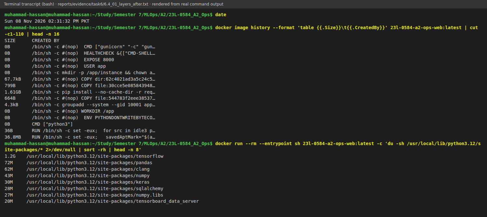

**Optimisation: `--no-cache-dir`.** By default, pip keeps every downloaded wheel in `~/.cache/pip`. In a Docker build, that cache is written in the same `RUN` step and frozen into the layer. It is never used again, because the image never reinstalls anything. To measure the effect, I built [`docker/Dockerfile.before`](https://github.com/MHassanAbaid24/23L-0584_A2_Ops/blob/main/docker/Dockerfile.before). Apart from comment lines, its only difference is the missing flag, as the `diff` in Figure 6.11 shows. Table 6.1 compares the two images.

**Table 6.1 — Image size before and after `--no-cache-dir`**

| | Before (`docker/Dockerfile.before`) | After (`Dockerfile`) |
|---|---|---|
| Image size | 2,097,435,883 bytes (2.1 GB) | 1,728,429,175 bytes (1.73 GB) |
| `pip install` layer | 1.98 GB | 1.61 GB |
| `/root/.cache/pip` | 355 MB | absent |

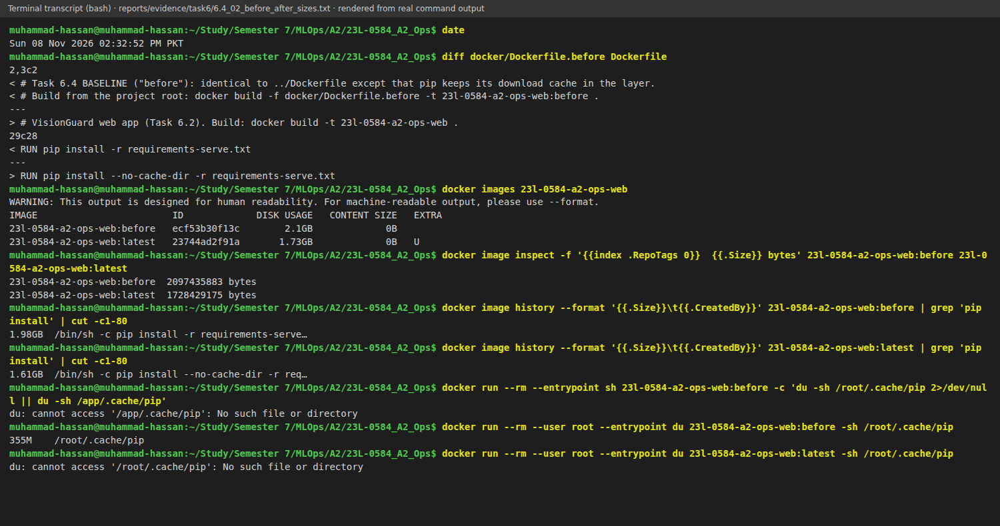

The image shrank from 2.1 GB to 1.73 GB, a saving of 369 MB (17.6 %). The pip cache was dead weight. The rest of the size is TensorFlow itself, so a further large cut would need a lighter runtime. One option is a TFLite model with the TFLite interpreter instead of full TensorFlow at serving time. This is the route the cloud API in Chapter 7 takes.

### What went wrong

My first `du` on the before image ran as `app` and looked in the wrong home folder. pip ran as root during the build (`USER app` comes later), so the cache is under `/root`. I repeated the command with `--user root` (Figure 6.11).

## 6.5 Operations and troubleshooting

**Start, stop, restart.** In Figure 6.12, `docker compose stop web` leaves web `Exited (0)` while db stays healthy. `docker compose start web` again waits for db to be healthy before starting web. After `docker compose restart db`, both services are up and healthy. Web did not need a restart of its own. Its SQLAlchemy engine uses `pool_pre_ping=True`, which tests each pooled connection before use and replaces dead ones.

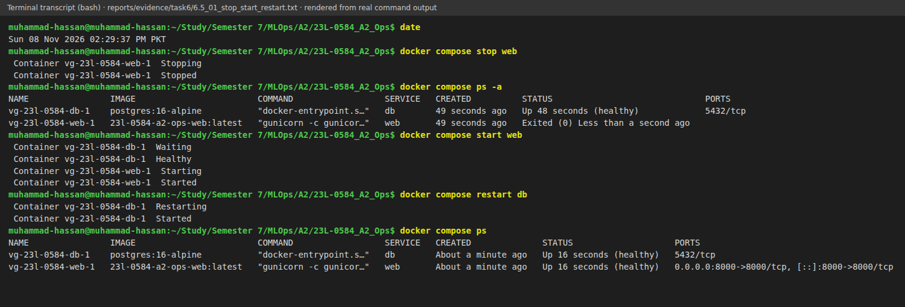

**Logs and shells.** Figure 6.13 starts with an upload from the host (`POST /predict` → HTTP 200). The web log shows the health-check requests (`Python-urllib`), the app's line `prediction id=1 … label=ai conf=0.998 total=405ms`, and the access-log line from 172.22.0.1, the network gateway that my host request came through. The db log shows the restart ("shut down", then "ready to accept connections"). A shell in web shows user `app`, folder `/app` and the mounted `champion.keras` and `serving_config.json`. `psql` in db shows the row the containerised app wrote: label ai, confidence 0.998, model `23L-0584_A2_Ops_visionguard` v3, source `local`.

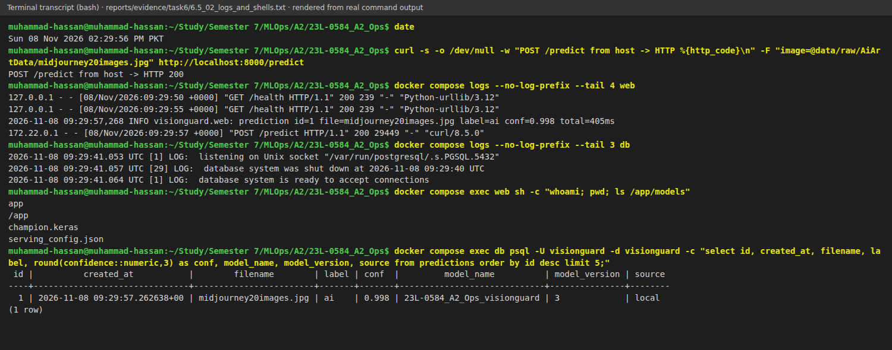

**Breaking it on purpose.** I ran `env POSTGRES_PASSWORD=not-the-real-password docker compose up -d --no-deps web`. A shell variable takes precedence over `.env` when Compose fills the placeholders, so web's `DATABASE_URL` carried a wrong password. `--no-deps` recreated only web. The db container kept the real password, which PostgreSQL had stored in the volume at first initialisation. The only visible symptom was the status `Restarting (3)` (Figure 6.14), and that status does not say why.

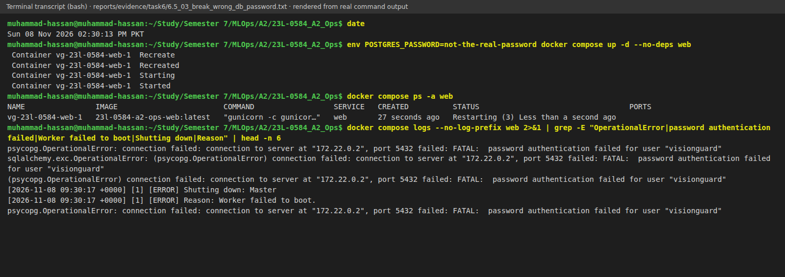

**Diagnosis from the logs only.**

1. The web log (Figure 6.14) shows `connection to server at "172.22.0.2", port 5432 failed: FATAL: password authentication failed for user "visionguard"`, then gunicorn's `Worker failed to boot`. The name `db` resolved and the connection reached the server, so the network was fine; the server refused the login. The app failed at boot because `create_app()` creates the schema at start-up.
2. The db log (Figure 6.15) shows the same `FATAL` line, with `DETAIL` naming the `pg_hba.conf` rule `host all all all scram-sha-256`. The password check for a network client failed.
3. `psql` inside db answers `select 1`, so the database itself is up. The fault is the client's credential.

**Fix.** I ran `docker compose up -d --no-deps web` without the override. Web was recreated with the `.env` value, both services were healthy again, and `/health` returned ok (Figure 6.15).

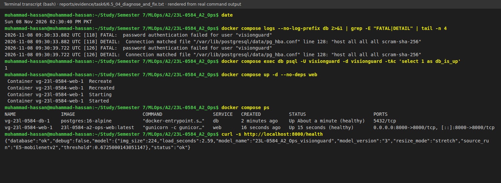

## 6.6 Tool lab: GitHub Actions (CI)

**Toy.** I made a public throw-away repository, <https://github.com/MHassanAbaid24/23L-0584_A2_Ops_ci_toy>. It has `calc.py` (`add`, `mean`, `multiply`) and `test_calc.py` with four pytest tests. Its workflow runs on every push and pull request. One job, `test`, uses a matrix `python-version: ["3.11", "3.12"]`, so GitHub starts one runner per version. I set `fail-fast: false`, so a failure on one version does not cancel the other and I see both results. The steps are checkout, `setup-python` with the pip cache, `pip install -r requirements.txt` and `pytest -v`.

The first commit, "Add CI toy with deliberate failing test", contained `assert add(2, 2) == 5`. [Run 42465926045](https://github.com/MHassanAbaid24/23L-0584_A2_Ops_ci_toy/actions/runs/42465926045) failed on both versions with `assert 4 == 5` (Figure 6.16). The commit "Fix deliberately failing test" triggered [run 42466069364](https://github.com/MHassanAbaid24/23L-0584_A2_Ops_ci_toy/actions/runs/42466069364), which was green on 3.11 (10 s) and 3.12 (11 s) (Figure 6.17).

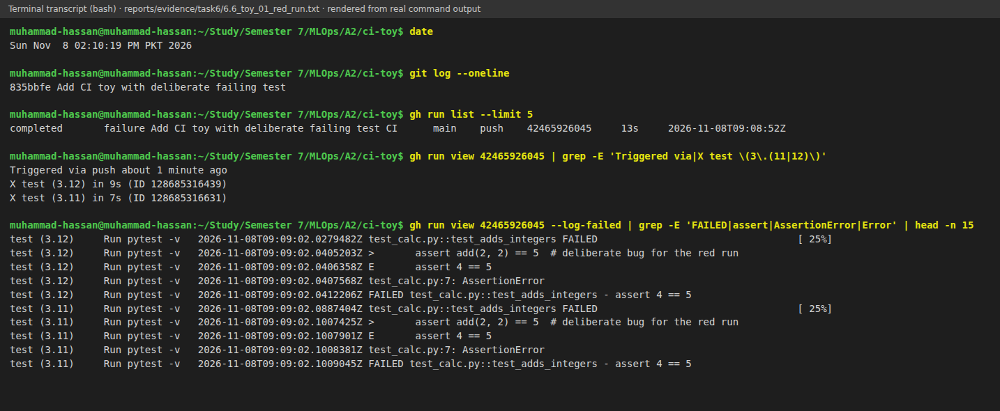

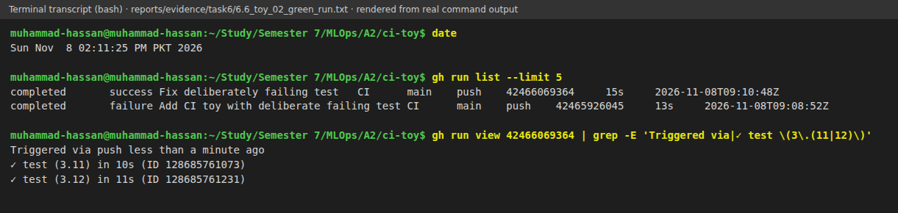

**VisionGuard workflow.** [`.github/workflows/ci.yml`](https://github.com/MHassanAbaid24/23L-0584_A2_Ops/blob/main/.github/workflows/ci.yml) runs on pushes and pull requests to `main` and has two jobs:

- `test` uses Python 3.12, the image's version, with the pip cache keyed on `requirements-serve.txt`. It installs the serving requirements, which are the same pins as the image (`tensorflow-cpu`). It also installs pytest and ruff, and runs `pip install --no-deps -e .` so the tests can import `visionguard`. Then it runs `ruff check src scripts labs tests` (rules E, F, I, B and UP from `pyproject.toml`) and `pytest -q`.
- `docker` has `needs: test`, so a commit with failing tests is never built. It builds the image with BuildKit (`docker/setup-buildx-action` and `docker/build-push-action`) with `push: false`. The job proves that the Dockerfile builds on a clean machine; no registry is needed yet. The layers are cached in the GitHub Actions cache (`type=gha, mode=max`), so an unchanged dependency layer can be reused across runs.

The tests in [`tests/`](https://github.com/MHassanAbaid24/23L-0584_A2_Ops/tree/main/tests) cover:

- preprocessing: shape, dtype and value range; grey, RGBA and palette images converted to RGB; pad versus stretch; decoding by content, not by file extension;
- validation: TIFF → 415, text → 400, truncated JPEG → 400, WEBP accepted;
- the Flask app, with a fake predictor and a temporary SQLite database: rows are written only on success, the filename is sanitised, history is newest first, an unknown result gives 404, and `/health` works;
- a real tiny saved Keras model loaded through `ChampionModel`.

To check that the tests catch real bugs, I temporarily changed the 415 to 400. `test_failed_uploads_do_not_create_prediction_records` then failed with `assert 400 == 415`.

The first project run, [run 42467537562](https://github.com/MHassanAbaid24/23L-0584_A2_Ops/actions/runs/42467537562), was green in 3m11s: test in 52 s and docker in 2 min 12 s (Figure 6.18). Ruff printed "All checks passed!" and pytest "14 passed, 2 warnings in 2.69s". Line 3 of `README.md` holds the CI status badge, which links to the workflow page and shows the result of the latest run. A later commit added `tests/test_remote.py`, so the suite now collects 18 tests.

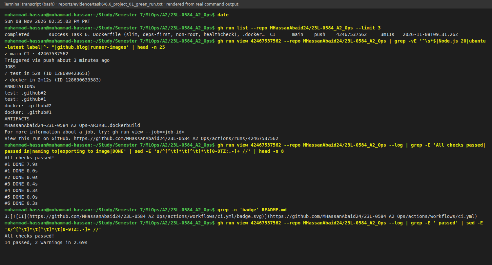

**Secrets.** This workflow needs no secrets. A future secret, such as a registry token, belongs in GitHub → Settings → Secrets and variables → Actions, and the workflow refers to it as `${{ secrets.NAME }}`. A comment in `ci.yml` says so. The workflow file is in Git: anyone who can read the repository or a fork can read it, and a value stays in the history even after it is deleted. Actions secrets are stored encrypted, given to the job only at run time, and masked in the logs.

### What went wrong

The toy's red run was deliberate. On the project run, GitHub added annotations (the `.github#1/#2` lines in Figure 6.18) saying that Node.js 20 actions are being forced to run on Node 24. This affects `checkout@v4`, `setup-python@v5`, `setup-buildx-action@v3` and `build-push-action@v6`. It is harmless for now; I will update the action versions later.
