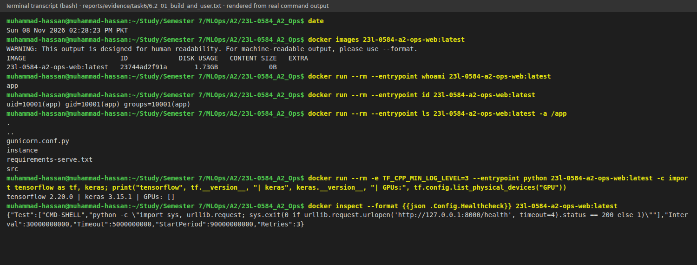
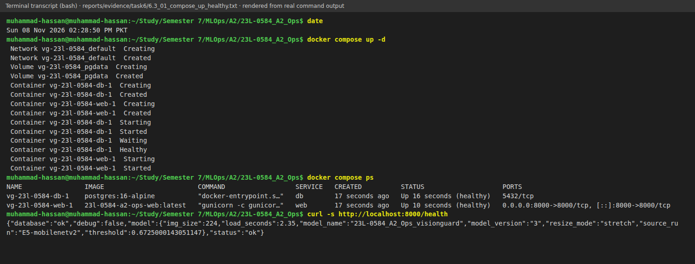
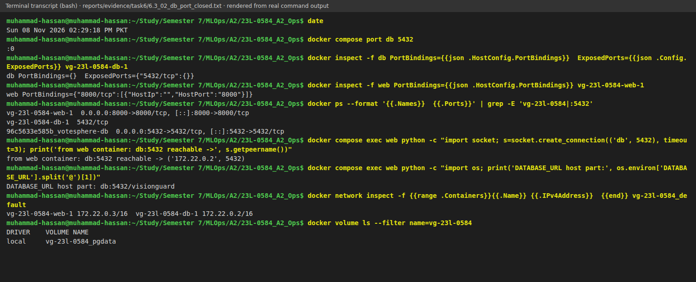

# Chapter 6 — Containerization with Docker and Docker Compose (14 marks)

Each figure is a rendered command transcript rather than a desktop screenshot. I saved the exact output in `reports/evidence/task6/*.txt`, rendered it with `scripts/render_transcripts.py`, and left the command context visible so the results can be checked.

## 6.1 Docker warm-up

Before packaging VisionGuard, I practised Docker with `nginx:alpine`.

**Pull and inspect.** `docker pull nginx:alpine` downloaded the image. `docker images nginx` listed it at 63 MB, while `docker image history` showed where that size came from. Figure 6.1 shows one 50.2 MB `RUN` layer, small `COPY` layers, and 0 B metadata instructions.

**Run, map a port, mount a folder.** I mounted a one-line page from `/tmp/vg-warmup-site` into nginx with `docker run -d --name vg-warmup -p 8081:80 -v /tmp/vg-warmup-site:/usr/share/nginx/html:ro nginx:alpine`. `-p` maps host port 8081 to nginx port 80, and `:ro` stops nginx changing my folder. Figure 6.2 shows that `curl localhost:8081` returned the page and `docker port` confirmed the mapping.

**Volumes and logs.** A host edit appeared in the next `curl` without restarting nginx because a bind mount is the host folder, not a copy. I also wrote `persisted` into `vg-warmup-data` from one throw-away `alpine` container and read it from another, which separates persistent data from a container's writable layer. Figure 6.3 shows both results. `docker logs vg-warmup` then showed nginx start-up and the two requests, with 40 and 66 byte responses, in Figure 6.4.

**Shell and clean-up.** In Figure 6.5, `docker exec vg-warmup sh -c '…'` shows that this image runs as `root`, on Alpine Linux, with nginx 1.31.8. I could also inspect the mounted `index.html` from there. That is why my own image uses a non-root user in Section 6.2. Finally, Figure 6.6 records `docker stop`, `docker rm`, `docker volume rm`, and `docker rmi alpine`; the empty listings confirm that I cleaned up.

### Definitions in my own words

- **Image:** a read-only package used to start software, such as `nginx:alpine`.
- **Container:** a running, isolated instance of an image with its own processes and writable layer.
- **Layer:** a cached filesystem change from one build instruction; Figure 6.1 shows their stack.
- **Volume:** storage outside a container. Docker manages named volumes, while bind mounts use a host folder.
- **Port mapping:** forwarding a host port to a container port so software outside Docker can reach it.

### What went wrong

My first `docker pull` hit a TLS handshake timeout. A retry worked, so Figure 6.1 says the image was already up to date.

## 6.2 Dockerfile for the web app

The image comes from [`Dockerfile`](https://github.com/MHassanAbaid24/23L-0584_A2_Ops/blob/main/Dockerfile), [`.dockerignore`](https://github.com/MHassanAbaid24/23L-0584_A2_Ops/blob/main/.dockerignore), and [`requirements-serve.txt`](https://github.com/MHassanAbaid24/23L-0584_A2_Ops/blob/main/requirements-serve.txt).

**Base image and packages.** I used `python:3.12-slim`, matching my 3.12.3 training environment. Slim Debian omits compilers and documentation but retains glibc. TensorFlow wheels need glibc, so `python:3.12-alpine` was not suitable. The server uses `tensorflow-cpu==2.20.0`, a 259 MB wheel, rather than the 621 MB CUDA-capable package because it has no GPU. The CPU package has the same Python API and loads the same `.keras` model. Serving dependencies are pinned in `requirements-serve.txt`; training-only tools are left out.

**Cache order.** Docker caches each instruction and invalidates the changed layer and everything after it. I copy `requirements-serve.txt` and install dependencies before copying `gunicorn.conf.py` and `src`, then set `USER`, `EXPOSE`, `HEALTHCHECK`, and `CMD`. This puts the files that change least near the start of the build. Figure 6.10 shows why: the dependency layer is 1.61 GB and source is 67.7 kB, so a code change only copies the source layer rather than reinstalling TensorFlow. If source came first, its changed checksum would invalidate the installation too.

`PYTHONUNBUFFERED=1` sends logs straight to `docker logs`; `PYTHONDONTWRITEBYTECODE=1` avoids `.pyc` files; `PYTHONPATH=/app/src` makes `visionguard` importable. `KERAS_HOME=/tmp/.keras` is writable by the application user.

**Least privilege and health.** The Dockerfile creates `app` with UID and GID 10001, makes only `/app/instance` writable, and switches with `USER app`. A compromised app therefore does not get root inside the container, and the fixed identity makes mounted-file permissions predictable. The health check uses Python's `urllib` against `/health`, avoiding an extra `curl` package. It runs every 30 s, with a 5 s timeout, 3 retries, and a 90 s start period for TensorFlow and model loading. A database failure makes `/health` return 503, so healthy means the model and database are both available. Figure 6.7 shows the 1.73 GB image, user `app`, TensorFlow 2.20.0, Keras 3.15.1, and no GPU.

`.dockerignore` excludes `.env`, `.git`, `.venv`, `data`, `models`, `reports`, `tests`, and `scripts`, so secrets cannot enter an image layer. `CMD` uses exec form, which lets gunicorn receive `docker stop` directly.

### What went wrong

The first build timed out downloading TensorFlow after 14 minutes. With `PIP_DEFAULT_TIMEOUT=120` and `PIP_RETRIES=10`, it built in 3 min 43 s. Local Docker lacked buildx, so `--progress=plain` failed and I used the legacy builder. I also re-recorded Figure 6.7 after nested shell quoting broke the TensorFlow version command.

## 6.3 Compose stack

[`compose.yaml`](https://github.com/MHassanAbaid24/23L-0584_A2_Ops/blob/main/compose.yaml) and [`.env.example`](https://github.com/MHassanAbaid24/23L-0584_A2_Ops/blob/main/.env.example) define the stack. `name: vg-23l-0584` gives its resources predictable names.

**Database and web service.** `db` uses `postgres:16-alpine` and stores data in `pgdata`, which survives `docker compose down`; only `down -v` removes it. Alpine is fine here because the TensorFlow glibc issue applies only to the web image. `pg_isready -U visionguard -d visionguard` checks readiness every 5 s with a 3 s timeout, 10 retries, and a 10 s start period. A started database is not necessarily ready after its first initialisation. `web` waits for that check through `depends_on: db: condition: service_healthy`, then connects to `db` on the internal `vg-23l-0584_default` network. Only web publishes `8000:8000`, and both services use `restart: unless-stopped`. Figure 6.8 shows db becoming healthy before web starts, followed by both services `Up (healthy)`.

**Private database.** Figure 6.9 shows `docker compose port db 5432` returning `:0` and `PortBindings={}`. The service exposes `5432/tcp` to the Compose network but not to the host; web can still reach `db:5432` at 172.22.0.2. Testing localhost would have been misleading because unrelated `votesphere-db` already owns host port 5432. For maintenance, I use `docker compose exec db psql` in Section 6.5.

**Passwords and model.** `POSTGRES_PASSWORD` and `SECRET_KEY` are in untracked `.env`; `.env.example` documents their names and generation command. `${POSTGRES_PASSWORD:?set POSTGRES_PASSWORD in .env}` stops Compose if the password is missing instead of starting PostgreSQL with a bad configuration. Only listed `environment:` values reach each container, so DagsHub tokens do not. PostgreSQL stores its first password in the volume, which is why changing it later requires matching the stored database state.

I mount `./models:/app/models:ro` and use `MODEL_PATH=/app/models/champion.keras`. This keeps the image generic, makes a new champion a restart rather than a rebuild, and keeps each image 25 MB smaller. A missing model makes `create_app()` fail at start-up; `:ro` prevents changes. `INFERENCE_MODE`, `MODEL_API_URL`, and `MODEL_API_KEY` belong to Task 8 and default to local inference.

## 6.4 Image analysis

Figure 6.10 confirms that `pip install` dominates the image at 1.61 GB; source is 67.7 kB. TensorFlow alone is 1.2 GB, ahead of pandas (72 MB), clang (62 MB), numpy (43 MB), and keras (30 MB). This is expected because TensorFlow brings native libraries and the runtime needed to load the model, while my application code is small.

**Optimisation: `--no-cache-dir`.** Pip's download cache is useless in a finished image, so the Dockerfile installs with this flag. Figure 6.11 compares it with [`docker/Dockerfile.before`](https://github.com/MHassanAbaid24/23L-0584_A2_Ops/blob/main/docker/Dockerfile.before), whose only functional difference is the missing flag. Table 6.1 gives the measurements.

**Table 6.1 — Image size before and after `--no-cache-dir`**

| | Before (`docker/Dockerfile.before`) | After (`Dockerfile`) |
|---|---|---|
| Image size | 2,097,435,883 bytes (2.1 GB) | 1,728,429,175 bytes (1.73 GB) |
| `pip install` layer | 1.98 GB | 1.61 GB |
| `/root/.cache/pip` | 355 MB | absent |

The image fell from 2.1 GB to 1.73 GB, saving 369 MB (17.6 %). TensorFlow now accounts for most of the remaining size; a larger cut would need a lighter runtime, such as the TFLite route used by the cloud API in Chapter 7.

### What went wrong

I first checked the cache as `app`, but pip had run as root during the build. Repeating `du` with `--user root` produced Figure 6.11.

## 6.5 Operations and troubleshooting

**Start, stop, restart.** Figure 6.12 shows that stopping web leaves db healthy. Starting web waits for db again, and restarting db leaves both services healthy. Web did not need its own restart. SQLAlchemy uses `pool_pre_ping=True`, so it tests pooled connections before reuse and replaces stale ones after the database restarts.

**Logs and shells.** In Figure 6.13, a host `POST /predict` returns HTTP 200. The web log records health checks, the request, and `prediction id=1 … label=ai conf=0.998 total=405ms`; the db log records its restart. The host reached the service through the network gateway, so its access-log address is 172.22.0.1. The shell confirms user `app` and the mounted model files, while `psql` shows prediction id 1 with the expected model version and source `local`.

**Broken password and diagnosis.** I ran `env POSTGRES_PASSWORD=not-the-real-password docker compose up -d --no-deps web`. The shell value replaced `.env` only for recreated web, while db retained its original volume password. Figure 6.14 shows only `Restarting (3)`, but its log reports a failed password authentication.

The web log showed that `db` resolved and accepted a connection, so the network was fine. The db log named `pg_hba.conf` and `scram-sha-256`, while `psql` inside db answered `select 1`; the client's credential was the fault, not the database. I removed the override and recreated web with the `.env` value. Figure 6.15 shows both services healthy and `/health` returning ok.

## 6.6 Tool lab: GitHub Actions (CI)

**Toy.** I made a public throw-away repository, <https://github.com/MHassanAbaid24/23L-0584_A2_Ops_ci_toy>, with `calc.py` and four pytest tests. Its workflow runs on pushes and pull requests with Python `["3.11", "3.12"]`; `fail-fast: false` keeps both results visible. It checks out the code, restores the pip cache, installs requirements, and runs `pytest -v`.

The deliberate `assert add(2, 2) == 5` made [run 42465926045](https://github.com/MHassanAbaid24/23L-0584_A2_Ops_ci_toy/actions/runs/42465926045) fail with `assert 4 == 5` on both versions, as Figure 6.16 shows. After fixing it, [run 42466069364](https://github.com/MHassanAbaid24/23L-0584_A2_Ops_ci_toy/actions/runs/42466069364) passed in 10 s on 3.11 and 11 s on 3.12 in Figure 6.17.

**VisionGuard workflow.** [`.github/workflows/ci.yml`](https://github.com/MHassanAbaid24/23L-0584_A2_Ops/blob/main/.github/workflows/ci.yml) runs on pushes and pull requests to `main`. Its `test` job uses Python 3.12, the image version, with a pip cache keyed by `requirements-serve.txt`. It installs serving pins, pytest, ruff, and `pip install --no-deps -e .`, then runs `ruff check src scripts labs tests` and `pytest -q`. The `docker` job needs `test`, then uses BuildKit and the GitHub Actions cache with `push: false`. A broken test therefore stops a clean-machine image build, while unchanged dependency layers can be reused across runs.

The tests cover preprocessing shape, dtype, and image formats; invalid and accepted uploads; the Flask app with a temporary SQLite database; and a tiny saved Keras model. They check that failed uploads create no rows, history is newest first, filenames are sanitised, and `/health` works. I changed the 415 response to 400 once; `test_failed_uploads_do_not_create_prediction_records` failed with `assert 400 == 415`, which showed that the status-code requirement was actually covered.

Figure 6.18 records [run 42467537562](https://github.com/MHassanAbaid24/23L-0584_A2_Ops/actions/runs/42467537562): green in 3m11s, with test in 52 s and docker in 2 min 12 s. It reported "All checks passed!" and "14 passed, 2 warnings in 2.69s". The README badge links to the workflow; after `tests/test_remote.py`, the suite collects 18 tests.

**Secrets.** This workflow needs none. A future registry token belongs in GitHub Actions secrets and appears as `${{ secrets.NAME }}`; a comment in `ci.yml` already records that approach. Unlike workflow text, which remains readable in Git history, secrets are encrypted, injected only at run time, and masked in logs.

### What went wrong

The toy failure was intentional. Figure 6.18 also has GitHub notices that Node.js 20 actions are forced onto Node 24 for `checkout@v4`, `setup-python@v5`, `setup-buildx-action@v3`, and `build-push-action@v6`; they did not affect the run.
