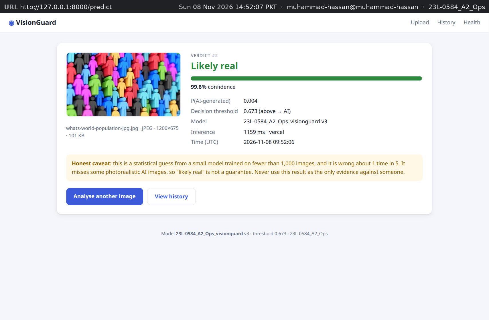
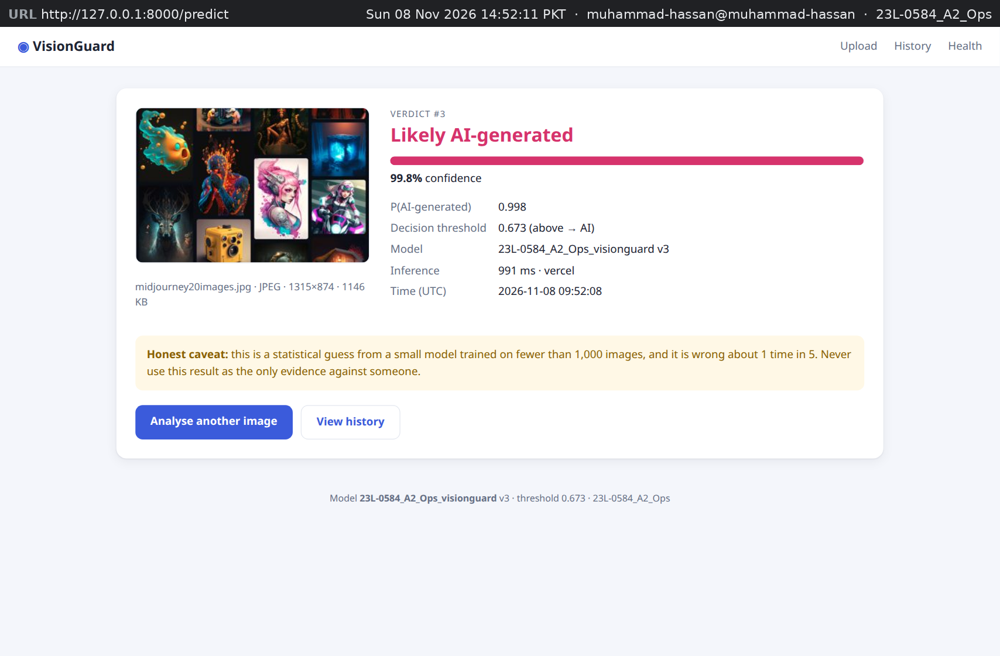
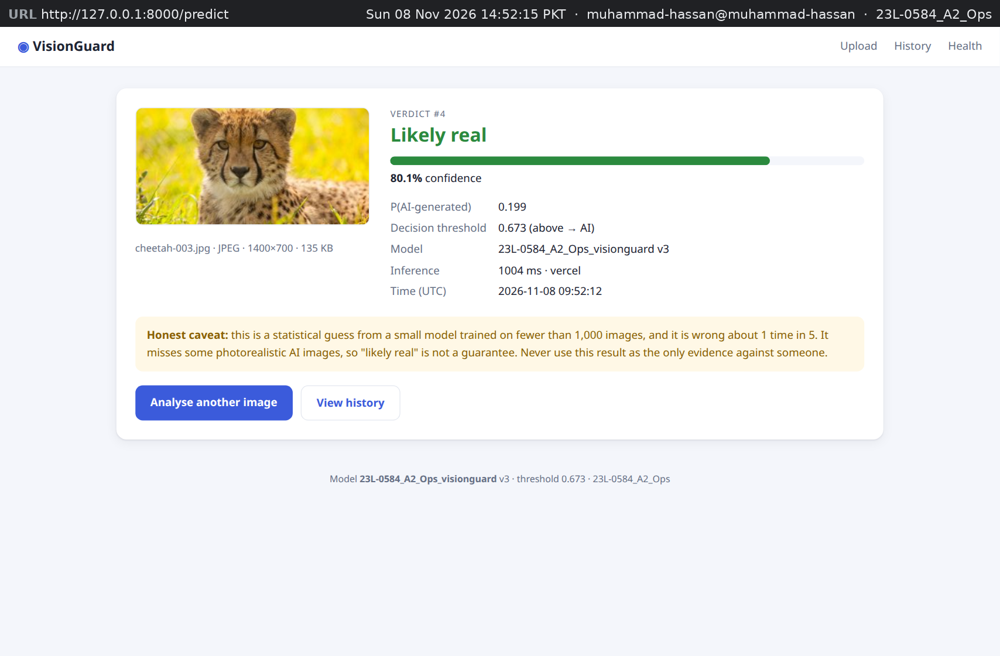
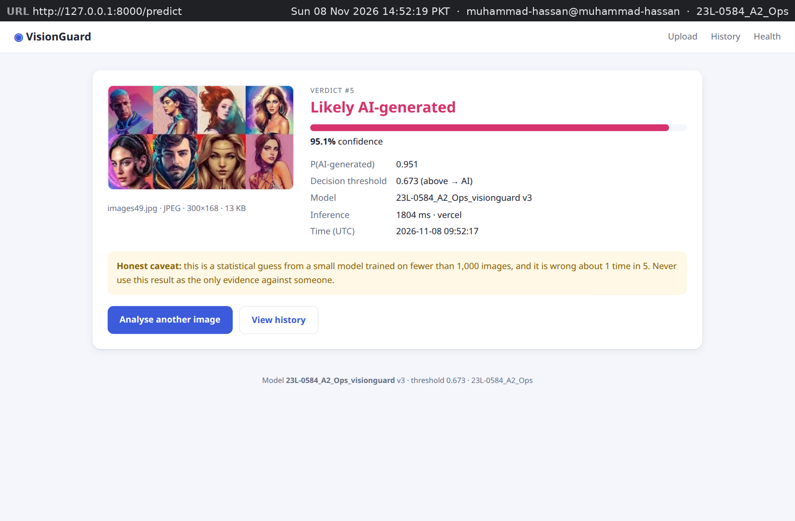
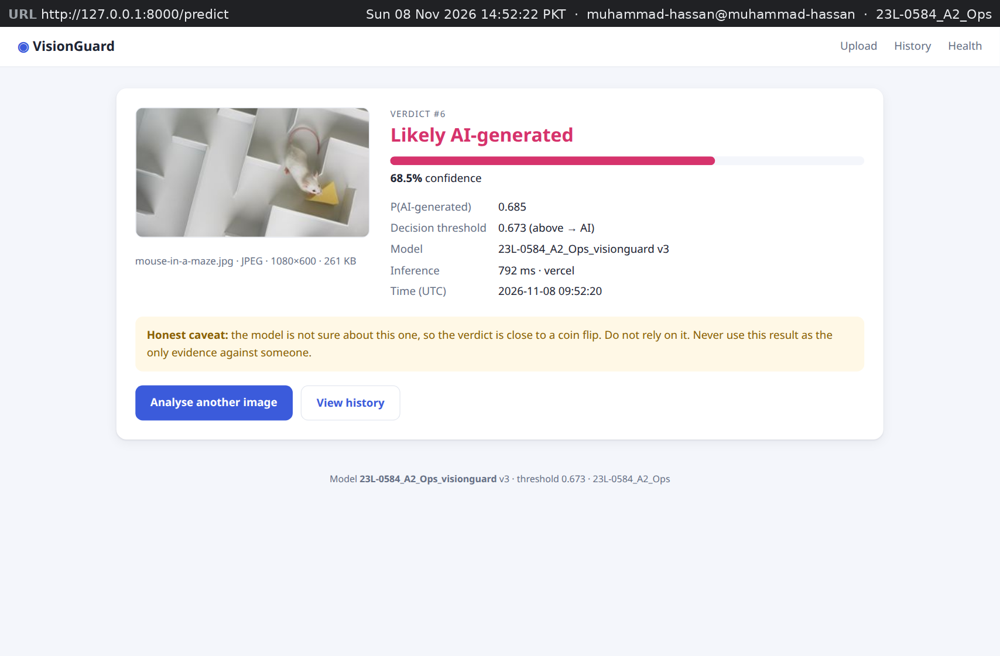
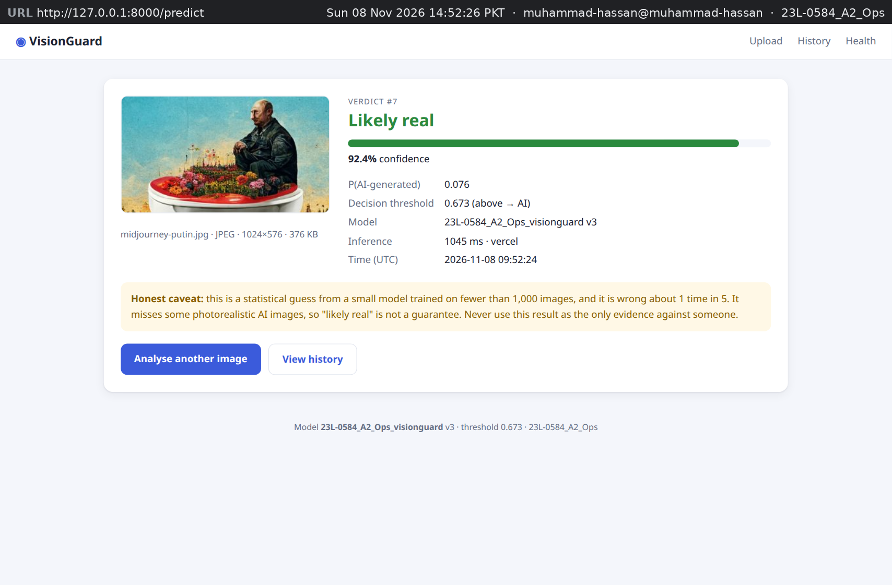

# Chapter 7 — API Deployment (15 marks)

**Model API URL: <https://23l-0584-a2-ops.vercel.app>**

- `GET` <https://23l-0584-a2-ops.vercel.app/api/health> is public and returns the deployed model's metadata.
- `POST` <https://23l-0584-a2-ops.vercel.app/api/predict> takes one image (multipart field `image`) and needs the header `X-API-Key: $MODEL_API_KEY`.

The brief asks for the model to be reachable from the public internet, on a cloud platform or Vercel. The Flask app itself keeps running on localhost and calls the hosted model (Chapter 8). The API lives in its own folder, [`cloud_api/`](https://github.com/MHassanAbaid24/23L-0584_A2_Ops/tree/main/cloud_api), which is the Vercel project root. The model export is [`scripts/export_tflite.py`](https://github.com/MHassanAbaid24/23L-0584_A2_Ops/blob/main/scripts/export_tflite.py).

Figures 7.1, 7.2, 7.4 and 7.5 are rendered transcripts, not desktop screenshots. On Sun 08 Nov 2026, between 14:35 and 14:48 PKT, I saved the exact output of the commands in `reports/evidence/task7/*.txt` and turned each file into an image with `scripts/render_transcripts.py`. The grey bar at the top of each image names the transcript file, and the first command is `date`. Figure 7.3 is a browser capture of the public URL. Its added context strip shows the URL, the time and `user@host`. No figure shows a secret: the API key and the Vercel token appear only as the variable names `$MODEL_API_KEY` and `$VERCEL_TOKEN`.

## 7.1 Choosing the platform and its limits

I had one hard constraint: no credit card. Oracle Cloud, AWS and Google Cloud ask for a card even for their free tiers. Azure for Students was not available to me. Hugging Face Docker Spaces now need a paid plan (their documentation, November 2026). Vercel's Hobby plan is free, signs up with a GitHub account and asks for no card. The brief also names Vercel, so I chose it.

Vercel does not run a long-lived server. It runs serverless functions: each request starts or reuses a short-lived function instance. Before writing any code, I read the platform's limits in the [Vercel Functions limits](https://vercel.com/docs/functions/limitations) and [Limits](https://vercel.com/docs/limits) pages. Table 7.1 lists the limits that shaped the design.

**Table 7.1 — Vercel Hobby limits and what each one meant for VisionGuard**

| Limit | Value | Consequence for the design |
|---|---|---|
| Python function bundle (uncompressed) | 500 MB | TensorFlow alone is about 1.2 GB installed (Figure 6.10), so the Keras model cannot be served as it is. I converted it to TFLite (Section 7.2). |
| Memory and CPU | 2 GB RAM, 1 vCPU | Enough for an 8,866,508-byte float32 TFLite model that handles one image per call. |
| Maximum duration | 300 s | A prediction takes milliseconds. I set `maxDuration: 30` in `vercel.json`, so a stuck request ends early. |
| Request body | 4.5 MB | The API accepts images up to 4 MB. That leaves room for the multipart wrapping, so an oversize image gets my JSON error. In Chapter 8, Flask sends a 224 px PNG of about 100 KB. |
| Persistent disk | none | A SQLite file written by the function would not survive. The API stores nothing. The database stays local, in the Compose stack's PostgreSQL. |

The last row decided the architecture. A function instance can disappear at any time, so anything it writes is lost. I therefore made the API stateless: it receives an image and returns a verdict. The prediction trail stays where Chapter 5 put it, in the local app's database. Vercel's lack of a disk then does not matter.

A public URL can be called by anyone. The prediction endpoint costs compute time, so it needs a secret: the `X-API-Key` header described in Section 7.3. The key is stored as a Vercel environment variable, `VG_API_KEY`, never in code. Locally, the same value is `MODEL_API_KEY` in the untracked `.env` file.

## 7.2 Making the model fit

The champion is the MobileNetV2 transfer model from run E5-mobilenetv2, registered as `23L-0584_A2_Ops_visionguard` version 3 (Section 3.6). In Keras form, it needs TensorFlow at serving time, and TensorFlow does not fit in 500 MB. TensorFlow Lite (TFLite) stores the same network as one flat file that a small interpreter can run without TensorFlow.

`scripts/export_tflite.py` loads `models/champion.keras` and converts it with `tf.lite.TFLiteConverter.from_keras_model`. It writes `cloud_api/model/champion.tflite` (8,866,508 bytes) and copies `serving_config.json` next to it. That config holds the threshold 0.6725, the image size 224, the resize mode `stretch`, the registered name, version 3 and the source run, so the API reads the same settings as the local app. I kept float32 weights and did not quantize. The file already fits with a large margin, and quantization would change the probabilities, so the threshold would need a new check.

To run the file on Vercel I used Google's `ai-edge-litert` 2.3.0, the stand-alone LiteRT (TFLite) interpreter. Its wheel is 21.8 MB, against about 1.2 GB for TensorFlow. [`cloud_api/requirements.txt`](https://github.com/MHassanAbaid24/23L-0584_A2_Ops/blob/main/cloud_api/requirements.txt) pins only four packages: `ai-edge-litert==2.3.0`, `Flask==3.1.3`, `numpy==1.26.4` and `Pillow==10.4.0`. The API decodes and resizes images with Pillow, because TensorFlow's image functions are not available there.

**Parity check.** A conversion error or a different resize could silently change predictions. The threshold of 0.6725 was chosen on validation for the Keras model (Section 2.5), so I needed proof that the decisions stay the same. I compared the two models on all 147 test images (Table 7.2). The first comparison feeds both models the same input tensor, so it tests only the conversion. The second compares the whole pipelines: Keras after TensorFlow's resize, as in training, against TFLite after Pillow's bilinear resize, as the API does it for a raw upload. The exporter prints this second comparison every time it runs.

**Table 7.2 — Keras vs TFLite on the 147 test images**

| Comparison | Result |
|---|---|
| Same input tensor: largest absolute difference in P(AI) | 3.2e-06 |
| Full pipeline (TF resize vs Pillow resize): mean absolute difference in P(AI) | 0.0048690 |
| Full pipeline: largest absolute difference in P(AI) | 0.0485432 |
| Decisions that change at the threshold 0.6725 | 0 |
| Test accuracy at 0.6725 | 0.7823 (Keras) and 0.7823 (TFLite) |

A difference of 3.2e-06 is float rounding, so the conversion is faithful. The two resize functions differ slightly, by up to 0.049 in P(AI). On the test set this never moved an image across the threshold, and the accuracy is identical. The difference is still real, and it is the reason why Flask does the resizing itself in Chapter 8.

## 7.3 The API

The API is one small Flask app, [`cloud_api/api/index.py`](https://github.com/MHassanAbaid24/23L-0584_A2_Ops/blob/main/cloud_api/api/index.py). Vercel's Python runtime serves its `app` object as a single function. [`cloud_api/vercel.json`](https://github.com/MHassanAbaid24/23L-0584_A2_Ops/blob/main/cloud_api/vercel.json) routes every `/api/(.*)` path to it. `includeFiles: "model/**"` bundles the model and config with the function, and `maxDuration` is 30 s. Table 7.3 gives the contract.

**Table 7.3 — API contract**

| Request | Status | JSON response |
|---|---|---|
| `GET /api/health` | 200 | `status`, `model_name`, `model_version`, `source_run`, `threshold`, `img_size`, `runtime` |
| `POST /api/predict` with a valid key and image | 200 | `label`, `confidence`, `p_ai`, `threshold`, `model_name`, `model_version`, `source_run`, `latency_ms`, `runtime` |
| Missing or wrong `X-API-Key` | 401 | `{"error": "Unauthorized."}` |
| Bytes that are not a decodable image | 400 | `{"error": "Image could not be decoded."}` |
| Image larger than 4 MB | 413 | `{"error": "Image exceeds the 4 MB limit."}` |
| Image format other than JPEG, PNG, WEBP, GIF, BMP (e.g. TIFF) | 415 | `{"error": "Unsupported image format."}` |
| `GET /api/predict` | 405 | `{"error": "Method not allowed."}` |

**Health.** `/api/health` is public on purpose. It holds no secrets, only the model's identity and settings. Anyone can check that the service is up, and the Flask client reads its threshold and image size from it at start-up (Chapter 8).

**The key.** The client sends the key in the `X-API-Key` header, not in the URL, because URLs end up in logs and browser history. The API compares it with `VG_API_KEY` using `hmac.compare_digest`. That comparison takes the same time whether the first or the last character is wrong, so response times reveal nothing about the key. If `VG_API_KEY` is empty, every prediction is refused. A missing setting therefore locks the API instead of opening it. The key is checked first, so the API never decodes an image for an unauthorised caller.

**Errors.** Every error is JSON with an `error` field and a precise status code. The client is a program, and it decides what to do from the status. The format is read from the bytes with Pillow, not from the file name. The allowed set is the same as in the Flask app (Section 4.2). Flask's `MAX_CONTENT_LENGTH` is 4 MB plus 64 KB for the multipart wrapping, and the handler checks the image itself against 4 MB again.

**Load once.** The config and the TFLite interpreter are created at module level, when the module is imported. Vercel imports the module once per function instance, on its cold start, and the instance then serves the following requests with the loaded model. Loading the model per request would add the load time to every call. The interpreter has one set of input and output buffers, so a lock makes sure that only one request at a time sets the input, runs the model and reads the output. `latency_ms` times only that model call.

Before deploying, I tested every row of Table 7.3 against the API running on my machine (Figure 7.1). The real test image gives P(AI) 0.0597, so it is "real" with confidence 0.940. The AI test image gives P(AI) 0.8556, so it is "ai". The model call took 24.0 and 18.5 ms. Every error case returns its intended status and message. `model_name` still shows the run name here; I changed that before the final deployment (Section 7.6).

## 7.4 Step-by-step deployment

These are the steps I followed, in order. [`cloud_api/README.md`](https://github.com/MHassanAbaid24/23L-0584_A2_Ops/blob/main/cloud_api/README.md) repeats the redeploy commands. Not every step has its own screenshot; for those steps I name the figure where their result is visible.

1. **Account.** On vercel.com I chose "Continue with GitHub" (Hobby plan, no card). I created an access token at vercel.com/account/tokens and stored it as `VERCEL_TOKEN` in the untracked `.env`, so the CLI can run without an interactive login. I did not screenshot the sign-up. The account's team, `studentpurpose2244-6727s-projects`, appears in the Inspect URL in Figure 7.2.
2. **Export the model.** `.venv/bin/python scripts/export_tflite.py` writes `cloud_api/model/champion.tflite` and `serving_config.json` and prints the parity check (Table 7.2). Its output was not captured as an image. The exported model answers in Figure 7.1 with `runtime: tflite`, version 3 and threshold 0.6725.
3. **Test locally.** I started the API with Flask's development server on 127.0.0.1:5057, with `VG_API_KEY` set from `MODEL_API_KEY`, and ran curl for every contract case (Figure 7.1).
4. **Create and link the project.** `cd cloud_api && npx vercel link --yes --project 23l-0584-a2-ops --token "$VERCEL_TOKEN"` creates the Vercel project and links the folder to it. Vercel lowercases project names, so the project is `23l-0584-a2-ops`. The link is stored in `cloud_api/.vercel/`, which is git-ignored. The project name appears in Figure 7.2.
5. **Store the key.** `vercel env add VG_API_KEY production` stores the key as a production environment variable of the project. I piped the value from `.env`, so I never typed it and it never appeared on screen. The effect shows in Figure 7.4: requests with the key get 200, and requests without it or with a wrong one get 401.
6. **Deploy.** `vercel deploy --prod --yes --token "$VERCEL_TOKEN"` uploads the folder, installs `requirements.txt` into the function and publishes it. [`cloud_api/.vercelignore`](https://github.com/MHassanAbaid24/23L-0584_A2_Ops/blob/main/cloud_api/.vercelignore) starts with `*` and re-includes only `api/`, `model/`, `requirements.txt` and `vercel.json`, so nothing else is uploaded, including `.env` files. Figure 7.2 shows the CLI output: deployment `dpl_8PvQVg63S5ruSPWSBrk2RHSH4EKY` is `READY` with target `production`, and it is aliased to the stable URL <https://23l-0584-a2-ops.vercel.app>.
7. **Open it to the public.** The project was created with Vercel Authentication (Deployment Protection) switched on, so public requests got a Vercel login page instead of JSON. Flask cannot log in to Vercel. I disabled this protection for the project through Vercel's REST API (`PATCH /v9/projects/{id}` with `ssoProtection: null`). The API is still protected by its own key. The last line of Figure 7.2 records the change, and the deployment reports `"deploymentProtection": []`. Figure 7.3 shows the health endpoint opening in a browser without any login.
8. **Test the deployment.** I ran the curl cases again against the public URL (Figure 7.4) and ran the Postman collection with newman (Figure 7.5). Section 7.5 discusses both.

Figure 7.2 shows the first complete deployment. When I changed `model_name` (Section 7.6), I repeated step 6. `vercel inspect https://23l-0584-a2-ops.vercel.app` reports that the production URL now serves deployment `dpl_6sHpb7gprUZcdwyTWgFFq6MGPqP4`, created at 14:45:47 PKT. Every test in Section 7.5 and Chapter 8 ran after that time, against this deployment.

## 7.5 Testing: curl and Postman

**curl.** Figure 7.4 repeats the nine cases from Figure 7.1 against the production URL. Every status matches the contract (Table 7.4). The two predictions return exactly the same P(AI) as on my machine, to every printed digit (0.05974023416638374 and 0.855620801448822). The model call itself took 12.77 ms and 11.05 ms on Vercel.

**Table 7.4 — curl against https://23l-0584-a2-ops.vercel.app (Figure 7.4)**

| Case | Status | Total time (s) |
|---|---|---|
| Health | 200 | 0.644539 |
| Predict real image | 200 | 3.610686 |
| Predict AI image | 200 | 2.933100 |
| Predict without key | 401 | 2.390130 |
| Predict wrong key | 401 | 2.311441 |
| Predict TIFF | 415 | 0.994394 |
| Predict text as JPEG | 400 | 1.085976 |
| Predict image larger than 4 MB | 413 | 4.003042 |
| GET on /api/predict | 405 | 0.420933 |

The total times are much larger than the 11–13 ms of the model call. The two 401 requests are the clearest sign: the API rejects them before it even reads the image, yet they took 2.3–2.4 s. The upload still travels from Pakistan to Vercel's servers and the reply travels back, so I read most of the time as network, TLS set-up and upload time. Cold starts add to it. On the first request to a fresh deployment, the whole request took 2453.7 ms with 12.99 ms of inference. The next one took 1882.8 ms with 11.05 ms of inference.

**Postman.** The collection [`cloud_api/postman/VisionGuard.postman_collection.json`](https://github.com/MHassanAbaid24/23L-0584_A2_Ops/blob/main/cloud_api/postman/VisionGuard.postman_collection.json) has six requests: Health, Predict real image, Predict AI image, Predict without key (401), Predict wrong key (401) and Predict TIFF (415). Each request has a test script with two assertions. The first checks the status code. The second checks the body: health must say `ok`, `tflite`, version 3 and 224; a prediction must have the expected label and exactly the nine fields of Table 7.3; an error must carry a string `error`. The URL and the key are the collection variables `baseUrl` and `apiKey`. `apiKey` is empty in the file and is passed only at run time, so the key never enters Git.

I ran the collection with newman, Postman's command-line runner, against production: `npx --yes newman run cloud_api/postman/VisionGuard.postman_collection.json --env-var apiKey=$MODEL_API_KEY --working-dir "$PWD" --reporters cli,json --reporter-json-export reports/evidence/task7/newman_results.json`. `--env-var` fills `apiKey` from my shell for this run only. `--working-dir` makes the image paths in the collection (`data/raw/...`) resolve from the project root. The `cli` reporter prints the log in Figure 7.5, and the `json` reporter saves every request and response to a file. Figure 7.5 shows the logged result: 6 requests, 12 assertions, 0 failed. The run took 14.2 s, with an average response time of 2.3 s (min 323 ms, max 4.9 s, s.d. 1658 ms). The JSON report is saved as [`reports/evidence/task7/newman_results.json`](https://github.com/MHassanAbaid24/23L-0584_A2_Ops/blob/main/reports/evidence/task7/newman_results.json). It records the same P(AI) values as curl. Before committing it, I replaced the four serialised key values in it with `$MODEL_API_KEY`, and a scan found neither `MODEL_API_KEY` nor `VERCEL_TOKEN` values in `cloud_api/` or `reports/`. I used newman, not the Postman desktop app, so there is no GUI screenshot. The same collection can be imported into the app with File → Import; after setting `apiKey` in the collection variables, the same six tests run there.

## 7.6 What went wrong

- **The exporter crashed on a path.** `tf.io.read_file` rejected a `pathlib.Path`. I pass `str(path)` instead.
- **The first deployment shipped only two files.** My first `.vercelignore` re-included the folders with directory negations, which did not re-include the files inside them. The function had no entrypoint and no model. I rewrote the rules as `!api`, `!api/**`, `!model`, `!model/**`, and the next deployment contained both.
- **401s in the first local test.** The API reads `VG_API_KEY`, but `.env` stores the key as `MODEL_API_KEY`. I now map one to the other when I start the local server.
- **Deployment Protection blocked public access.** Public requests got a Vercel login page (step 7 in Section 7.4). I turned the protection off and kept the API's own key.
- **Inconsistent model name.** The API first reported the run name (`E5-mobilenetv2`) as `model_name`, while the local app reports the registered name. History rows would have named the same model in two ways. I changed the API to return the registered name, kept the run name in `source_run`, and redeployed. Figure 7.1 shows the old value and Figure 7.3 the new one.

# Chapter 8 — Integrating Flask and the API (15 marks)

In this chapter the Flask app runs on localhost, in the Compose stack from Chapter 6 at <http://127.0.0.1:8000>. It sends every upload to the hosted model at <https://23l-0584-a2-ops.vercel.app> and stores the answer in its local PostgreSQL database. The client is [`src/visionguard/remote.py`](https://github.com/MHassanAbaid24/23L-0584_A2_Ops/blob/main/src/visionguard/remote.py). It is wired in by [`src/visionguard/web/__init__.py`](https://github.com/MHassanAbaid24/23L-0584_A2_Ops/blob/main/src/visionguard/web/__init__.py) and configured by [`src/visionguard/web/config.py`](https://github.com/MHassanAbaid24/23L-0584_A2_Ops/blob/main/src/visionguard/web/config.py) and [`compose.yaml`](https://github.com/MHassanAbaid24/23L-0584_A2_Ops/blob/main/compose.yaml).

Figures 8.1 and 8.10 are rendered transcripts of real command output, saved in `reports/evidence/task8/*.txt` on Sun 08 Nov 2026 (14:46 and 14:52 PKT) and drawn with `scripts/render_transcripts.py`, like those in Chapter 7. Figures 8.2 to 8.9 are browser captures of the running app at 127.0.0.1:8000. Their added context strip shows the URL, the time (14:52:07–14:52:29 PKT), `user@host` and the project name.

## 8.1 Design of the remote mode

**One switch.** The environment variable `INFERENCE_MODE` selects the model: `local` (the default, as in Chapters 4–6) or `remote`. Remote mode also needs `MODEL_API_URL` and `MODEL_API_KEY`; `MODEL_API_TIMEOUT` defaults to 20 s. `Settings.from_env` refuses to start in remote mode without the URL and the key. `create_app` then builds a `RemotePredictor` instead of loading the Keras model. The routes, the validation, the templates and the database code stay the same, because both predictors offer the same two methods, `predict_bytes` and `describe`. Switching is a configuration change, not a code change, as Section 4.4 required for every setting.

**Start-up.** The `RemotePredictor` calls `/api/health` once, when the app starts. It reads the model name, version, source run, threshold, image size and runtime from the answer. If the API cannot be reached, or its answer lacks a field, the app does not start. An app that accepts uploads it cannot answer is worse than one that fails at once with a clear message.

**Each upload** then goes through five steps:

1. Validate the upload as in Section 4.2: the 10 MB size limit, then `inspect_image` checks the format from the bytes and decodes the image fully.
2. Decode and resize it with `decode_and_resize` from `visionguard.data`, the function used in training: TensorFlow, 224 × 224 px, stretched.
3. Encode the 224 × 224 uint8 array as PNG with `tf.io.encode_png`.
4. Send it to `/api/predict` as multipart data with the `X-API-Key` header, using `urllib` from the standard library with the configured timeout.
5. Check that the answer has every field, then store a row with `source = "vercel"` and the model name and version reported by the API. The stored latency is the round trip measured by Flask.

**Why preprocessing stays in Flask.** I had three reasons.

- *Exactly the training preprocessing.* For a raw upload, the API resizes with Pillow. Table 7.2 shows that this changes P(AI) by up to 0.049. The image from Flask already measures 224 × 224, so the API's resize step is skipped. The TFLite model then sees the same pixels that the Keras model saw in training.
- *The 4.5 MB limit.* Flask accepts uploads up to 10 MB (`MAX_UPLOAD_MB`), but Vercel refuses request bodies over 4.5 MB. A 224 × 224 RGB image is 150,528 bytes before compression, and as PNG about 100 KB. For example, `midjourney20images.jpg` is 1146 KB (Figure 8.4), but only the small PNG crosses the network.
- *PNG, not JPEG.* PNG is lossless. JPEG would change the pixels a second time.

The price is that the web image still contains TensorFlow, which it needs for steps 2 and 3.

**Errors.** Every failure of the remote call becomes a `RemoteModelError`, which the view turns into a friendly error page:

- If the API rejects the key (401), the page is **502 "Model API rejected the key"**. The fault is in my configuration, not in the user's image, so a gateway error fits better than a 4xx.
- If the API is down, times out or answers with a server error, the page is **503 "Model service unavailable"**.
- For other 4xx answers, the page shows the API's own error message.

**No row on failure.** The database row is written only after a valid prediction has come back. A failed call never shows up in History as if it were a decision. In remote mode, `/health` also reports `api_url` and `api_health`. It checks the API with a timeout of at most 2 s and returns 503 with status `degraded` when the API is unreachable.

## 8.2 Running it

I rebuilt the web image with the Task 8 code and restarted only the web service in remote mode (Figure 8.1):

- `docker compose build web` rebuilt the image.
- `INFERENCE_MODE=remote MODEL_API_URL=https://23l-0584-a2-ops.vercel.app docker compose up -d --no-deps web` recreated only the web container. As in Section 6.5, shell variables take precedence over `.env` when Compose fills the `${…}` placeholders in `compose.yaml`. `MODEL_API_KEY` comes from the untracked `.env` through `${MODEL_API_KEY:-}`. `--no-deps` left the database alone: `docker compose ps` shows db up for 21 minutes and healthy, so the earlier row from Section 6.5 is still in it.
- `docker compose exec web env` shows `INFERENCE_MODE=remote` and the API URL. For the key, a shell test only prints "MODEL_API_KEY is set inside the container (value not shown)".
- `curl http://localhost:8000/health` returns `api_health: true`.

The last command in Figure 8.1 is a second build. It took 2.670 s, because every layer came from the cache.

Figure 8.2 shows the same health check in the browser. The local app is healthy, its database is `ok`, debug is off, `inference_mode` is `remote` and `api_health` is `true`. The model block is filled from the API's health answer: `23L-0584_A2_Ops_visionguard` version 3, run E5-mobilenetv2, threshold 0.6725, 224 px, resize mode `stretch`, runtime `tflite`. `load_seconds` is 0.61. In remote mode that is the time of the start-up health call. Loading the Keras model locally took 1.97 s (Figure 4.10).

## 8.3 Multiple inputs and responses

I uploaded six test-split images through the normal upload page, one after another, between 09:52:06 and 09:52:24 UTC (14:52 PKT). They are the same files that the local model classified in Chapters 4 and 5. Together they cover each kind of outcome: two clear real photos, two clear AI images, a borderline AI image and a missed fake. Each result page says "vercel" next to the latency, which shows where the prediction came from.

- Figure 8.3: `whats-world-population-jpg.jpg`, a real photo → "Likely real", 99.6 %, P(AI) 0.004.
- Figure 8.4: `midjourney20images.jpg`, a 1146 KB Midjourney collage → "Likely AI-generated", 99.8 %.
- Figure 8.5: `cheetah-003.jpg`, a real photo → "Likely real", 80.1 %, P(AI) 0.199.
- Figure 8.6: `images49.jpg`, a small 300 × 168 AI image → "Likely AI-generated", 95.1 %.
- Figure 8.7: `mouse-in-a-maze.jpg`, a borderline case: P(AI) 0.685 is just above the threshold 0.673, so the confidence is 68.5 % and the caveat switches to its low-confidence wording.
- Figure 8.8: `midjourney-putin.jpg` is AI-generated, but the model says "Likely real" at 92.4 %. It is the same missed fake as in Figure 4.9, which shows that the remote path reproduces the local model's mistakes as well as its correct answers.

Table 8.1 puts the six remote answers next to the local results for the same files. The remote values come from the database (Figure 8.10). The local values are the rows from the Task 5 history (Figure 5.1); Figures 4.6–4.9 show four of them as result pages.

**Table 8.1 — Six uploads through the hosted API, compared with the local model**

| Row | File | True class | Remote verdict | Remote confidence | API round trip (ms) | Local verdict and confidence (Figure 5.1) |
|---|---|---|---|---|---|---|
| 2 | whats-world-population-jpg.jpg | real | real | 99.6 % | 1159 | real, 99.6 % |
| 3 | midjourney20images.jpg | ai | ai | 99.8 % | 991 | ai, 99.8 % |
| 4 | cheetah-003.jpg | real | real | 80.1 % | 1004 | real, 80.1 % |
| 5 | images49.jpg | ai | ai | 95.1 % | 1804 | ai, 95.1 % |
| 6 | mouse-in-a-maze.jpg | ai | ai | 68.5 % | 792 | ai, 68.5 % |
| 7 | midjourney-putin.jpg | ai | real | 92.4 % | 1045 | real, 92.4 % |

**Same answers.** All six verdicts and confidences are identical to the local model's, and so are the P(AI) values on the history pages (0.004, 0.998, 0.199, 0.951, 0.685, 0.076). This is what the design in Section 8.1 should produce. Flask feeds the API the same 224 px pixels that the local model gets, and the TFLite model differs from the Keras model by at most 3.2e-06 on the same input (Table 7.2). The result confirms that the preprocessing matches. Five of the six verdicts are right; the miss on `midjourney-putin.jpg` belongs to the model, not to the deployment.

**Slower answers.** The round trips took 792–1804 ms, 1133 ms on average over the six. The one local prediction in the same database took 391 ms (row 1, from Section 6.5). On Vercel the model call itself takes only 11–13 ms (Section 7.5), so almost all of the difference is the network. The "Inference" line on the result page shows the round trip measured by Flask, not the API's own model time. The first upload was much slower end to end. The web log (Figure 8.10) gives 5490 ms for it, while its round trip was 1159 ms. The extra 4.3 s were spent before the HTTP call started, in the first TensorFlow use of the freshly started web process. In remote mode, TensorFlow is imported only when the first image is preprocessed (decode, resize and PNG encoding). Later uploads took 832–1826 ms end to end.

## 8.4 History and database logs

History in the top menu reads from the database, as in Section 5.3; it is now the Compose stack's PostgreSQL. Figure 8.9 shows it after the six uploads: "7 predictions · 4 AI · 3 real", newest first. Rows 2–7 have SOURCE `vercel`. Row 1 is the earlier local prediction and has `local`. Every row names the same model, "visionguard v3". That consistency comes from the `model_name` fix in Section 7.6, because the history takes the model name from whoever made the prediction. The format and dimensions under each file name describe the original upload (for example JPEG 1315 × 874), not the 224 px PNG that went to the API. The image itself is still never stored.

Figure 8.10 checks the same trail directly in the database. `docker compose exec db psql` lists all seven rows: time, file, label, confidence, model name and version, latency and source. A `group by source` query returns `local` 1 row with an average of 391 ms, and `vercel` 6 rows with an average of 1133 ms. The last command filters the web container's log for the app's `prediction id=` lines. These are the log entries of the six remote predictions, with their end-to-end times. The database, the log and the history page agree on every row.

## 8.5 Tests and what went wrong

[`tests/test_remote.py`](https://github.com/MHassanAbaid24/23L-0584_A2_Ops/blob/main/tests/test_remote.py) tests the remote mode without Vercel. Each test starts a small stand-in API on a random local port and points the app at it. The four tests check:

- **Normal prediction.** A row is stored with source `vercel` and the stand-in's model name and version. The stand-in receives a PNG of exactly `img_size` × `img_size`, and `/health` reports `remote` and `api_health: true`.
- **Wrong key.** The upload gets the 502 page and no row is stored.
- **API down.** With the stand-in stopped, the upload gets 503 and no row is stored.
- **Fail fast.** If the health endpoint is unreachable at start-up, `create_app` raises an error instead of starting.

With these four, the suite has 18 tests, and all pass.

### What went wrong

- **A slow first build.** `docker compose build` uses BuildKit. Its layer cache is separate from that of the legacy `docker build` I had used before, so its first build reinstalled all dependencies (≈273 s; pip finished at 273.4 s in Figure 8.1). The second build took 2.670 s, with every layer `CACHED`.
- **A slow first prediction.** The first remote upload took 5490 ms end to end, against about 1 s for the others (Section 8.3), because it paid for importing and first using TensorFlow in the new web process. Its stored round trip of 1159 ms is normal, so this is a one-off cost after each restart.
