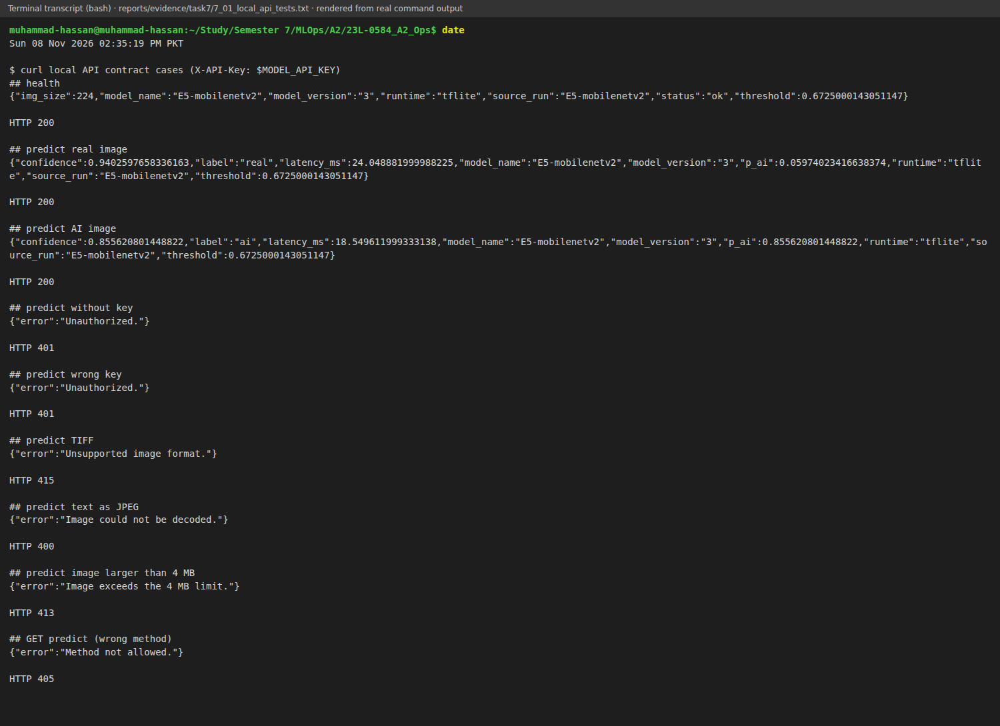
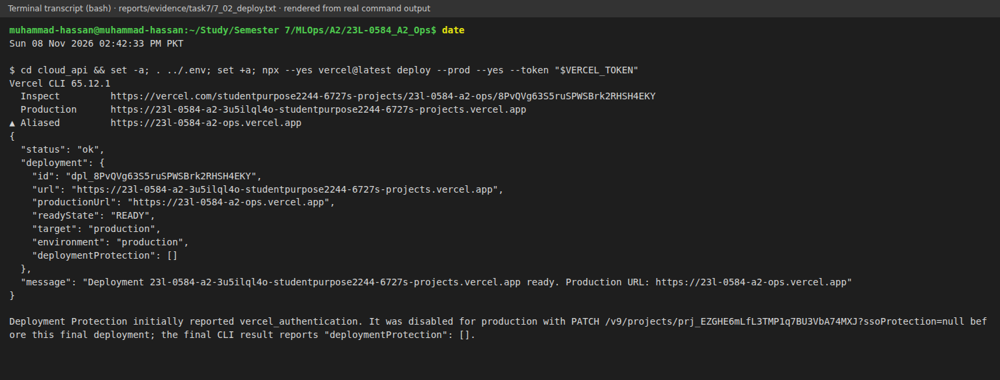
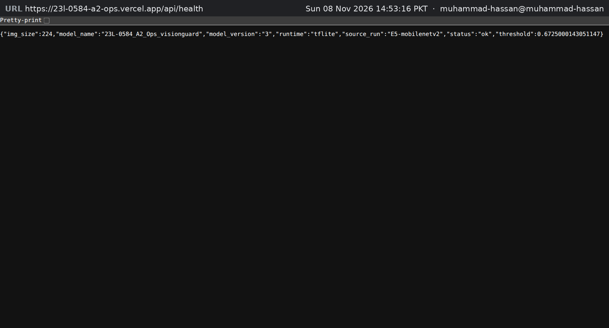
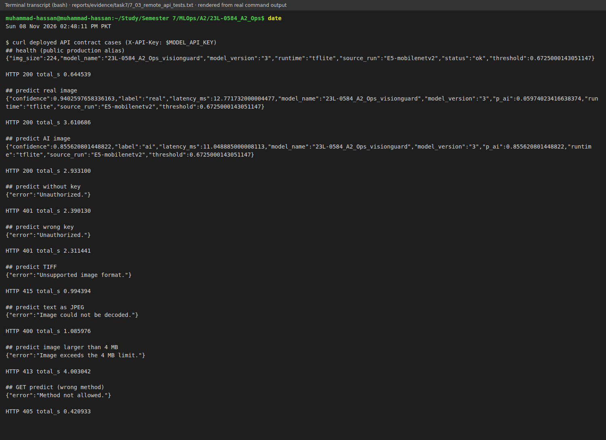
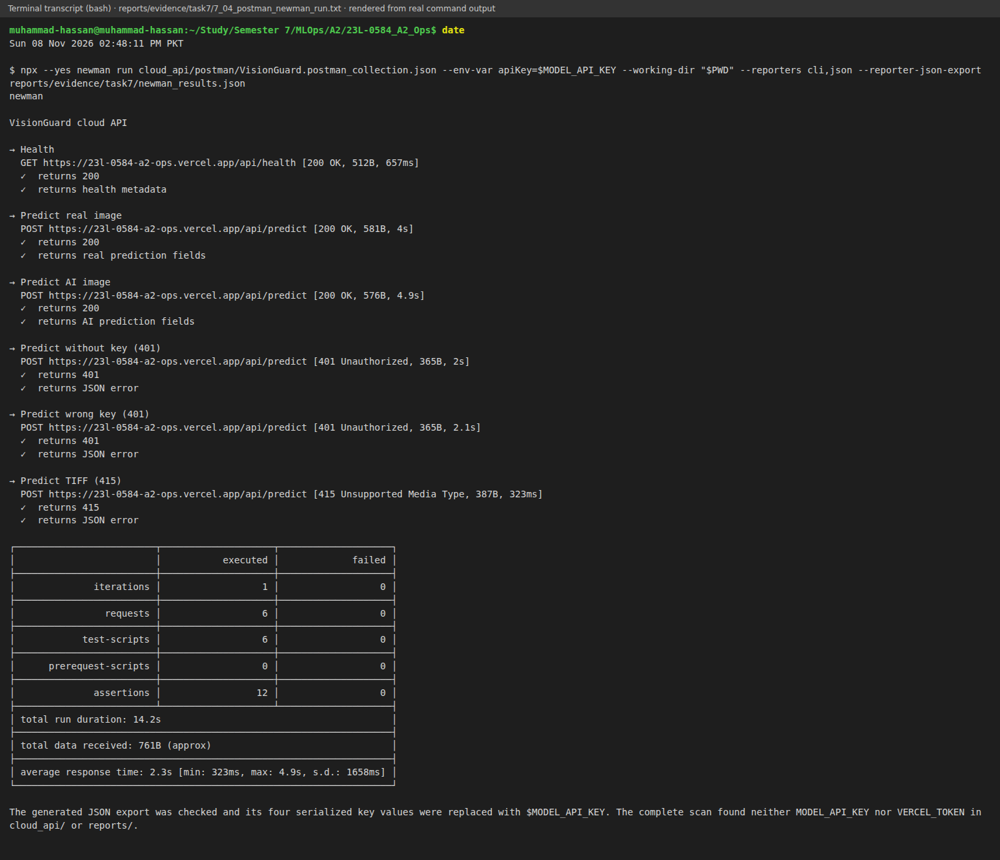
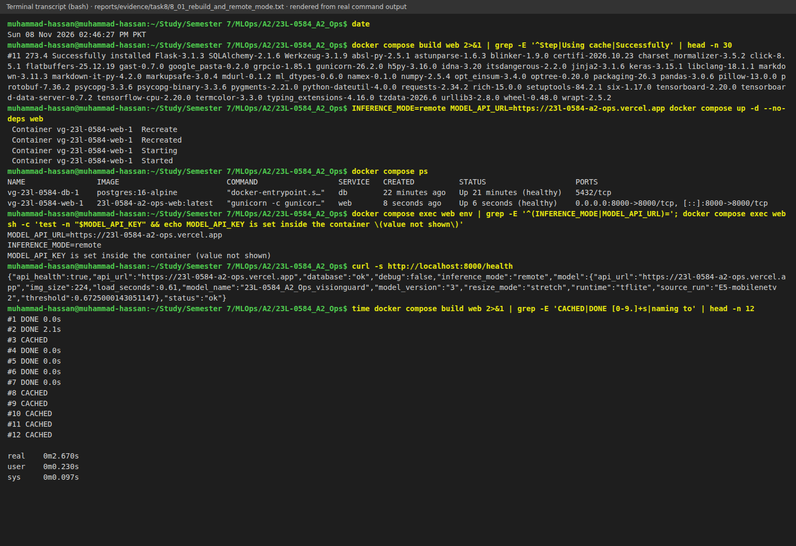
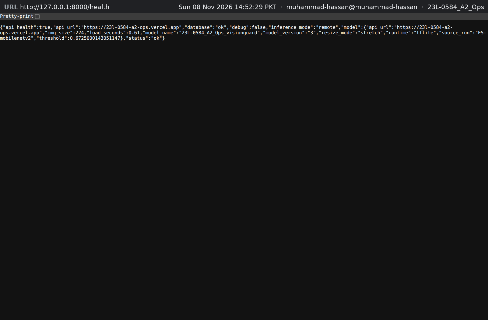
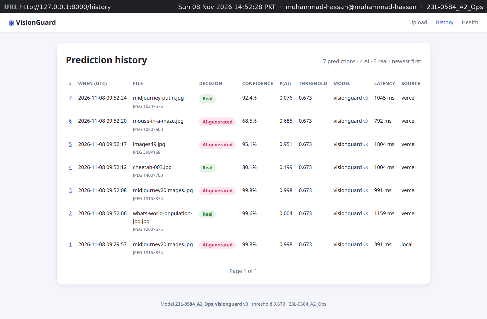
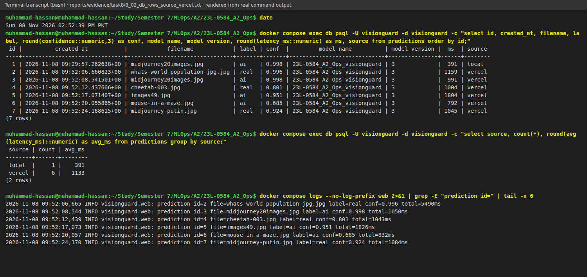

# Chapter 7 — API Deployment (15 marks)

**Model API URL: <https://23l-0584-a2-ops.vercel.app>**

- `GET` <https://23l-0584-a2-ops.vercel.app/api/health> is public and returns the deployed model's metadata.
- `POST` <https://23l-0584-a2-ops.vercel.app/api/predict> takes one image (multipart field `image`) and needs the header `X-API-Key: $MODEL_API_KEY`.

The brief requires a public model, while the Flask app stays local and calls it in Chapter 8. I kept the API in [`cloud_api/`](https://github.com/MHassanAbaid24/23L-0584_A2_Ops/tree/main/cloud_api), with [`scripts/export_tflite.py`](https://github.com/MHassanAbaid24/23L-0584_A2_Ops/blob/main/scripts/export_tflite.py) exporting the model.

Figures 7.1, 7.2, 7.4 and 7.5 are rendered command transcripts saved in `reports/evidence/task7/*.txt` on Sun 08 Nov 2026, between 14:35 and 14:48 PKT. Figure 7.3 is a browser capture. The context strips identify the URL, time and `user@host`; secrets appear only as `$MODEL_API_KEY` and `$VERCEL_TOKEN`.

## 7.1 Choosing the platform and its limits

I needed a platform with no credit card. Oracle Cloud, AWS and Google Cloud require one even for free tiers; Azure for Students was unavailable to me, and Hugging Face Docker Spaces required a paid plan in November 2026. Vercel's Hobby plan is free, uses GitHub sign-in and is named in the brief, so I chose it.

Vercel uses short-lived serverless functions rather than a persistent server. I checked its [Vercel Functions limits](https://vercel.com/docs/functions/limitations) and [Limits](https://vercel.com/docs/limits) before designing the API. Table 7.1 shows what mattered.

**Table 7.1 — Vercel Hobby limits and what each one meant for VisionGuard**

| Limit | Value | Consequence for the design |
|---|---|---|
| Python function bundle (uncompressed) | 500 MB | TensorFlow is about 1.2 GB installed (Figure 6.10), so I used TFLite. |
| Memory and CPU | 2 GB RAM, 1 vCPU | Enough for the 8,866,508-byte float32 model and one image per call. |
| Maximum duration | 300 s | `maxDuration: 30` ends a stuck request early. |
| Request body | 4.5 MB | The API accepts images up to 4 MB; Flask sends a 224 px PNG of about 100 KB in Chapter 8. |
| Persistent disk | none | The API is stateless; PostgreSQL remains local in the Compose stack. |

The missing disk decided the split: the API returns a verdict and Flask keeps the prediction trail. Public predictions also need the `X-API-Key` from Section 7.3. Vercel stores it as `VG_API_KEY`; locally it is `MODEL_API_KEY` in the untracked `.env`.

A function instance can disappear after any request, so a SQLite file written there would be unreliable. Keeping only inference in Vercel also means the public service does not retain uploaded images. Flask owns the database record and its history page.

## 7.2 Making the model fit

The champion is the MobileNetV2 transfer model from E5-mobilenetv2, registered as `23L-0584_A2_Ops_visionguard` version 3 (Section 3.6). Its Keras form needs TensorFlow, which cannot fit in 500 MB. TFLite stores the same network in one file for a smaller interpreter.

`scripts/export_tflite.py` converts `models/champion.keras` with `tf.lite.TFLiteConverter.from_keras_model`, writing `cloud_api/model/champion.tflite` (8,866,508 bytes) and `serving_config.json`. The config retains threshold 0.6725, image size 224, `stretch`, registered name, version 3 and source run. I kept float32 weights because quantization would alter probabilities and need a new threshold check.

Vercel uses Google's `ai-edge-litert` 2.3.0, whose wheel is 21.8 MB instead of about 1.2 GB for TensorFlow. [`cloud_api/requirements.txt`](https://github.com/MHassanAbaid24/23L-0584_A2_Ops/blob/main/cloud_api/requirements.txt) pins `ai-edge-litert==2.3.0`, `Flask==3.1.3`, `numpy==1.26.4` and `Pillow==10.4.0`. Pillow handles decoding and resizing.

The LiteRT package is a stand-alone TFLite interpreter. It lets the API load the flat model without bringing TensorFlow's serving dependencies into the bundle. Pillow is enough for image decoding and the API's upload resize.

I compared both models on all 147 test images. The same-tensor check isolates conversion; the pipeline check compares TensorFlow training resize with Pillow bilinear resize for uploads. Table 7.2 gives the result.

The threshold 0.6725 came from Keras validation in Section 2.5, so matching probabilities alone was not enough. The exporter prints the full-pipeline comparison whenever it runs. I wanted to know whether either conversion or different resize behaviour could change the final label.

**Table 7.2 — Keras vs TFLite on the 147 test images**

| Comparison | Result |
|---|---|
| Same input tensor: largest absolute difference in P(AI) | 3.2e-06 |
| Full pipeline (TF resize vs Pillow resize): mean absolute difference in P(AI) | 0.0048690 |
| Full pipeline: largest absolute difference in P(AI) | 0.0485432 |
| Decisions that change at the threshold 0.6725 | 0 |
| Test accuracy at 0.6725 | 0.7823 (Keras) and 0.7823 (TFLite) |

The 3.2e-06 difference is float rounding. Pillow can differ by up to 0.049 in P(AI), but no test decision moved across 0.6725. That is why Flask resizes uploads in Chapter 8.

## 7.3 The API

[`cloud_api/api/index.py`](https://github.com/MHassanAbaid24/23L-0584_A2_Ops/blob/main/cloud_api/api/index.py) is a small Flask app served by Vercel as one function. [`cloud_api/vercel.json`](https://github.com/MHassanAbaid24/23L-0584_A2_Ops/blob/main/cloud_api/vercel.json) routes `/api/(.*)`, bundles `model/**`, and sets `maxDuration` to 30 s. Table 7.3 is its contract.

**Table 7.3 — API contract**

| Request | Status | JSON response |
|---|---|---|
| `GET /api/health` | 200 | `status`, `model_name`, `model_version`, `source_run`, `threshold`, `img_size`, `runtime` |
| `POST /api/predict` with a valid key and image | 200 | `label`, `confidence`, `p_ai`, `threshold`, `model_name`, `model_version`, `source_run`, `latency_ms`, `runtime` |
| Missing or wrong `X-API-Key` | 401 | `{"error": "Unauthorized."}` |
| Bytes that are not a decodable image | 400 | `{"error": "Image could not be decoded."}` |
| Image larger than 4 MB | 413 | `{"error": "Image exceeds the 4 MB limit."}` |
| Image format other than JPEG, PNG, WEBP, GIF, BMP (e.g. TIFF) | 415 | `{"error": "Unsupported image format."}` |
| `GET /api/predict` | 405 | `{"error": "Method not allowed."}` |

`/api/health` is public because it contains only model settings, which the Flask client reads at start-up. Predictions use `X-API-Key`, not a URL parameter, and `hmac.compare_digest` compares it with `VG_API_KEY`. An empty setting rejects every prediction, and authentication happens before image decoding.

Errors are JSON with an `error` field. Pillow reads the actual bytes rather than the file name; allowed formats match Section 4.2. Flask limits multipart bodies to 4 MB plus 64 KB and checks the image again at 4 MB.

The header avoids placing a secret in logs or browser history. `hmac.compare_digest` takes the same approach regardless of which character is wrong, and a missing `VG_API_KEY` locks the endpoint instead of leaving it open. The handler checks that header before it spends time decoding an upload.

For invalid requests, the status tells Flask what went wrong. The file extension is not trusted: Pillow decodes the bytes and identifies the real format. Checking the image after the multipart limit also lets the API return its own 4 MB error when an image is too large.

The config and interpreter load at module import, once per function instance. A lock protects their shared input and output buffers, while `latency_ms` measures only inference.

Loading the interpreter for every request would make each prediction slower. Module-level loading avoids that after a cold start, but the interpreter's buffers are shared, so only one request can set input, run inference and read output at a time.

Figure 7.1 shows my local check of every Table 7.3 case. The real image gave P(AI) 0.0597 and 24.0 ms; the AI image gave 0.8556 and 18.5 ms. The old `model_name` shown there was fixed before deployment (Section 7.6).

## 7.4 Step-by-step deployment

[`cloud_api/README.md`](https://github.com/MHassanAbaid24/23L-0584_A2_Ops/blob/main/cloud_api/README.md) records the redeploy commands. I followed these steps:

1. **Account.** I used GitHub sign-in on the Hobby plan and stored a Vercel token as `VERCEL_TOKEN` in the untracked `.env`. Figure 7.2 shows team `studentpurpose2244-6727s-projects`.
2. **Export and local test.** `.venv/bin/python scripts/export_tflite.py` wrote the TFLite model and config, then I tested Flask on 127.0.0.1:5057 with `VG_API_KEY` mapped from `MODEL_API_KEY`. Figure 7.1 shows the result.
3. **Link and configure.** `cd cloud_api && npx vercel link --yes --project 23l-0584-a2-ops --token "$VERCEL_TOKEN"` linked the git-ignored `.vercel/` folder. `vercel env add VG_API_KEY production` stored the production key; Figure 7.4 later shows 200 with it and 401 without it.
4. **Deploy.** `vercel deploy --prod --yes --token "$VERCEL_TOKEN"` published the function. [`cloud_api/.vercelignore`](https://github.com/MHassanAbaid24/23L-0584_A2_Ops/blob/main/cloud_api/.vercelignore) allows only `api/`, `model/`, `requirements.txt` and `vercel.json`, excluding `.env` files. Figure 7.2 shows `dpl_8PvQVg63S5ruSPWSBrk2RHSH4EKY` as `READY`, target `production`, at the stable URL.

The token let the CLI deploy without an interactive login. The ignore rules start with `*`, so the project uploads only the function files and cannot accidentally include `.env`. I piped the production key from `.env`, so it was never typed or shown on screen.
5. **Allow public health checks.** I disabled Vercel Authentication through `PATCH /v9/projects/{id}` with `ssoProtection: null`, while retaining the API key. Figure 7.3 shows the public health endpoint, and Figure 7.2 records `"deploymentProtection": []`.
6. **Test production.** Figure 7.4 shows curl against the public URL; Figure 7.5 shows the newman collection.

After the `model_name` change, I redeployed. `vercel inspect https://23l-0584-a2-ops.vercel.app` reports `dpl_6sHpb7gprUZcdwyTWgFFq6MGPqP4`, created at 14:45:47 PKT; Section 7.5 and Chapter 8 use that deployment.

## 7.5 Testing: curl and Postman

Figure 7.4 repeats the nine contract cases in production, all with the Table 7.3 status. The predictions matched local P(AI) to every printed digit: 0.05974023416638374 and 0.855620801448822. Inference took 12.77 ms and 11.05 ms.

**Table 7.4 — curl against https://23l-0584-a2-ops.vercel.app (Figure 7.4)**

| Case | Status | Total time (s) |
|---|---|---|
| Health | 200 | 0.644539 |
| Predict real image | 200 | 3.610686 |
| Predict AI image | 200 | 2.933100 |
| Predict without key | 401 | 2.390130 |
| Predict wrong key | 401 | 2.311441 |
| Predict TIFF | 415 | 0.994394 |
| Predict text as JPEG | 400 | 1.085976 |
| Predict image larger than 4 MB | 413 | 4.003042 |
| GET on /api/predict | 405 | 0.420933 |

The 11–13 ms inference time is much smaller than the full requests, including 2.3–2.4 s for rejected keys. Network, TLS, upload and cold-start time explain the gap. The first request took 2453.7 ms with 12.99 ms inference; the next took 1882.8 ms with 11.05 ms.

The rejected-key timings make the network cost clear: the API rejects them before reading an image, yet the request and response still cross the network. A fresh Vercel instance also has a cold start before it can answer.

The [`cloud_api/postman/VisionGuard.postman_collection.json`](https://github.com/MHassanAbaid24/23L-0584_A2_Ops/blob/main/cloud_api/postman/VisionGuard.postman_collection.json) collection covers Health, two predictions, two 401 cases and TIFF 415. Its two assertions per request check status and response shape; `apiKey` stays empty in the file.

The prediction checks require the expected label and all nine Table 7.3 fields. Health checks `ok`, `tflite`, version 3 and 224; error requests need a string `error`. `--working-dir "$PWD"` lets newman resolve the collection's `data/raw/...` image paths.

I ran it with `npx --yes newman run cloud_api/postman/VisionGuard.postman_collection.json --env-var apiKey=$MODEL_API_KEY --working-dir "$PWD" --reporters cli,json --reporter-json-export reports/evidence/task7/newman_results.json`. Figure 7.5 records 6 requests, 12 assertions, 0 failed, in 14.2 s. The JSON report is [`reports/evidence/task7/newman_results.json`](https://github.com/MHassanAbaid24/23L-0584_A2_Ops/blob/main/reports/evidence/task7/newman_results.json), with serialised keys replaced by `$MODEL_API_KEY`.

The CLI reporter produced the transcript, while the JSON reporter saved every request and response. The collection can also be imported into Postman after setting `apiKey`, but I used newman so the report has a repeatable command rather than a desktop-only test.

## 7.6 What went wrong

- `tf.io.read_file` rejected `pathlib.Path`; I pass `str(path)`.
- My first `.vercelignore` omitted nested files, so the function had no entrypoint or model. `!api`, `!api/**`, `!model` and `!model/**` fixed it.
- Local requests returned 401 until I mapped `.env`'s `MODEL_API_KEY` to `VG_API_KEY`.
- Deployment Protection returned a Vercel login page. I disabled it and retained the API key.
- The API first used `E5-mobilenetv2` as `model_name`. I changed it to the registered name and kept the run as `source_run`, so history is consistent. Figure 7.1 shows the old value and Figure 7.3 the new one.

# Chapter 8 — Integrating Flask and the API (15 marks)

The Flask app runs locally in the Chapter 6 Compose stack at <http://127.0.0.1:8000>, sends uploads to the hosted API, and stores answers in local PostgreSQL. [`src/visionguard/remote.py`](https://github.com/MHassanAbaid24/23L-0584_A2_Ops/blob/main/src/visionguard/remote.py) is wired by [`src/visionguard/web/__init__.py`](https://github.com/MHassanAbaid24/23L-0584_A2_Ops/blob/main/src/visionguard/web/__init__.py) and configured by [`src/visionguard/web/config.py`](https://github.com/MHassanAbaid24/23L-0584_A2_Ops/blob/main/src/visionguard/web/config.py) and [`compose.yaml`](https://github.com/MHassanAbaid24/23L-0584_A2_Ops/blob/main/compose.yaml).

Figures 8.1 and 8.10 are rendered transcripts saved in `reports/evidence/task8/*.txt` on Sun 08 Nov 2026; Figures 8.2 to 8.9 are browser captures at 127.0.0.1:8000.

## 8.1 Design of the remote mode

`INFERENCE_MODE` selects `local` or `remote`; remote mode also requires `MODEL_API_URL` and `MODEL_API_KEY`, while `MODEL_API_TIMEOUT` defaults to 20 s. `Settings.from_env` rejects incomplete remote settings. `create_app` then builds `RemotePredictor`, which has the same `predict_bytes` and `describe` interface as the local predictor, so routes, validation, templates and database code stay unchanged.

At start-up, `RemotePredictor` reads model name, version, source run, threshold, image size and runtime from `/api/health`. If the API is unavailable or incomplete, the app refuses to start rather than accepting uploads it cannot answer.

For each upload, Flask validates the 10 MB limit and bytes, resizes with `decode_and_resize` to 224 × 224 px, encodes PNG with `tf.io.encode_png`, and posts it with `urllib` and `X-API-Key`. After validating the response, it stores `source = "vercel"`, the reported model details and Flask's round-trip latency.

`inspect_image` decodes the upload fully and identifies its format before any remote call. Flask then uses the same TensorFlow resize path as training, stretches the image, and posts the resulting PNG as multipart data. The API response must contain every expected field before a history row is written.

I kept preprocessing in Flask because Table 7.2 found Pillow differences up to 0.049 in P(AI). Flask sends training-style pixels, and a 224 × 224 RGB PNG is about 100 KB, below Vercel's 4.5 MB limit despite Flask allowing 10 MB uploads. PNG is lossless, though the web image still needs TensorFlow for preprocessing.

For a raw upload, the API would use Pillow's bilinear resize. Sending an already resized PNG skips that step, so the TFLite model sees the same pixels as the local Keras model. A 224 × 224 RGB image is 150,528 bytes before compression; the smaller PNG also leaves space inside the request body.

A rejected key becomes **502 "Model API rejected the key"**; unavailable, timed-out or server-error responses become **503 "Model service unavailable"**; other 4xx responses show the API message. Failed calls create no database row. In remote mode, `/health` reports `api_url` and `api_health`, checking the API in at most 2 s and returning 503 `degraded` if unavailable.

The 502 identifies a configuration problem rather than blaming the uploaded image. A health check that fails later does not hide it either: `/health` returns 503 `degraded`, giving the caller a clear view of a working local app whose remote model is unavailable.

## 8.2 Running it

I rebuilt the web image and restarted only the web service in remote mode. `docker compose build web` rebuilt it; `INFERENCE_MODE=remote MODEL_API_URL=https://23l-0584-a2-ops.vercel.app docker compose up -d --no-deps web` left the database running. `MODEL_API_KEY` comes from `${MODEL_API_KEY:-}`, and `curl http://localhost:8000/health` returned `api_health: true`. Figure 8.1 also shows the cached second build in 2.670 s.

Compose shell variables take precedence over `.env` when it fills `compose.yaml`, so the command switches only this container to remote mode. `--no-deps` keeps PostgreSQL running; `docker compose exec web env` confirmed the mode and URL without printing the key.

Figure 8.2 shows the browser health check: local database `ok`, remote mode and `api_health: true`. Its model block reports `23L-0584_A2_Ops_visionguard` version 3, E5-mobilenetv2, threshold 0.6725, 224 px, `stretch`, `tflite`, and `load_seconds` 0.61. Local Keras loading took 1.97 s in Figure 4.10.

## 8.3 Multiple inputs and responses

I uploaded six test-split images between 09:52:06 and 09:52:24 UTC (14:52 PKT). Their result pages say `vercel` beside latency. Figure 8.3 shows a real photo at 99.6 % and P(AI) 0.004; Figure 8.4 shows the 1146 KB AI collage at 99.8 %. Figure 8.5 shows a real photo at 80.1 % and P(AI) 0.199, while Figure 8.6 shows the 300 × 168 AI image at 95.1 %. Figure 8.7 is the borderline AI result: P(AI) 0.685, threshold 0.673 and confidence 68.5 %. Figure 8.8 is the missed AI image at 92.4 %, matching Figure 4.9.

Table 8.1 compares the remote database rows with the local history in Figure 5.1; Figure 8.10 shows the remote rows directly.

**Table 8.1 — Six uploads through the hosted API, compared with the local model**

| Row | File | True class | Remote verdict | Remote confidence | API round trip (ms) | Local verdict and confidence (Figure 5.1) |
|---|---|---|---|---|---|---|
| 2 | whats-world-population-jpg.jpg | real | real | 99.6 % | 1159 | real, 99.6 % |
| 3 | midjourney20images.jpg | ai | ai | 99.8 % | 991 | ai, 99.8 % |
| 4 | cheetah-003.jpg | real | real | 80.1 % | 1004 | real, 80.1 % |
| 5 | images49.jpg | ai | ai | 95.1 % | 1804 | ai, 95.1 % |
| 6 | mouse-in-a-maze.jpg | ai | ai | 68.5 % | 792 | ai, 68.5 % |
| 7 | midjourney-putin.jpg | ai | real | 92.4 % | 1045 | real, 92.4 % |

All six remote verdicts, confidences and P(AI) values match local results. Flask gives TFLite the same 224 px pixels as Keras, and Table 7.2's same-input difference is at most 3.2e-06. Five verdicts are right; the `midjourney-putin.jpg` miss belongs to the model, not deployment.

Round trips were 792–1804 ms, averaging 1133 ms; the earlier local row took 391 ms. API inference itself took 11–13 ms in Section 7.5, so most of the difference is network time. Figure 8.10 records 5490 ms for the first end-to-end upload but only 1159 ms for its round trip: the extra 4.3 s was the first TensorFlow preprocessing use. Later end-to-end uploads took 832–1826 ms.

## 8.4 History and database logs

Figure 8.9 shows PostgreSQL-backed History after six remote uploads: `7 predictions · 4 AI · 3 real`, newest first. Rows 2–7 use `vercel`; row 1 is the earlier `local` result. Every row names visionguard v3 after the Section 7.6 model-name fix. Original upload format and dimensions are shown, but images are not stored.

Figure 8.10 checks the trail with `docker compose exec db psql`: seven rows, `local` 1 at 391 ms, and `vercel` 6 at 1133 ms. Its web-log entries agree with the database and history.

## 8.5 Tests and what went wrong

[`tests/test_remote.py`](https://github.com/MHassanAbaid24/23L-0584_A2_Ops/blob/main/tests/test_remote.py) uses a local stand-in API. Its four tests cover normal prediction and PNG sizing, rejected keys, an unavailable API, and failing fast when health is unreachable. The suite has 18 tests, all passing.

### What went wrong

- BuildKit had no legacy `docker build` cache, so the first build reinstalled dependencies (≈273 s; pip finished at 273.4 s in Figure 8.1). The cached rebuild took 2.670 s.
- The first remote upload took 5490 ms because the new web process first imported and used TensorFlow. Its 1159 ms stored round trip was normal.
